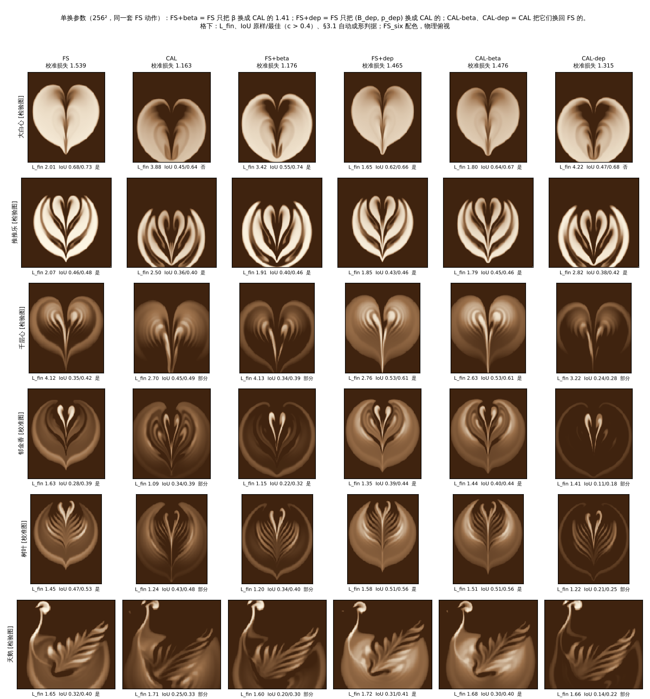
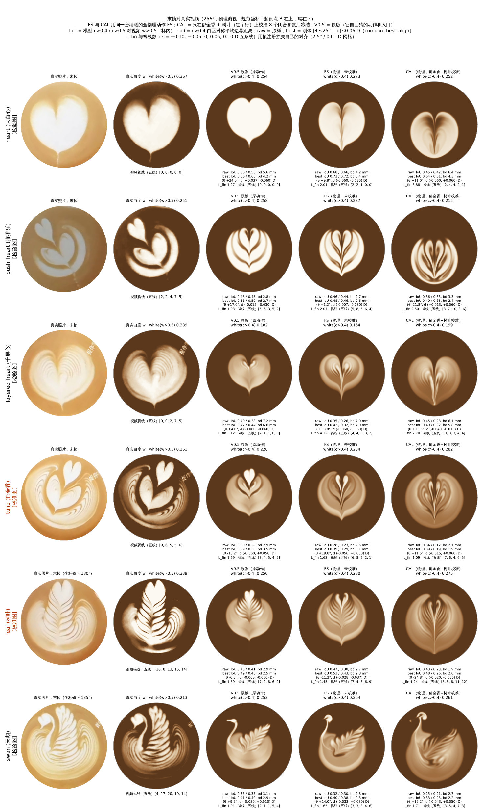
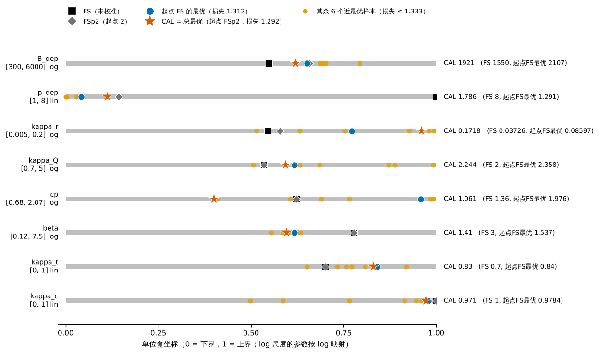
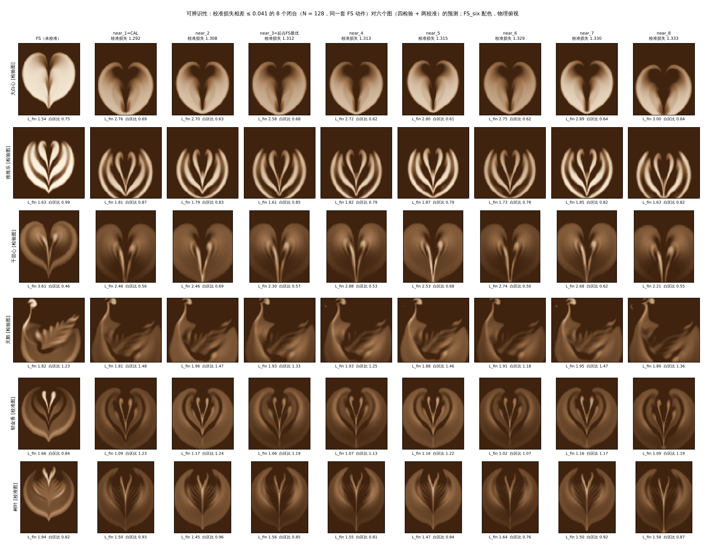

# 猜测的全物理动作 + 物理参数在郁金香、树叶上校准后冻结：结果

> **用户的问题**："那如果是物理参数用郁金香+树叶两个图校准，然后固定，动作参数靠猜呢"。
> 也就是学长的"两个校准、四个检验"协议，但动作不用咖啡师的真实动作，而用猜测的全物理动作 FS（`V05_ALLPHYS_RESULT.md`）。
> **模型**：学长的 V0.5 单层模型（`latte_imex/solver.py`，闭合 'chi'，回流律 'v05'），求解器一行没改。
> **驱动**：`latte_imex/v05_guessed_calib.py`。图、表、记录在 `latte_imex/v05_guessed_calib/`，分析和核对脚本的副本在其中的 `scripts/`；运行缓存（每次调用的末帧场）在审稿暂存目录 `review/v05gcal/`，没有进仓库（§6）。
> **单位**：D = 8 cm 杯径（1 D = 80 mm，0.05 D = 4 mm），边界距离用 mm，流量 mL/s，奶量 mL，时间 s。
> **组名**：
> - FS：未校准的全物理闭合；
> - CAL：校准后冻结的闭合；
> - V0.5：原版，用它自己猜的动作和入口，只作参照。
>
> FS 和 CAL 两组用的是同一套动作（同一套奶壶流量 F；接收流量 Q = F/κ_Q 随闭合的 κ_Q 变，见 §3）。

## 0. 问题与回答

**回答：不会更像，图案也不再都成形。** 动作固定为猜测的全物理动作 FS，只校准 8 个闭合参数。用郁金香、树叶两段真实视频的末帧做校准，结果如下：

- **校准图**：损失降了。N = 128 上从 1.80 降到 1.29，256² 上从 1.54 降到 1.16。下降来自边界距离和褐线数两项，形状重合（Dice）没有变好，树叶的 Dice 还略差（0.69 → 0.64）。
- **四个检验图（大白心、推推乐、千层心、天鹅）冻结预测，均值离真实视频更远了**：
  - 原样 IoU 均值 0.45 → 0.38，最佳刚体对齐后 0.51 → 0.47；
  - 把预注册的校准损失 L_fin 用在检验图上，均值 2.46 → 2.70；
  - 三个盲评（三个相互独立的自动图像评审，不是人）在 18 票里 16 票判 FS 更像真实。按多数票，六个图案（包括两张校准图）都是 FS 更像。
  - 检验终点没有预注册；以形状指标和盲评为主是看过结果后的选择（§1）。
- **成形**：按盲评多数，CAL 只有推推乐成形，其余五个都是"部分"。FS 是 5 个成形，千层心部分。
- **检验图里 IoU 和 L_fin 都变好的只有千层心**（原样 IoU 0.35 → 0.45，L_fin 4.12 → 2.71）：它的白区变大了，但心的外廓不再闭合。此外推推乐、天鹅的最佳边界距离略近（2.6 → 2.4 mm、2.3 → 2.2 mm），对齐后的边界项也略好。

**原因：主要杠杆是 β，不是 p_dep。** 审稿时做了单换一个参数的检验：把 β、或者沉积开关 (B_dep, p_dep) 单独在 FS 和 CAL 之间互换，其余参数不动。N = 128 上跑郁金香、树叶、大白心（12 次），256² 上跑六个图（24 次），都没有失败。结果在 `v05_guessed_calib/ablate/`；N = 128 那组的原件是 `review/v05gcal/review_ablate/ablate.json`、`ablate.png`。

| 闭合 | β [/s] | (B_dep, p_dep) | 校准损失 N = 128（占 0.51 的增益） | 校准损失 256²（占 0.38 的增益） | 大白心 L_fin 128 / 256² | 大白心 | 检验四图 256²：L_fin / 原样 IoU / 最佳 IoU |
|---|---|---|---|---|---|---|---|
| FS | 3.0 | 1550, 8 | 1.802 | 1.539 | 1.541 / 2.007 | 实心（有中缝） | 2.462 / 0.45 / 0.51 |
| CAL | 1.41 | 1921, 1.79 | 1.292 | 1.163 | 2.757 / 3.876 | 空心，没有尖 | 2.697 / 0.38 / 0.47 |
| FS，只换 β | 1.41 | 1550, 8 | 1.544（得 51 %） | 1.176（得 96 %） | 2.548 / 3.425 | 空心（256² 空了上半，还有尖） | 2.766 / 0.37 / 0.47 |
| FS，只换沉积开关 | 3.0 | 1921, 1.79 | 1.717（得 17 %） | 1.465（得 20 %） | 1.601 / 1.650 | 实心 | 1.997 / 0.47 / 0.54 |
| CAL，β 换回 3.0 | 3.0 | 1921, 1.79 | 1.640（失 68 %） | 1.476（失 83 %） | 1.542 / 1.797 | 实心 | 1.973 / 0.48 / 0.54 |
| CAL，沉积开关换回 FS 的 | 1.41 | 1550, 8 | 1.841（失 100 % 以上） | 1.315（失 41 %） | 2.784 / 4.224 | 空心，没有尖 | 2.981 / 0.31 / 0.40 |



- **大白心的 ΔL +1.87 左右了检验 L_fin 均值的结论，而它来自 β**，和用真实动作那次校准是同一个杠杆。FS 只把 β 从 3.0 降到 1.41 /s，大白心就从凹口往下出现褐色空心楔形；CAL 把 β 换回 3.0，大白心又是实心。β 不进 χ 的公式，所以只换 β 时每一笔的 χ 都和 FS 一样。
- **β 也是校准损失下降的主要来源**：只换 β 就拿到 N = 128 上 51 %、256² 上 96 % 的增益。低 β 让郁金香、树叶的 L_fin 降下去，但两张图的 IoU 也降了（256² 原样 IoU 均值 0.38 → 0.28）。
- **沉积开关的 χ 变化**（底座笔少沉积约 20 %，细切和桥开始铺白，§3）主要改变白区的大小和灰度：
  - 在校准图上，它和低 β 有交互。CAL 换回 FS 的沉积开关后，256² 上郁金香、树叶的白区只剩真实的 0.28、0.40 倍；校准增益在 N = 128 上全部丢掉，256² 上丢 41 %。FS 只换沉积开关，只拿到 17–20 %。
  - 千层心变好来自它：只换沉积开关时，千层心原样 IoU 0.35 → 0.53。
- **"底座少沉积约 20 %"不会让大白心变空**：FS 只换沉积开关时，256² 大白心的沉积同样少 19 %（CAL 少 21 %），心仍是实心。
- **事后看到的组合，不是校准结果**：β 留在 3.0、只用 CAL 的沉积开关的两个组合（表中第 4、5 行），检验四图在 256² 上都比 FS 好，§3.1 自动判据也是 6/6。但它们的校准损失是 1.47 / 1.48，远高于 CAL 的 1.16，预注册的损失不会选它们。这个拆分是看过检验图之后做的，只说明损失把 β 推错了方向，不能当作更好的物理参数。盲评没有看过这些组合。
- **p_dep 的起点**：CAL 的 p_dep 是 1.79，它的起点 FSp2 本来就是 2。只有从 FS 出发的那条 CMA 是从 8 降到 1.29。

**参数不可辨识，预测只是部分相近。** 校准损失几乎相同的 8 个闭合（near_1 即 CAL）参数散得很开（§3）。它们对检验图的预测：
- 彼此更接近（两两 IoU 均值 0.67–0.81，最小 0.44–0.63）；
- 离 FS 更远（0.32–0.62）。推推乐上两段有重叠：两两最小 0.44，对 FS 最高 0.51。
- 大白心全部空心，这 8 个闭合的 β 都在 1.19–1.65 /s。
- κ_Q 在 1.9–4.9 /D 之间，所以它们收到的奶相差 2.6 倍（大白心 26.5–68.3 mL，郁金香 34.9–90.2 mL）。损失看不到奶量，"动作固定"只对奶壶流量 F 成立。

这与之前用咖啡师真实动作做的校准（`v05_calibrated/CALIBRATION_RESULT.md`）方向相同：两次都是在两张图上校准闭合，主要杠杆都是把 β 降到约 1.4–1.6 /s，四个检验图的均值都变差。这次千层心的 IoU 和 L_fin 是例外，但盲评四个检验图都判 FS 更像。

## 1. 设置（预注册，`v05_guessed_calib/prereg.json`，在任何校准运行之前写定，之后没改）

| 项 | 设置 |
|---|---|
| 动作（校准和检验都固定，不为新闭合重设计） | 全物理最终组 FS：<br>- V0.5 原版的路径、时序、摆动（`v05_controls/*.json`）；<br>- 每笔壶嘴高度来自 FS 反设计（0.30–2.50 cm），U⊥ = √(0.35² + 2gz)，连续性足迹；<br>- 出口水平速度 ≥ 0.10 m/s（'exitmin'），5 Hz 脉动 ≤ 0.41；<br>- 壶嘴滞后 τ = 0.08 s，桥 ≥ 0.3 s，起停斜坡 0.1 s，高度过渡 ≤ 0.11 m/s；<br>- 流量峰相位：郁金香、树叶、天鹅 0，千层心 π/2，大白心、推推乐不脉动。<br>入口与 `v05allphys/final/drvf.py FS <p> --exp P2 --pulse 0.41 --lat exitmin --lag 0.08 --ztr` 逐位相同。drvf.py 的暂存版和仓库版完全相同（sha1 dbb61f71）。 |
| 校准参数（8 个，`v05_adapter.SPACE` 的物理界） | - B_dep 300–6000 D/s²（log）<br>- p_dep 1–8（lin）<br>- κ_r 0.005–0.2（log）<br>- κ_Q 0.7–5 /D（log）<br>- c_p 0.68–2.07 D/s（log）<br>- β 0.12–7.5 /s（log）<br>- κ_t 0–1（lin）<br>- κ_c 0–1（lin）<br><br>ν = 1e-3 D²/s、D = 1e-7 D²/s 固定。κ_Q 同时决定接收流量 Q = clip(F/κ_Q, 1, 32 mL/s)，与 drvf.py 相同。 |
| 损失（只用末帧：猜测动作有自己的时间轴，过程指标没有定义） | 比较在 `compare.py` 的规范坐标里做：<br>- 树叶转 180°、天鹅转 135°；<br>- 模型白取 c > 0.4，视频白取 w > 0.5，杯内 R = 0.49 D；<br>- 先做 IoU 最佳刚体对齐：\|θ\| ≤ 25°（步长 2.5°），\|d\| ≤ 0.06 D（步长 0.01 D）。<br><br>**L_fin = (1 − Dice) + d_bnd / 0.05 D + S**。S 取五条线 x = −0.10、−0.05、0、0.05、0.10 D 的平均，每条线算 \|n_模型 − n_视频\| / max(n_视频, 1)，n 是褐线数（缝 + 凹谷，`structnum.stripes`）。<br>校准损失 = 郁金香、树叶的 L_fin 等权平均。 |
| 网格规则 | 预注册的规则是：如果 FS 闭合在 N = 96 上的每线褐线数与 256² 相差 ≤ ±1，且 L_fin 相差 ≤ 0.15，就用 N = 96，否则用 N = 128，只取 2 个起点。<br><br>实测 N = 96 不合格：树叶 ΔL +0.53，五条线的褐线数差 −6…−2。所以用 **N = 128**，起点只有 FS、FSp2 两个，单位盒中心按规则放弃。<br><br>**规则只检验了 N = 96。按同一标准，N = 128 也不合格**：<br>- 树叶 ΔL +0.49，五条线的褐线数差 −4、−4、−2、−4、−6；<br>- 郁金香有一条线差 −2。<br><br>所以 N = 128 上褐线项的增益有一部分是拟合在弥补没分辨出来的叶脉：FS 树叶的褐线项在 N = 128 上是 0.88，256² 上是 0.56。 |
| 优化器 | `calib.calibrate` 的 CMA-ES，带磁盘缓存和 1500 s 超时，种群 12，σ0 = 0.25，每个起点 20 代，种子 1、2。起点各算一次作参照。最优点 = 所有 CMA 样本里校准损失最低的一个。 |
| 检验 | 冻结的最优闭合（CAL）和 FS 在六个图案上跑 256²。<br>- 检验图：大白心、推推乐、千层心、天鹅；<br>- 校准图：郁金香、树叶。<br>检验图没有参与任何选择。<br><br>**检验终点没有预注册**：<br>- `prereg.json` 的 test 一节只规定跑什么（场和指标 JSON），没有规定用哪个指标定胜负；<br>- 盲评也没有预注册：给盲评的说明 `structures.md` 写于 19:38，CMA 在 19:29 结束；<br>- 以形状指标和盲评为主是看过结果后的选择（§2.3）。 |

**运行**：
- 480 个 CMA 候选，960 次前向调用，加 2 次 FSp2 参照，0 次失败，0 次超时。
- N = 128 每次调用中位 61 s（最长 127 s），共 17.6 CPU·h，墙钟 4 h 32 min（含一次重启）。
- 评估阶段另有 46 次新的前向调用，0 次失败：
  - 256² 10 次：CAL 六个图，加 FS 的大白心、推推乐、千层心、天鹅；
  - N = 128 可辨识性 36 次。
  - FS 郁金香、树叶的 256² 场复用网格规则那两次。
- 审稿时另加单换参数检验：N = 128 12 次、256² 24 次，0 次失败（§0）。

**核对**：
- 六个 FS 256² 场与 `v05allphys/final/runs/FS_*` 逐位相同。
- 两条 CMA 都能只读缓存逐代重放，20/20 代一致。
- 在新进程、空 numba 缓存下重跑 CAL：郁金香 N = 128、大白心 256² 的场与记录逐位相同。
- 独立重写的 L_fin、IoU、Dice、边界距离与记录相差 ≤ 9e-16（`v05_guessed_calib/verify/`）。范围有限：
  - 只核对了两例：CAL 大白心 256²、CAL 郁金香 N = 128；
  - 这两例都不需要转坐标，所以树叶 180°、天鹅 135° 的规范坐标修正没有独立核对；
  - 褐线数沿用 `structnum`，没有独立重写。

## 2. 主表：六个图案 × {FS, CAL}，256²



`final_vs_real.png` 的五列依次是：真实照片、真实白度 w、V0.5 原版、FS、CAL。`FS_vs_CAL.png` 多一列差图 c_CAL − c_FS。

**表中各列的定义**：
- **IoU**：模型 c > 0.4 / c > 0.5 对视频 w > 0.5，只算杯内。"原样"不做任何变换；"最佳"取 `compare.best_align` 的刚体对齐（1° / 0.01 D 网格，再细化）。
- **边界**：c > 0.4 白区与真实白区的对称平均边界距离。
- **白区比**：模型白区 / 真实白区。
- **褐线数**：五条线上的计数，取 L_fin 对齐下的值。
- **成形·自动**：`V05_ALLPHYS_RESULT.md` §3.1 的可数判据。
- **成形·盲评**：三个盲评的判断，顺序是评审 1 / 2 / 3，箭头后是多数。
  - 三个盲评是三个相互独立的自动图像评审，不是人。
  - 它们只看 `blind/` 里的图（真实照片 + 白度 + 随机标成 A/B 的两个模型）和 `blind/structures.md`。
  - 按 `blind/key.json` 解码后的答案在 `blind/judges.json`。
- **更像真实**：盲评三票里判为更接近真实照片的一组。

### 2.1 检验图（冻结预测）

| 图案（真实白区；真实褐线数） | 组 | IoU 原样 c>0.4 / c>0.5 | IoU 最佳 c>0.4 / c>0.5 | 边界 原样 / 最佳 [mm] | 白区比 | 褐线数（模型） | L_fin | 成形·自动 | 成形·盲评 | 更像真实 |
|---|---|---|---|---|---|---|---|---|---|---|
| 大白心（0.367；[0,0,0,0,0]） | FS | 0.68 / 0.66 | 0.73 / 0.72 | 4.2 / 3.4 | 0.74 | [2,2,1,0,0] | 2.007 | 是（中缝 34 mm） | 是/是/是 → **是** | **FS 3:0** |
| | CAL | 0.45 / 0.42 | 0.64 / 0.61 | 6.4 / 4.3 | 0.69 | [2,4,4,2,1] | 3.876 | 否 | 部分/部分/否 → **部分** | |
| 推推乐（0.251；[2,2,4,7,5]） | FS | 0.46 / 0.44 | 0.48 / 0.46 | 2.7 / 2.6 | 0.94 | [5,8,6,6,4] | 2.072 | 是 | 是/是/是 → **是** | **FS 3:0** |
| | CAL | 0.36 / 0.33 | 0.40 / 0.35 | 3.3 / 2.4 | 0.86 | [8,7,10,8,6] | 2.499 | 是 | 是/是/是 → **是** | |
| 千层心（0.389；[0,0,2,7,5]） | FS | 0.35 / 0.26 | 0.42 / 0.32 | 7.0 / 7.0 | 0.42 | [4,4,3,3,2] | 4.121 | 是 | 是/部分/部分 → **部分** | **FS 3:0** |
| | CAL | 0.45 / 0.28 | 0.49 / 0.32 | 6.1 / 5.8 | 0.51 | [0,3,3,4,4] | 2.705 | 部分 | 部分/部分/否 → **部分** | |
| 天鹅（0.213；[4,17,20,19,14]） | FS | 0.32 / 0.30 | 0.40 / 0.38 | 2.8 / 2.3 | 1.24 | [3,3,3,4,6] | 1.649 | 是（颈一段淡） | 是/是/是 → **是** | **FS 2:1** |
| | CAL | 0.25 / 0.21 | 0.33 / 0.23 | 2.7 / 2.2 | 1.23 | [3,5,4,7,3] | 1.707 | 部分 | 部分/部分/部分 → **部分** | |
| **检验四图均值** | FS | **0.45** / 0.42 | **0.51** / 0.47 | 4.2 / 3.8 | 0.84 | – | **2.462** | 4 是 | 3 是、1 部分 | **FS 11 票，CAL 1 票** |
| | CAL | **0.38** / 0.31 | **0.47** / 0.38 | 4.6 / 3.7 | 0.82 | – | **2.697** | 1 是、2 部分、1 否 | 1 是、3 部分 | |

### 2.2 校准图（拟合，不是预测）

| 图案（真实白区；真实褐线数） | 组 | IoU 原样 c>0.4 / c>0.5 | IoU 最佳 c>0.4 / c>0.5 | 边界 原样 / 最佳 [mm] | 白区比 | 褐线数（模型） | L_fin | 成形·自动 | 成形·盲评 | 更像真实 |
|---|---|---|---|---|---|---|---|---|---|---|
| 郁金香（0.261；[9,6,5,5,6]） | FS | 0.28 / 0.23 | 0.39 / 0.29 | 2.5 / 3.1 | 0.90 | [6,8,5,2,1] | 1.626 | 是 | 是/是/部分 → **是** | **FS 2:1** |
| | CAL | 0.34 / 0.12 | 0.39 / 0.19 | 2.1 / 1.9 | 1.08 | [7,6,4,6,5] | 1.087 | 部分 | 部分/部分/否 → **部分** | |
| 树叶（0.339；[16,8,13,15,14]） | FS | 0.47 / 0.38 | 0.53 / 0.43 | 2.7 / 2.3 | 0.83 | [7,4,3,6,9] | 1.451 | 是 | 是/是/是 → **是** | **FS 3:0** |
| | CAL | 0.43 / 0.23 | 0.48 / 0.26 | 1.9 / 2.0 | 0.81 | [5,5,8,11,12] | 1.238 | 部分 | 部分/部分/部分 → **部分** | |
| **校准两图均值** | FS | 0.38 / 0.31 | 0.46 / 0.36 | 2.6 / 2.7 | 0.86 | – | **1.539** | 2 是 | 2 是 | **FS 5 票，CAL 1 票** |
| | CAL | 0.39 / 0.18 | 0.43 / 0.23 | 2.0 / 2.0 | 0.95 | – | **1.163** | 2 部分 | 2 部分 | |

### 2.3 L_fin 分项（各组均值）

| | 1 − Dice | 边界 / 0.05 D（对齐后） | 褐线项 S | L_fin |
|---|---|---|---|---|
| 检验四图 FS | 0.335 | 0.962 | 1.165 | 2.462 |
| 检验四图 CAL | 0.373 | 0.942 | 1.382 | 2.697 |
| 校准两图 FS | 0.374 | 0.675 | 0.489 | 1.539 |
| 校准两图 CAL | 0.398 | 0.500 | 0.265 | 1.163 |

**校准图**：L_fin 降了 0.38，其中边界项 −0.18，褐线项 −0.22，Dice 项还升了 0.02。郁金香的 Dice 不变（0.561 → 0.561），树叶变差（0.690 → 0.644）。

c > 0.5 的 IoU 掉得更多：郁金香最佳 0.29 → 0.19，树叶 0.43 → 0.26。这说明 CAL 的白更灰：多出来的是 0.4–0.5 之间的浅色。

**检验图**：形状项（Dice、IoU）和褐线项变差，对齐后的边界项略好。不对齐时边界反而变远（原样 4.2 → 4.6 mm）。

L_fin 均值的结论受大白心支配。大白心的 ΔL 是 +1.87，主要来自褐线项 1.0 → 2.6：CAL 在一颗本该实心的心里画出 2–4 道线，空心来自 β（§0）。去掉大白心后，三图 L_fin 均值是 FS 2.614、CAL 2.304，CAL 反而低。

所以本文把形状指标和盲评当作检验图的主证据，不用 L_fin。这是看过上面的结果后才定的（检验终点没有预注册，§1）。逐图看：
- 最佳 IoU 和原样 IoU：CAL 在大白心、推推乐、天鹅上更低，在千层心上更高。
- L_fin：同样是这三个变差、千层心变好。

**盲评与非盲目判的出入**：评估人自己的目判是非盲的（`tables.md` §10），与盲评多数有两处不同：
- CAL 大白心：目判"否"，盲评多数"部分"（有一票"否"）。
- FS 千层心：目判和 §3.1 自动判据都是"是"，盲评两票"部分"。这两票的理由是：心形闭合，但中间和下半是空的褐色，每瓣也只有 2–4 道弧，而真实的千层心下半是实白，每瓣 8–10 道细弧。

这两票对照的是 `structures.md` 里写的真实杯子（每瓣 8–10 道弧、下半实白），不是 §3.1 的成形判据。所以这是更严的标准，不能据此说非盲判断有偏。按 §3.1 判据，FS 仍是 6/6 成形；按盲评多数是 5 是、1 部分。

**逐图看到的变化**（三个盲评的描述基本一致，`blind/judges.json`）：
- **大白心**：CAL 是空心的。从凹口往下一大块褐色楔形，下部圆钝、没有尖，整体偏下：白质心比真实低约 0.13 D（10 mm），这是盲评 2 的估计。FS 是实心心形加尖，但有 34 mm 中缝。真实的心是实白、无缝。
- **推推乐**：两组的臂都分得开。CAL 的臂细、褐缝宽，内心散成两道细弧，整体偏低，像一把张开的郁金香。FS 是宽白块加细缝，盲评三票都判它更像真实的"大白块、2–4 mm 缝"。两组都没有真实里那颗独立的小心，也没有约 40° 的倾斜：猜测动作本身就没有这些。
- **千层心**：CAL 的白区更大（0.199 对 0.164，真实 0.389），所以指标更好。但它的两瓣在下方不闭合，中间伸出一根长茎，像两只翅膀长在一根茎上。FS 外廓闭合，有尖，每瓣 3–4 道弧。两组都远小于真实，下半也都没有实白。
- **郁金香**：CAL 更大，有 4–5 道细瓣，像羽毛扇，三层叠瓣读不出来。FS 层次清楚，但比真实小。一票判 CAL 更像，理由是它的大小和圆底弧更接近真实。
- **树叶**：CAL 的叶脉细、淡、稀，多出一根贯穿上下的白中脉，心形叶尖没了（两侧翼高过叶尖）。FS 有心形叶尖，6–7 对清楚的 V 形叶片。
- **天鹅**：CAL 的颈很快糊成一大团，羽毛糊成低对比的斜条。FS 有细 S 颈和 6–8 道清楚的羽，但多一个真实里没有的圆形身体。一票判 CAL 更像，理由是它的白团分布（质心、范围）更接近真实。

## 3. 校准出来的闭合



| 参数 | 物理界（尺度） | FS | FSp2（参照起点，见下注） | **CAL**（总最优，起点 FSp2，第 12 代，gen 11） | CAL 单位盒 | 起点 FS 的最优（第 15 代，gen 14） | 其单位盒 |
|---|---|---|---|---|---|---|---|
| B_dep [D/s²] | 300–6000（log） | 1550 | 2149 | **1921** | 0.620 | 2107 | 0.651 |
| p_dep | 1–8（lin） | 8 | 2 | **1.786** | 0.112 | 1.291 | 0.042 |
| κ_r | 0.005–0.2（log） | 0.0373 | 0.0423 | **0.1718** | 0.959 | 0.0860 | 0.771 |
| κ_Q [/D] | 0.7–5（log） | 2.0 | 2.0 | **2.244** | 0.592 | 2.358 | 0.618 |
| c_p [D/s] | 0.68–2.07（log） | 1.36 | 1.36 | **1.061** | 0.400 | 1.976 | 0.958 |
| β [/s] | 0.12–7.5（log） | 3.0 | 3.0 | **1.410** | 0.596 | 1.537 | 0.617 |
| κ_t | 0–1 | 0.7 | 0.7 | **0.830** | 0.830 | 0.840 | 0.840 |
| κ_c | 0–1 | 1.0 | 1.0 | **0.971** | 0.971 | 0.978 | 0.978 |
| 校准损失（N = 128） | | 1.802 | 1.736 | **1.292** | | 1.312 | |
| 郁金香 / 树叶 L_fin（N = 128） | | 1.660 / 1.944 | 1.400 / 2.071 | 1.089 / 1.495 | | 1.058 / 1.565 | |

ν = 1e-3 D²/s、D = 1e-7 D²/s 固定。代数从 1 数；括号里的 gen 是 `calib.json` 里从 0 数的编号。

**注（FSp2）**：这里的 FSp2 只是一个参照起点：FS 的动作（逐笔高度不变）配 p_dep = 2 的闭合，校准损失 1.736。它不是 `V05_ALLPHYS_RESULT.md` §3.3 的 FSp2 组。那一组按 p_dep = 2 重新反设计了逐笔高度（细切抬到 6–7 cm），六个图都成形。

**边界**：
- 两个最优点都没有参数落在单位盒两端 2 % 以内，但有五个坐标在 2–4.2 % 之间：
  - CAL 的 κ_r 0.959、κ_c 0.971；
  - 起点 FS 的最优：c_p 0.958、p_dep 0.042、κ_c 0.978。
- 近最优的 8 个闭合（见下文"可辨识性"）里贴界的更多：
  - p_dep 的单位坐标 0.0001 / 0.0014 / 0.0026（near_2、near_5、near_6，即 p_dep 1.000–1.018）；
  - κ_r 0.994（near_4）、0.980（near_6）；
  - c_p 0.992（near_4）、0.984（near_5）；
  - κ_Q 0.991（near_8）。
- p_dep 被一致推向下界 1。最后一代的样本里，p_dep 的单位坐标在 0.000–0.134（起点 FS）和 0.014–0.219（起点 FSp2）之间。
- CMA 末代均值：起点 FS 的 p_dep 是 1.17（单位 0.025）、c_p 是 2.02（0.980）；起点 FSp2 的 κ_r 是 0.190（0.987，贴近上界 0.2）。
- 也就是说，物理先验的界（p_dep 的下界 1，κ_r、c_p、κ_Q 的上界）在起作用。
- `calib.json` 历史里的 "mean" 是 CMA 内部坐标直接截断到 [0, 1] 后的值，越界时不等于实际采样点；末代均值请看 `calib_replay.json` 的 xfavorite。

**物理后果**（动作不变，`chi_strokes.json`、`tables.md` §5、§9）：

逐笔沉积分数 χ 的变化，箭头左边是 FS，右边是 CAL。χ 只取决于冲击速度 U⊥、奶柱直径和沉积开关 (B_dep, p_dep)，不含 β：

| 笔的类型 | χ 变化 |
|---|---|
| "轻柔全沉积"的底座笔 | 0.94–0.99 → 0.73–0.81 |
| 摆动底座，设计目标 0.335（各图 #1、郁金香 #3；这些笔已在 2.50 cm 的高度上界） | 0.31–0.34 → 0.51–0.52 |
| 摆动底座，设计目标 0.52（#0） | 0.51 → 0.57 |
| 细切（推推乐、郁金香、树叶、天鹅） | 0.00–0.02 → 0.30–0.34 |
| 紧跟底座、中间没有桥的细切（大白心、千层心） | 0.14 / 0.19 → 0.40 / 0.42 |
| 原本几乎不沉积的桥（郁金香 #2、#4，天鹅 #2、#6） | 0.00–0.01 → 0.24–0.32 |

这些 χ 变化主要改变白区的大小和灰度，大白心变空不是它们造成的（§0 的单换检验）。

其他闭合参数的变化：
- κ_r 是 FS 的 4.6 倍，冲击点的径向回流更强。
- β 从 3.0 降到 1.41 /s。这是大白心变空心、校准损失下降的主要来源（§0）。
- c_p 从 1.36 降到 1.06 D/s。

入口与沉积量的变化：
- κ_Q 2.0 → 2.24，所以接收奶量少 11 %：大白心 64.6 → 57.6 mL，郁金香 85.3 → 76.0 mL，树叶 83.4 → 74.3 mL。
- 沉积量：大白心 −21 %，推推乐 −19 %；千层心 +34 %，郁金香 +35 %，树叶 +16 %，天鹅 +17 %。
- 入口仍全部在物理包络内：
  - 接收流量 1.0–19.4 mL/s；
  - 1 mL/s 下限只在起停斜坡处碰到，占出流时间：CAL 2.0–5.5 %（求解器采样；1 ms 网格 1.9–5.4 %），FS 1.7–4.7 %（求解器采样）；
  - 32 mL/s 上限从未碰到；
  - 出口水平速度 ≥ 0.10 m/s、脉动 ≤ 0.41 照旧。

**可辨识性**（`ident.png`、`tables.md` §8）：



- **起点只有两个，不是三个**：N = 128 的规则只允许两个起点，没有单位盒中心起点。
- **两个起点的最优点不是同一个点**：
  - 损失只差 0.019（1.312 对 1.292），但两点在单位盒里相距 0.595。
  - 距离主要来自 c_p（单位差 0.56）和 κ_r（0.19）。其余六个参数里，p_dep 差 0.071，另外五个 ≤ 0.031。
- **两条 CMA 都没收敛**：
  - 跑满 20 代停止，末代 σ 分别是 0.137 和 0.119；
  - 末代的 c_p 分处两段：起点 FS 是 0.82–0.99，起点 FSp2 是 0.32–0.58。
- **8 个近最优闭合**：取全部 480 个候选里校准损失最低的 8 个（1.292–1.333；near_1 即 CAL，near_3 即起点 FS 的最优），在 N = 128 上跑四个检验图。
  - 参数散得很开：
    - c_p 1.06–2.05 D/s；
    - κ_r 0.033–0.195；
    - κ_Q 1.9–4.9 /D；
    - κ_c 0.50–0.98；
    - κ_t 0.65–0.92；
    - B_dep 1580–3230 D/s²。
  - 只有 p_dep（1.0–1.8）和 β（1.19–1.65 /s）比较集中。
  - **接收奶量相差 2.6 倍**：κ_Q 1.9–4.9 /D，而 Q = F/κ_Q，所以同一套奶壶流量下，大白心收到 26.5–68.3 mL，郁金香 34.9–90.2 mL（FS 64.6、85.3 mL）。L_fin 看不到奶量；"动作固定"只对奶壶流量 F 成立。
  - 预测比参数集中，但彼此仍有差别：
    - 8 个预测两两之间的 IoU 均值 0.67–0.81（按图案），最小 0.44–0.63；
    - 它们对 FS 的 IoU 是 0.32–0.62，比彼此之间低。推推乐上两段有重叠（两两最小 0.44，对 FS 最高 0.51）。
  - 8 个闭合的共同特征：

  | 检验图 | 8 个闭合的 L_fin | FS 的 L_fin |
  |---|---|---|
  | 大白心（全部是空心心） | 2.58–3.00 | 1.54 |
  | 千层心（全部是张开的两瓣） | 2.21–2.88 | 3.61 |
  | 推推乐 | 1.61–1.87 | 1.63 |
  | 天鹅 | 1.80–1.96 | 1.82 |

- **检验四图均值**，8 个闭合对 FS（N = 128）：

  | 量 | 8 个闭合 | FS | 比较 |
  |---|---|---|---|
  | 原样 IoU | 0.35–0.44 | 0.46 | 全部更差 |
  | Dice（对齐后） | 0.59–0.66 | 0.68 | 全部更差 |
  | 边界，对齐后 [mm] | 3.4–3.8 | 3.9 | 全部更好 |
  | 边界，原样 [mm] | 4.1–4.6 | 4.3 | 两个更好，六个更差 |
  | L_fin | 2.105–2.343 | 2.150 | 一个更低，七个更高 |

  所以"形状更差、对齐后边界略好"在这 8 个闭合上都成立（near_1 即 CAL；CAL 在 256² 上也是这样）。原样边界和 L_fin 均值的符号则不稳定。

## 4. 这意味着什么

**问题**：在两段真实视频上校准物理参数，能不能让另外四个图案的猜测动作预测更接近真实视频？图案还能不能成形？

**这次的回答是不能**：

- 四个检验图的形状重合变差（原样 IoU 0.45 → 0.38，最佳 0.51 → 0.47），盲评 12 票里 11 票判 FS 更像真实。
- 成形从 FS 的 5/6（盲评多数）降到 1/6 成形、5/6 部分。
- 连两张校准图，盲评也是 6 票里 5 票判 FS 更像。

CAL 在校准图上拿到的损失下降，来自边界距离和褐线数，主要靠把 β 降到 1.41 /s；沉积开关变平又让细切铺出细白条、让白区变大。形状并没有更像。

**和前几步放在一起**（六图均值；IoU 定义与 `V05_REAL_COMPARE.md` 相同：c > 0.4 对 w > 0.5，原样 / 最佳刚体 ±25°、±0.06 D）：

| 阶段 | 动作 | 入口 | 闭合 | 成形 | 原样 IoU 均值（范围） | 最佳 IoU 均值（范围） | 检验四图 L_fin / 校准两图 L_fin |
|---|---|---|---|---|---|---|---|
| V0.5 原版 | 猜测（`v05_controls`） | 部分不物理：Q 0.025–0.35 mL/s、U⊥ 0.015–0.62 m/s、c_p 0.3 D/s | V0.5 | 6/6（作为参照） | 0.417（0.30–0.56） | 0.488（0.39–0.66） | 2.057 / 1.639 |
| FS（`V05_ALLPHYS_RESULT.md`） | 猜测，逐笔高度按 FS 闭合反设计 | 全物理 | FS（未看视频） | 6/6（§3.1）；本轮盲评多数 5/6 + 千层心部分（两票"部分"按真实杯子的标准判，§2.3） | 0.426（0.28–0.68） | 0.493（0.39–0.73） | 2.462 / 1.539 |
| **本轮 CAL** | 同 FS，冻结 | 全物理 | 郁金香 + 树叶校准后冻结 | 盲评 1/6 + 5 部分；自动 1 是、4 部分、1 否 | 0.381（0.25–0.45） | 0.456（0.33–0.64） | 2.697 / 1.163 |
| 真实动作，零调参（`V05_REAL_ACTIONS_RESULT.md`） | 咖啡师（`stage_scripts`） | 全物理 | FS / FSp2 原样 | 没有一个图案的决定性结构完整：大白心部分、树叶部分、天鹅部分（弱），其余三个否 | 0.487 / 0.482 | 0.580 / 0.575 | 未算 L_fin |
| 真实动作，校准（`v05_calibrated/CALIBRATION_RESULT.md`） | 咖啡师 | 全物理 + u_exit、流量比例 | 郁金香 + 树叶校准 10 个参数后冻结 | 四个检验图都没有完整结构 | 检验四图末帧 IoU 0.504 → 0.336（calib 定义：观测算子 + 阈值 0.5，N = 128，与本表不同） | – | 检验四图 calib 损失 1.814 → 1.951 |

**读法**：
1. **猜测动作给结构；真实动作的原样 IoU 略高，但位置、大小也不对**。
   - 猜测动作（V0.5、FS）的白团位置和大小不对，但结构清楚：叶脉、天鹅颈、叠瓣都在。
   - 真实动作的原样 IoU 略高（0.48–0.49 对 0.43），但白偏下游 4.6–7.4 mm、面积大 1.05–2.2 倍，结构出不来（`V05_REAL_ACTIONS_RESULT.md`）。
   - 所有组对真实的原样 IoU 都在 0.25–0.68。
2. **两次闭合校准（真实动作、猜测动作）都让四个检验图的均值变差**，而且杠杆相同：
   - 两次的主要杠杆都是 β，都降到约 1.4–1.6 /s：真实动作那次 1.41–1.56 /s，这次 1.41 /s（近最优的 8 个闭合是 1.19–1.65 /s）。
   - 这次只换 β 一项，就拿到校准增益的 51 %（N = 128）到 96 %（256²），也单独造成空心大白心（§0）。
   - 这次 p_dep 也被推到下界附近，但它主要改变白区大小（千层心因此变好），不是检验变差的主因。
   - 两次的损失都奖励低 β 带来的细线和更近的边界，形状指标都没有变好。
   - 所以按目前的做法——两张图、这类末帧或过程损失、8–10 个闭合参数——闭合参数会去吸收动作和真实倒法之间的差别，而不是变得更物理。
3. **猜测动作和闭合是一起设计的**。FS 的每笔高度让 χ 落在 V0.5 的值上；闭合一变，同一套动作的 χ 就偏了（§3），细切开始铺白。
   - "动作固定、只换闭合"对猜测动作并不中性。它检验的是"这套为 FS 量身定的动作在别的闭合下还成不成形"，而这次的答案是多半只部分成形。
   - 本文的 FSp2 只是参照起点，没有为 p_dep = 2 重设计高度。`V05_ALLPHYS_RESULT.md` §3.3 的 FSp2 重设计了高度（细切抬到 6–7 cm），六个图都成形。
   - 但空心大白心来自 β，不经过 χ。按新闭合重设计高度只能把 χ 配回去，去不掉它（§0：只换 β 时 χ 一笔不变，心照样空）。
4. **猜测动作里本来就有或没有的元件，校准改不了**：
   - 补不出来：推推乐的独立小心、郁金香上下叠的几颗心；
   - 去不掉：FS 天鹅多出的圆形身体（CAL 里糊成一团）；
   - 细褐线数也一样：天鹅视频每线 4–20 条，模型 3–7 条；树叶视频 8–16 条，CAL 5–12 条，而且多出来的是淡线。

## 5. 局限与下一步

**局限**：
- **猜测动作不是咖啡师的动作**：
  - 元件布局（在哪里倒、倒几下）由动作决定，闭合只能改同样的笔怎样沉积、怎样铺开，也就是大小、位置、对比和线宽。
  - 本轮数据里这几项在检验图上也没有变好：
    - 白区比 0.84 → 0.82（大白心 0.74 → 0.69，千层心 0.42 → 0.51，真实千层心仍是模型的 2 倍）；
    - 原样边界 4.2 → 4.6 mm，最佳边界 3.8 → 3.7 mm；
    - 白更灰：c > 0.5 的 IoU 比 c > 0.4 低得多。
- **对齐顶到窗口边界**：
  - 12 个 L_fin 对齐（六图 × 两组，256²）里有 8 个顶到 ±25° / ±0.06 D 的窗口边界：FS 3/6，CAL 5/6；只看检验图，FS 2/4，CAL 3/4。
  - 两张校准图也在里面，N = 128 的校准里同样如此：CAL 的郁金香 dy +0.06，树叶 θ −25°。8 个近最优闭合的树叶全部在 θ = −25°。
  - 顶窗口时，Dice、边界距离和褐线项都是在窗口边上算的，所以 CAL 的位置和角度误差被低估了。
- **动作冻结，没有为 CAL 重设计**：这是预注册的做法。要是每换一个候选闭合都按同一条规则重新反设计逐笔高度（规则不看视频），结果可能不同；本轮没做。
  - 但重设计高度只针对 χ。β 引起的空心大白心不经过 χ，重设计去不掉它（§0）。
- **接收奶量随 κ_Q 变**：近最优的 8 个闭合 κ_Q 1.9–4.9 /D，同一套奶壶流量下收到的奶相差 2.6 倍（大白心 26.5–68.3 mL，郁金香 34.9–90.2 mL）。L_fin 不约束奶量，所以"动作固定"只对奶壶流量 F 成立。
- **只用末帧**：猜测动作的时间轴不是视频的，所以过程指标没法用。
- **搜索网格 N = 128**：
  - 预注册的网格规则只检验了 N = 96；按同一标准 N = 128 也不合格（树叶 ΔL +0.49，褐线数差 −4、−4、−2、−4、−6；郁金香一条线差 −2）。
  - FS 的树叶 L_fin 在 N = 128 上是 1.94，256² 上是 1.45；褐线数 [3,0,1,2,3] 对 [7,4,3,6,9]，褐线项 0.88 对 0.56。所以 N = 128 上褐线项的增益有一部分是拟合在弥补没分辨出来的叶脉。
  - 校准增益到 256² 上保住了大部分：N = 128 降 0.51，256² 降 0.38。
- **CMA 预算有限**：
  - 每个起点 20 代、一个种子、两个起点，都没收敛；
  - p_dep 贴近先验下界，近最优集合里 κ_r、c_p、κ_Q 也有贴上界的（§3）；
  - 参数不可辨识（§3），所以 CAL 的具体数值不应当作物理测量。
- **损失本身的弱点**：
  - 褐线项按凹谷计数（显著度（prominence）≥ 0.1），模型线数少于视频时，多出的淡条纹就能降低它。这个弱点在审稿时已经指出，本轮又被利用了。
  - 低 β 在校准图上降低了 L_fin，同时降低了 IoU（§0）。损失奖励的方向和形状重合相反。
  - IoU、Dice 对结构和方向几乎不敏感（`V05_REAL_COMPARE.md` §0）。
- **检验终点没有预注册**：`prereg.json` 只规定检验跑什么，没有规定用哪个指标定胜负；盲评是 CMA 结束后才设计的。以形状指标和盲评为主是看过结果后的选择。§0 的单换参数检验也是看过检验图之后做的诊断。
- **判断的可靠性**：
  - 盲评只有三个，都是自动图像评审，不是人，而且只看末帧图。
  - 真实白度 w 会把 1–2 mm 的褐线糊成灰，所以真实褐线数是下限。
  - 每个图案只有一段视频。

**下一步（建议，未做）**：
1. **不再在猜测动作上校准闭合**。真实动作和猜测动作两次闭合校准都让检验均值变差。要回答"差距在动作还是在模型"，更直接的做法是固定物理闭合（FS 或 FSp2），对每段视频拟合动作。这是已暂停的任务，`v05_actfit.py` 已起草：
   - 如果拟合出来的动作在物理包络内能复现视频，差距主要在动作；
   - 如果不能，差距在模型（单层闭合、足迹宽度对细线的限制）。
2. **如果还要做闭合校准**，事先预注册这几条改动：
   - 每个候选闭合都按 FS 的规则重新反设计逐笔高度，让动作跟着闭合走，并且不看视频。这只管 χ，管不到 β。
   - 换一个不能靠淡条纹降低的结构项，比如只数阈值下 ≥ 1 mm 的缝，或要求凹谷对比 ≥ 0.2，再加上 c > 0.5 的 Dice。
   - 损失要能看见低 β 带来的代价（形状重合下降、空心），否则 CMA 会再次选低 β。
   - 把检验终点（盲评、形状指标）写进预注册，并定为主要终点。

## 6. 文件与复现

`latte_imex/v05_guessed_calib/`（共 8.2 MB）：

| 文件 | 内容 |
|---|---|
| `final_vs_real.png` | 六图末帧：真实照片、真实白度、V0.5、FS、CAL，256² |
| `FS_vs_CAL.png` | V0.5 / FS / CAL / 差图 c_CAL − c_FS |
| `params.png` | 8 个参数在单位盒里的位置：FS、FSp2、两个起点的最优、其余近最优样本 |
| `ident.png` | 8 个近最优闭合对六个图（四检验 + 两校准）的预测（N = 128） |
| `tables.md` | 全部表（主表、L_fin 分项、窗口边界、§3.1 结构量、入口与沉积、参数、可辨识性和接收奶量、逐笔 χ、非盲目判） |
| `eval.json` | 六图 × {FS, CAL, V0.5} 的全部指标、闭合、入口记录、FS 复用核对、可辨识性汇总 |
| `prereg.json` | 预注册。复制时把暂存目录的绝对路径换成了 `review/`，只在 N_decision 里，core sha1 不变（5be0cf25dd99） |
| `calib.json` | CMA 记录（两个起点、逐代历史、最优点）。复制时把 prereg 的绝对路径换成了 `review/` |
| `calib_summary.json`、`calib_replay.json` | 摘要；只读缓存重放（逐代一致；末代 xfavorite、σ、末代样本范围） |
| `chi_strokes.json` | 逐笔 χ，FS 对 CAL |
| `ident_set.json`、`ident_runs.json` | 8 个近最优闭合和它们在四个检验图上的结果 |
| `code_changes.json`、`code_changes_review.json` | 预注册之后对驱动的改动（缓存复用选项、复核时加的预注册守卫），都不改损失、动作、CMA 设置和缓存键 |
| `blind/` | 盲评图六张、`structures.md`（给盲评的说明）、`key.json`（A/B 对应）、`judges.json`（三个盲评的原始答案和解码） |
| `verify/` | 独立复现：新进程逐位重跑、独立 L_fin 实现、入口包络（1 ms 网格） |
| `ablate/` | 审稿时的单换参数检验（§0）：<br>- `ablate128.json`、`ablate128.png`：N = 128，郁金香、树叶、大白心，原件是 `review/v05gcal/review_ablate/ablate.json`、`ablate.png`；<br>- `ablate256.json`、`ablate256_metrics.json`、`ablate256.png`：256²，六个图，指标与 `eval.json` 同定义 |
| `scripts/` | 分析和核对脚本的副本：<br>- `eval/analyze.py`、`make_figs.py`、`ident.py`、`chi_strokes.py`；<br>- `verify_repro/check.py`、`fresh_run.py`、`indep.py`、`inlet_bounds.py`；<br>- `replay.py`、`summarize.py`；<br>- `ablate/ablate.py`、`ablate256.py`、`ablate256_analyze.py`。<br>副本里写死的暂存目录路径改成了读环境变量 `V05GCAL_REVIEW`，别的没改 |

**复现**（在 `/home/user/zfChen` 下）：
```
NUMBA_NUM_THREADS=1 python3 -m latte_imex.v05_guessed_calib test
NUMBA_NUM_THREADS=1 python3 -m latte_imex.v05_guessed_calib run      --out <DIR> --procs 4   # 读 <DIR>/prereg.json
NUMBA_NUM_THREADS=1 python3 -m latte_imex.v05_guessed_calib evaluate --out <DIR> --procs 4
```

- 驱动 sha1 facbe4549a90。
- 驱动从仓库读 `latte_imex/v05_allphys/drvf.py`（第 73 行），不从审稿目录读。
- 驱动从环境变量 `V05GCAL_REVIEW` 指向的审稿目录读三样东西：
  - `v05real/compare.py`、`structnum.py`，以及它们自己导入的模块；
  - `v05allphys/final/runs/FS_*`（存档的 FS 256² 场）；
  - `v05allphys/allphys_experiments.json`。
- 运行缓存（每次调用的末帧场，53 MB）、评估场和视频目标缓存只在暂存目录 `review/v05gcal/`，没有复制进仓库。`scripts/` 里的脚本都要读这些文件，所以**只靠仓库重建不了本文的图和表**：要先有审稿目录，或者用上面三条命令从头重跑（约 18 CPU·h），再把脚本放回 `review/v05gcal/` 的原位置（`eval/`、`verify_repro/`、`ablate256/`、`review_ablate/` 和根目录）运行。
- 本轮没有改 `solver.py`、`v05_program.py`、`drvf.py` 或任何已有结果文件。
