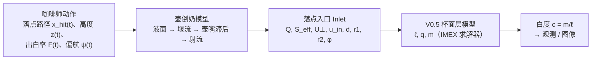

# V0.5 拉花模型：物理模型与壶倒奶模型（规格说明）

> 本文写的是当前代码实际实现、并用于最新结果"可倒设计 S1"的模型。以代码为准；每个式子旁边给出代码位置（`文件:函数`，路径相对 `latte_imex/`），完整索引见附录 B。
> 记号尽量沿用学长 V1 §3 与方式 B。两处改动：混合系数写作 $D_{\rm mix}$（代码名 `D`），以免与杯径单位 D 混淆；$Z$ 专指沉积开关变量，核归一化积分写作 $\mathcal Z_K$。

---

## 0 总览

### 0.1 链条

S1 有两条入口路径，后端相同：

| 路径 | 壶模型 | 用于 |
|---|---|---|
| **设计入口** | 准静态代理模型（§3.8）的表 → `PourF` | S1 反设计、256² 设计入口运行、手误差稳健性 |
| **壶送到的入口** | 完整壶模型 + 理想手（§3.1–3.7）的 1 ms 到达记录 → `LoopProgram` | 壶模型闭环 |

两条都调用 `run.run(pattern, control="v05")`，仅替换其中的程序对象（`v05_pourable.py:solve_design / pl_solve / rb_solve`）。

### 0.2 单位

| 量 | 约定 |
|---|---|
| 杯面模型长度 | D = 杯径 = 0.08 m；1 D² = 64 cm²；1 D³ = 512 mL |
| 时间 | s |
| 杯面速度 | D/s（1 m/s = 12.5 D/s） |
| 流量 Q | 求解器内 D³/s（1 mL/s = 1.953×10⁻³ D³/s） |
| 源强 $S_{\rm eff}$ | D²/s |
| 壶一侧 | SI：m、m/s、m/s²；体积写 mL，流量写 mL/s |

### 0.3 S1 用的参数组

| 项 | 取值 |
|---|---|
| 闭合 | `closure='chi'`（V0.5 单层），`return_law='v05'`，`tau_d=0` |
| 闭合参数 | $c_p$ 1.36 D/s，$\beta$ 3 /s，$\nu$ 1×10⁻³ D²/s，$D_{\rm mix}$ 1×10⁻⁷ D²/s，$\kappa_Q$ 2.0 /D，$\kappa_c$ 1.0，$\kappa_t$ 0.79，$\kappa_r$ 0.036982，$B_{\rm dep}$ 1617.9 D/s²，$p_{\rm dep}$ 7.0（`v05_pourable/data/design_S1_final.json` → `closure`） |
| 网格 | N = 256，`Numerics` 默认值，CPU 后端 |
| 壶 | CAD NX 壶（`pitcher_geom/pitcher_nx.json`），壶嘴外伸 b = 4.86 mm，α_lip = 0°，侧倾 φ_r = 0 |
| 杯 | 拿在手上（`held`），倾 20°，无桌面 |
| 入口规则 | `PourF(lat='pitcher', ulaw='pitcher')`，滞后 0.08 s，斜坡 0.1 s，桥 ≥ 0.3 s，Q ∈ [1, 32] mL/s，无 5 Hz 脉动 |

---

# 第一部分 物理模型（杯面层）

范围：V0.5 单层闭合 `closure='chi'`、`return_law='v05'`。代码里另有 `twolayer`、`skin`、`v2` 闭合和延迟沉积（`tau_d>0`），当前全部关闭（§1.9）。

## 1.1 计算域与状态变量

- 方形域 $[-\tfrac12,\tfrac12]^2$ D，N×N 单元，$h=1/N$（N = 256 时 0.3125 mm）；单元中心 $x_i=(i+\tfrac12)h-\tfrac12$。数组按 `c[iy, ix]` 存放。[`solver.py:Grid`]
- 杯域 $\Omega$：单元中心 $r\le R_c=0.49$ D（不是 0.5）。256² 时 49 396 个单元，面积 0.7537 D²。两侧单元都在杯内的面才是活跃面，杯壁为阶梯形。[`solver.py:Grid`]
- 参考系：静止杯系，无杯体加速度项、无移动网格、液面不倾斜。

| 量 | 含义 | 单位 | 初值 | 杯外 |
|---|---|---|---|---|
| $\ell$ | 归一化有效表层量（不是实际液面高度） | 1 | 1 | 每子步重置为 1 |
| $\mathbf q=\ell\mathbf u$ | 层动量（`qx`, `qy`） | D/s | 0 | 0 |
| $m$ | 新牛奶组分量 | 1 | 0 | 0 |
| $c=m/\ell$ | 牛奶比例 = 模型白度，∈[0,1] | 1 | 0 | 输出 NaN |
| $b=\ell-m$ | 原有棕色基底（不单独存储） | 1 | 1 | — |
| $\mathbf u=\mathbf q/\ell$ | 层速度（派生） | D/s | 0 | — |

[`solver.py:Solver.__init__`、`Solver.substep`（杯外重置）、`Solver.concentration`]

## 1.2 控制方程

$$\partial_t\ell+\nabla\!\cdot(\ell\mathbf u)=s \tag{1.1}$$

$$\partial_t m+\nabla\!\cdot(m\mathbf u)=\nabla\!\cdot(\ell\,D_{\rm mix}\nabla c)+s,\qquad c=m/\ell \tag{1.2}$$

$$\partial_t\mathbf q+\nabla\!\cdot(\mathbf q\otimes\mathbf u)+\nabla\!\big(\tfrac12c_p^2\ell^2\big)=\nabla\!\cdot(\nu\,\ell\,\nabla\mathbf u)-\beta\mathbf q+s\,\mathbf v_*+\Lambda(\mathbf v_*-\mathbf u) \tag{1.3}$$

| 项 | 含义 | 实现 | 代码 |
|---|---|---|---|
| $\nabla\cdot(\ell\mathbf u)$ | 层量输运 | 面通量 $G$（§1.6.2 步骤 B），与压力一起隐式 | `Solver.substep` 步骤 B；`kernels.py:mass_fluxes` |
| $\nabla\cdot(m\mathbf u)$ | 牛奶输运，与层量共用面通量：$F_m=G\,c_f$，$F_b=G(1-c_f)$ | MUSCL + van Leer | 步骤 C；`kernels.py:limited_face_x/y` |
| $\nabla(\tfrac12c_p^2\ell^2)$ | 有效压力：堆高的层被推开；扰动波速 $a=c_p\sqrt\ell$ | 线性化为 $c_p^2\ell^n\nabla\ell^{n+1}$，隐式 | 步骤 B；`kernels.py:stepB_prepare` |
| $\nabla\cdot(\nu\ell\nabla\mathbf u)$ | 黏性，**逐分量**作用在 $u_x,u_y$ 上 | 显式或隐式（§1.6.2 步骤 D） | 步骤 D；`kernels.py:apply_diffusion` |
| $-\beta\mathbf q$ | 对静止下层的线性拖曳 | 隐式 | 步骤 B |
| $s\,\mathbf v_*$ | 新沉积的奶带入目标速度 | 显式 | `stepB_prepare` |
| $\Lambda(\mathbf v_*-\mathbf u)$ | 未沉积奶流的牵引 | $\Lambda\mathbf v_*$ 显式，$-\Lambda\mathbf u$ 隐式 | `stepB_prepare` |
| $\nabla\cdot(\ell D_{\rm mix}\nabla c)$ | 组分混合（作用在 $c$ 上） | 显式（§1.6.2 步骤 D） | 步骤 D |
| $s$ | 沉积源，同时进入 $\ell$ 和 $m$（新奶 $c=1$） | — | `Solver.inlet_fields` |

注：黏性项不是学长 V1 的 $\nabla\cdot(2\nu\ell\,\mathsf S(\mathbf u))$，缺转置项（$\nabla\nabla\cdot\mathbf u$）与因子 2。S1 中 $\nu$ 只起正则化作用。

## 1.3 落点闭合

入口记录 `Inlet`（第二部分）每个控制帧取一次，帧内冻结。由它在全网格上计算 $s,\Lambda,\mathbf v_*$。[`solver.py:Solver.inlet_fields`（chi 分支）]

### 1.3.1 沉积开关

$$Z=\frac{U_\perp^2}{B_{\rm dep}\,d},\qquad \chi=\frac{1}{1+Z^{\,p_{\rm dep}}},\qquad d\leftarrow\max(d,10^{-6}) \tag{1.4}$$

$\chi$ 是落到杯面的奶中留在表层的份额。冲击越快、奶柱越细，$\chi$ 越小（奶钻到下层）。读法：$B_{\rm dep}=g'\,{\rm Fr}_c^2$，$g'=(1-\rho_f/\rho)g$ 的有效约化重力；$g'=73.6$ D/s²（$\rho_f/\rho=0.4$）时，S1 的 $B_{\rm dep}$ 对应 ${\rm Fr}_c\approx4.69$。

### 1.3.2 源与牵引

$$s_0=S_{\rm eff}\,K(\mathbf x),\qquad s=\chi\,s_0,\qquad \Lambda=\kappa_c\,(1-\chi)\,s_0\qquad[\text{1/s}] \tag{1.5}$$

未沉积的 $(1-\chi)$ 部分不增加层量，只通过 $\Lambda$ 把表层拖向 $\mathbf v_*$。

### 1.3.3 目标速度与回流速度

$$V_R=\min\!\big(U_\perp\,\chi^{1/(2p_{\rm dep})},\ U_\perp,\ \sqrt{B_{\rm dep}d}\big),\qquad R_{\rm dep}=\sqrt{\max(r_1r_2,10^{-12})} \tag{1.6}$$

$$\mathbf v_*(\mathbf x)=\kappa_t\,\mathbf u_{\rm in}+\kappa_r\,V_R\,\frac{\mathbf x-\mathbf x_{\rm hit}}{\sqrt{R_{\rm dep}^2+\|\mathbf x-\mathbf x_{\rm hit}\|^2}} \tag{1.7}$$

- 第一项继承奶柱的水平到达速度；第二项是落点处向外的径向回推。
- 恒有 $U_\perp\chi^{1/(2p)}=\big(U_\perp^{-2p}+(B_{\rm dep}d)^{-p}\big)^{-1/(2p)}$，即 $U_\perp$ 与 $\sqrt{B_{\rm dep}d}$ 的平滑最小值，因此 (1.6) 的两个上限不起作用。
- 径向因子模长 $<1$，落点处为 0。$R_{\rm dep}$ 用未加下限的 $r_1,r_2$。
- $\mathbf v_*$ 只经 $(s+\Lambda)$ 起作用，即只在足迹内。
- 关闭的旧律 `return_law='v1'`：径向项为 $\chi\kappa_rU_\perp$。

### 1.3.4 足迹核 K

[`solver.py:Solver.kernel`]

连续形式：

$$\tilde K(\mathbf x)=\big(1-\|\mathbf y\|^2\big)_+^2,\quad \mathbf y={\rm diag}(\hat r_1^{-1},\hat r_2^{-1})\,R_\phi^{\mathsf T}(\mathbf x-\mathbf x_{\rm hit}),\quad K=\frac{\tilde K\,\mathbf 1_\Omega}{\int_\Omega\tilde K\,dA} \tag{1.8}$$

离散形式：

- 半轴下限 $\hat r_{1,2}=\max(r_{1,2},1.5h)$（256²：0.47 mm）。
- 每单元 $q_K\times q_K$ 子点中点求积，$q_K=\min\!\big(12,\max(3,\lceil 4h/\min(\hat r_1,\hat r_2)\rceil)\big)$，下限 3 为 `Numerics.kernel_quadrature`。
- 只取杯内单元，归一化 $K_i=\tilde K_i/(h^2\sum_{j\in\Omega}\tilde K_j)$，离散上 $\sum_iK_ih^2=1$。
- 足迹跨出杯外的部分不扣除，全部重新分到杯内；足迹与杯不相交时抛 `ValueError`。
- S1 256²：最小半轴约 0.64 mm（六个 S1 N256 `inlet_log.npy` 的 $\min r/\sqrt{\mathcal A}$）> 1.5h，下限不起作用，$q_K=3$。

## 1.4 边界与初值

- 非活跃面（杯壁）上所有通量为 0：层通量 $G$、动量 Rusanov 通量、牛奶通量、黏性和混合通量。含义：$G\cdot\mathbf n=0$；$(\ell D_{\rm mix}\nabla c)\cdot\mathbf n=0$；速度零法向梯度（近似自由滑移）。[`solver.py:Grid`、`Solver.substep`]
- 壁旁单元的压力梯度取活跃面差分的平均（单侧）；不强制单元速度 $\mathbf u\cdot\mathbf n=0$。
- 杯外单元每子步重置为 $\ell=1,\ \mathbf q=0,\ m=0$。
- 初值：$\ell\equiv1,\ \mathbf q\equiv0,\ m\equiv0$（均匀棕色、静止）。
- 终止：`while t < T`，$T$ 为程序时长，含末尾停流段（0.35–0.7 s）；之后不额外静置。末帧输出 $c$。[`run.py:run`；$T$ 来自 `v05_controls/*.json` 经 `drvf.py:PhysF.__init__`]

## 1.5 守恒

$$\frac{d}{dt}\int_\Omega\ell\,dA=\frac{d}{dt}\int_\Omega m\,dA=\int_\Omega s\,dA,\qquad \frac{d}{dt}\int_\Omega(\ell-m)\,dA=0 \tag{1.9}$$

[`solver.py:Solver.ledger`]

- 账本：`layer_error` $=\int\ell-(|\Omega|_h+\text{deposited})$，`milk_error` $=\int m-\text{deposited}$，deposited $=\sum s\,h^2\Delta t$（D²）。
- 层量用最终面通量做守恒更新，误差与 PCG 精度无关。牛奶守恒只会被裁剪 $m\in[0,\ell]$ 破坏，裁剪量记入 `clip_mass`（显式混合后的那次裁剪不计入）。
- 能量诊断 $E=\int(\tfrac12|\mathbf q|^2/\ell+\tfrac12c_p^2\ell^2)\,dA$，只作诊断。[`Solver.energy`]
- S1 256²（12 次运行）：$|$layer_error$|$、$|$milk_error$|\le3\times10^{-15}$ D²，clip_mass = 0，无重试，最大子步数 5–12，deposited 0.10–0.24 D²。

## 1.6 数值方法

### 1.6.1 帧与子步

[`run.py:run`（帧循环）、`solver.py:Solver.advance_frame`、`Numerics`]

1. 在 $t$ 处探一次入口。若入口有效、$S_{\rm eff}>0$ 且 $\dot x_{\rm hit}>0$：
   $$\Delta t_f=\min\!\Big(\tfrac1{120}\,{\rm s},\ \max\big(0.5\min(h,r_1,r_2)/\dot x_{\rm hit},\ 10^{-4}\,{\rm s}\big)\Big) \tag{1.10}$$
   否则 $\Delta t_f=1/120$ s。
2. 在 $t+\Delta t_f/2$ 取入口，算一次 $s,\Lambda,\mathbf v_*$，整帧冻结。求解器在 `advance_frame` 中用这个中点入口的 $r_1,r_2,\dot x_{\rm hit}$ 再按 (1.10) 截一次（条件同上）；实际帧长取两者较小值，此时取样点不一定是实际帧的中点。
3. 子步：$u_{\max}=\max\big(\max|\mathbf q/\ell|,\ \max_{s+\Lambda>0}|\mathbf v_*|\big)$，$\Delta t_{\rm CFL}=0.5\,h/(2u_{\max})$，$n_{\rm sub}={\rm clamp}(\lceil\Delta t_f/\Delta t_{\rm CFL}\rceil,1,64)$，$\Delta t=\Delta t_f/n_{\rm sub}$。压力隐式，CFL 不含 $c_p\sqrt\ell$。
4. 子步出现非有限值或杯内 $\min\ell\le10^{-3}$ 时恢复整帧，$n_{\rm sub}$ 加倍重试；整帧最多尝试 8 次（首次 + 7 次加倍重试，$n_{\rm sub}$ 可超过 64），仍失败则抛 `RuntimeError`。[`solver.py:Solver.advance_frame`]

### 1.6.2 一个子步：A → B → C → D

[`solver.py:Solver.substep`]

**A. 动量对流**（显式，一阶 Rusanov，$\ell$ 冻结）[`kernels.py:rusanov_fluxes`]

$$\mathbf q^*=\mathbf q^n-\Delta t\,\nabla_h\!\cdot\mathbf F,\quad F_f=\tfrac12(\mathbf q_Lu_{n,L}+\mathbf q_Ru_{n,R})-\tfrac12\alpha_f(\mathbf q_R-\mathbf q_L),\quad \alpha_f=2\max(|u_{n,L}|,|u_{n,R}|) \tag{1.11}$$

**B. 层量 + 压力 + 阻尼 + 入口**（隐式，对 $\ell^{n+1}$ 得 SPD 椭圆方程）[`kernels.py:stepB_prepare / mass_fluxes / face_coef_and_diag / finish_B / q_from_gradient`；`solver.py:pcg`]

$$\theta=1+\Delta t\,(\beta+\Lambda/\ell^n),\qquad \mathbf a=\frac{\mathbf q^*+\Delta t\,(s+\Lambda)\,\mathbf v_*}{\theta},\qquad \kappa=\frac{c_p^2\ell^n}{\theta} \tag{1.12}$$

$$G^e_f=\tfrac12(a_{n,L}+a_{n,R})-\tfrac12w_f(\ell^n_R-\ell^n_L),\quad w_f=\max\!\Big(\tfrac{|a_{n,L}|}{\ell^n_L},\tfrac{|a_{n,R}|}{\ell^n_R}\Big),\quad k_f=\tfrac{\Delta t}{2}(\kappa_L+\kappa_R) \tag{1.13}$$

$$\ell^{n+1}-\Delta t\,\nabla_h\!\cdot(k_f\nabla_h\ell^{n+1})=\ell^n+\Delta t\,s-\Delta t\,\nabla_h\!\cdot G^e \tag{1.14}$$

- Jacobi 预条件 CG，相对残差 10⁻¹⁰，最多 500 次。
- 最终面通量 $G_f=G^e_f-k_f(\ell^{n+1}_R-\ell^{n+1}_L)/h$；再守恒更新 $\ell^{n+1}=\ell^n+\Delta t\,s-\Delta t\,\nabla_h\cdot G$。
- $\mathbf q^{n+1}=\mathbf a-\Delta t\,\kappa\,\nabla_c\ell^{n+1}$，$\nabla_c$ 为活跃面差分的平均。

**C. 牛奶**（显式，与 B 共用面通量 $G$）[`kernels.py:limited_face_x/y`]

$$m^{n+1}=m^n+\Delta t\,s-\Delta t\,\nabla_h\!\cdot(G\,c_f),\qquad c^n=m^n/\ell^n \tag{1.15}$$

- $c_f$：MUSCL 迎风，van Leer 限制器 $\varphi(r)=(r+|r|)/(1+|r|)$；壁旁退化为一阶；$c_f$ 夹到两侧值之间。
- 最后 $m$ 夹到 $[0,\ell^{n+1}]$（S1 中从未触发）。

**D. 黏性与混合**（$\ell$ 冻结在 $\ell^{n+1}$，面上取 $\ell$ 的面平均 $\ell_f$）

- 黏性：$\nu\Delta t/h^2<0.2$ 时显式 $\mathbf q\leftarrow\mathbf q+\Delta t\,\nabla_h\cdot(\nu\ell_f\nabla_h\mathbf u)$；否则逐分量隐式 $\ell\mathbf u^+-\Delta t\,\nabla_h\cdot(\nu\ell_f\nabla_h\mathbf u^+)=\ell\mathbf u^-$（PCG，容差 10⁻⁸）。256² 时 $n_{\rm sub}\ge3$ 走显式。
- 混合：$D_{\rm mix}\Delta t/h^2\le5.5\times10^{-5}<0.05$，S1 总走显式 $m\leftarrow m+\Delta t\,\nabla_h\cdot(D_{\rm mix}\ell_f\nabla_hc)$，再夹到 $[0,\ell]$。

子步全部有限且杯内 $\min\ell>10^{-3}$ 才提交。

### 1.6.3 数值参数（`Numerics` 默认，S1 全用默认）

| 名 | 值 |
|---|---|
| N | 256 |
| cfl | 0.5 |
| frame_dt | 1/120 s |
| max_substeps | 64 |
| cg_tol / cg_maxiter | 1e-10 / 500 |
| visc_tol | 1e-8 |
| explicit_visc_limit / explicit_mixing_limit | 0.2 / 0.05 |
| scan_safety | 0.5 |
| kernel_quadrature | 3 |
| cup_radius | 0.49 D |

## 1.7 参数表（十个闭合参数）

[`solver.py:Params`；S1 值见 `design_S1_final.json`；范围依据为 closure 审计与 `v05_adapter.py:SPACE`]

| 符号（代码名） | 作用 | S1 | FS | V0.5 原版控制 | 物理范围与依据 | S1 怎么定 |
|---|---|---|---|---|---|---|
| $c_p$（`cp`） | 有效压力 $\tfrac12c_p^2\ell^2$，波速 $c_p\sqrt\ell$ | 1.36 D/s（0.109 m/s） | 1.36 | 0.3 | 0.68–2.07 D/s：奶泡筏 $\sqrt{g'h_f}/D$，$\rho_f/\rho$ 0.3–0.7，$h_f$ 1–4 mm；名义 1.36（$\rho_f/\rho$ 0.4，$h_f$ 2 mm） | 固定 |
| $\beta$（`beta`） | 拖曳 $-\beta\mathbf q$；冲出长度约 $\|\mathbf v_*\|/\beta$ | 3 /s | 3 | 3 | 0.12–7.5 /s：Stokes 层拖曳 $(\rho/\rho_f)\sqrt{\nu_l/t}/h_f$，名义 1.1；集总量 | 固定 |
| $\nu$（`nu`） | 黏性 $\nabla\cdot(\nu\ell\nabla\mathbf u)$ | 1×10⁻³ D²/s（6.4×10⁻⁶ m²/s） | 1×10⁻³ | 1×10⁻³ | 7×10⁻⁵（液奶）–0.26 D²/s（奶泡）；此处起正则化作用 | 固定 |
| $D_{\rm mix}$（`D`） | 混合 $\nabla\cdot(\ell D_{\rm mix}\nabla c)$ | 1×10⁻⁷ D²/s（6.4×10⁻¹⁰ m²/s） | 1×10⁻⁷ | 1×10⁻⁷ | Brownian 8×10⁻¹¹–1.6×10⁻⁹ D²/s；12 s 内扩散 0.12 mm（小于一格），实际不起作用 | 固定 |
| $\kappa_Q$（`kappa_Q`） | $S_{\rm eff}=\kappa_QQ$（只在入口构造中使用；`Params.kappa_Q` 求解器不读） | 2.0 /D（$1/\kappa_Q$ = 40 mm） | 2.0 | 125 | 0.7–5 /D：$\ell_wD/\Gamma$，$\Gamma$ = 每单位白面积消耗的奶 16–120 mm | 固定 |
| $\kappa_c$（`kappa_c`） | 牵引 $\Lambda=\kappa_c(1-\chi)s_0$ | 1.0 | 1.0 | 1.0 | 0–1（效率） | 固定 |
| $\kappa_t$（`kappa_t`） | $\mathbf v_*$ 中继承的水平速度份额 | 0.79 | 0.7 | 0.7 | 0–1（份额） | 网格搜索 0.05–1；吸收壶给出的 $u_h$，不是测得值 |
| $\kappa_r$（`kappa_r`） | $\mathbf v_*$ 中径向回推份额 | 0.036982 | 0.03726 | 0.3 | 0.005–0.2（物理入口逐笔需要 0.007–0.17） | $(B_{\rm dep},p_{\rm dep})$ 定后对 V0.5 原版逐笔径向速度做加权对数平均：$\kappa_r=\exp\!\big(\sum w\ln(\text{radial}/\bar V_R)/\sum w\big)$，$w$ 为 V0.5 逐笔流量积分 $F_{\rm int}$，$\bar V_R$ 为该笔 1 ms 采样的源强加权平均，结果夹到 [0.005, 0.2]（`v05_pourable.py:finalize`、`inlet_strokes`） |
| $B_{\rm dep}$（`B_dep`） | 开关尺度 $Z=U_\perp^2/(B_{\rm dep}d)$ | 1617.9 D/s²（129.4 m/s²） | 1550.4 | 240 | 300–6000 D/s²：$g'{\rm Fr}_c^2$，${\rm Fr}_c$ 2–9；名义 1400–2200 | 搜索 |
| $p_{\rm dep}$（`p_dep`） | 开关陡度；也进 $V_R$ 指数 $1/(2p)$ | 7.0 | 8 | 2 | 1–8（先验；无独立物理值） | 搜索；数据未唯一确定 |

学长幅度约束：$\kappa_t^2+\kappa_r^2=0.626\le1$，$0\le\kappa_c\le1$，满足。

## 1.8 从模型到图像

| 用途 | 算子 | 代码 |
|---|---|---|
| 模型白度 | $c=m/\ell\in[0,1]$，杯外 NaN | `solver.py:Solver.concentration` |
| S1 成形判定 | 256² 原生网格，白区 $c>0.4$（IoU 与结构量） | `run.py` metrics（`white_area_c_gt_0p4`） |
| 校准观测算子 | ① 翻转到视频系 $c_T=c_M[::-1,:]$；② 双线性重采样到 $M_o\times M_o$；③ 高斯相机 PSF，$\sigma=0.005$ D（0.4 mm）；④ 夹到 [0,1]；⑤ 白/褐阈值 0.5。杯外先填最近杯内值 | `calib.py:observe_model`；`v05_adapter.py` |
| 与真实视频比较 | 双线性采样到视频网格，无 PSF，$c>0.4$（或 0.5）对视频白度 $w>0.5$；原样与最佳刚体对齐（$\|\theta\|\le25°$，$\|\mathbf d\|\le0.06$ D）各算一次 | 工作目录脚本（不在仓库中） |
| 显示 | $v={\rm clip}(c/0.8,0,1)^{0.8}$，RGB 在 BROWN (0.42, 0.25, 0.12) 与 WHITE (0.97, 0.95, 0.91) 间线性混合，杯外为背景色 BG (0.16, 0.16, 0.17)，行翻转为 y 向上 | `render.py:c_to_rgb` |

S1 的结果图另用拉伸 $(c-0.35)/0.65$ 与三色表 (0.25, 0.14, 0.06) → (0.62, 0.45, 0.30) → (1.0, 0.97, 0.90)，仅用于显示。

## 1.9 存在但关闭的选项

| 选项 | 状态 | 代码 |
|---|---|---|
| `closure='skin' / 'twolayer' / 'v2'` 及其参数（g_red、Fr_c2、phi_foam、H、H_f、tau_y 等） | 关 | `solver.py:Params`、`Solver` |
| `return_law='v1'` | 关 | `Solver.inlet_fields` |
| 延迟沉积 `tau_d>0` | 关（`tau_d=0`） | `Solver.substep` |
| 隐式混合 PCG 分支 | 存在，S1 未触发 | `Solver.substep` 步骤 D |
| `cuda_solver.CudaSolver` | 未用 | — |
| V0.5 原版控制 JSON 的 `numerics` / `strain_law` / `cg_law` 字段 | 本求解器不读 | `v05_controls/*.json` |

---

# 第二部分 落点入口（从倒出来的奶到求解器）

## 2.1 求解器收到的记录

[`solver.py:Inlet`]

| 字段 | 符号 | 含义 | 单位 |
|---|---|---|---|
| `active` | — | 此刻是否有奶落到杯面 | — |
| `x_hit` | $\mathbf x_{\rm hit}$ | 落点（杯系） | D |
| `S_eff` | $S_{\rm eff}=\kappa_QQ$ | 有效入流率；$Q$ 为已进杯、未乘 $\chi$ 的流量 | D²/s |
| `U_perp` | $U_\perp$ | 竖直冲击速度 | D/s |
| `u_in` | $\mathbf u_{\rm in}$ | 杯系水平到达速度 | D/s |
| `d_jet` | $d$ | 奶柱截面等面积直径 | D |
| `r1`, `r2`, `phi` | $r_1,r_2,\phi$ | 足迹椭圆半轴与方向 | D, rad |
| `scan_speed` | $\dot x_{\rm hit}$ | 落点速度上界，只用于限帧长 | D/s |

## 2.2 时间轴与笔

[`v05_allphys/drvf.py:pclass`、`PhysF.__init__`]

- 路径、各笔时长、摆动幅度与频率取自 V0.5 原版控制。
- 分类：有 `purpose` 字段的为桥（bridge）；$\max(F,F_{\rm end})\le0$ 为停（stop）；V0.5 原版控制该笔的 `radius` 字段（起始值）≤ 0.006 D 为细切（cut；不是入口足迹半径 $r$）；其余为低位/摆动（low）。流动笔 = low ∪ cut。
- 桥时长取 $\max(\text{原值},0.3\ {\rm s})$。
- 5 Hz 流量脉动关闭。
- 求解到 $T$ 为止。S1 各图案 $T$：大白心 6.925 s，推推乐 5.45 s，千层心 8.10 s，郁金香 11.05 s，树叶 11.409 s，天鹅 12.82 s。

## 2.3 流量与源强

| 式 | 内容 | 代码 |
|---|---|---|
| (2.1) 指令包络 | 流动笔 $k$ 内，$\tau=t-t_k$，$f=\tau/T_k$：$E(t)=s_k\big[F_k(1-f)+F_k^{\rm end}f\big]\,g_k(\tau)$；桥和停中 $E=0$。$F$ 为 V0.5 原版控制的出白率（D²/s）；S1 中 $s_k=1$ | `drvf.py:PhysF.envelope`；`v05_pourable.py:PourF.envelope` |
| (2.2) 斜坡 | $g_k=[\min(1,\tau/0.1\,{\rm s})]^{\,\mathbb 1_{\rm 前}}\,[\min(1,(T_k-\tau)/0.1\,{\rm s})]^{\,\mathbb 1_{\rm 后}}$，前/后为桥、停或时间端点时取斜坡 | `drvf.py:PhysF.gain` |
| (2.3) 壶嘴滞后 | $\bar E_i=\bar E_{i-1}+(1-e^{-\Delta t/\tau_s})(E_i-\bar E_{i-1})$，$\tau_s=0.08$ s，$\Delta t=0.5$ ms，查询时线性插值 | `drvf.py:PhysF.__init__`；`PourF.__call__` |
| (2.4) 开关与限幅 | $Q_{\rm raw}=\bar E/\kappa_Q$。$\bar E\le0$ → 不活跃；$Q_{\rm raw}<Q_{\min}$ 且处于桥/停 → 不活跃；否则 $Q={\rm clip}(Q_{\rm raw},Q_{\min},Q_{\max})$，$Q_{\min}=1$ mL/s，$Q_{\max}=32$ mL/s | `PourF.__call__`；`v05_pitcher_check.py:drvf_record` |
| (2.5) 源强 | $S_{\rm eff}=\kappa_QQ$，$\kappa_Q=2$ /D。限幅不起作用时 $S_{\rm eff}=\bar E$ | 同上 |
| (2.6) 壶中奶量 | $V(t)=\max\!\big(V_{\rm fill}-\int_0^tQ\,dt',\ 20\ {\rm mL}\big)$（只给壶表使用） | `v05_pourable.py:flow_schedule` |

例：大白心底座 $F=0.05$ D²/s → $Q=0.025$ D³/s = 12.8 mL/s。S1 中 32 mL/s 上限从未触发；最小流量下限在细切尾段和斜坡上起作用。

## 2.4 壶嘴高度

| 式 | 内容 | 代码 |
|---|---|---|
| (2.7) 想要的高度 $z_w(t)$ | 流动笔内为 $z_k$；直接相接的两笔在边界 $\pm h_z$ 内线性过渡，$h_z=\tfrac12\max(\|z_j-z_k\|/0.11\,{\rm m/s},\ 0.05\,{\rm s})$；桥/停内从前一笔线性走到后一笔；首笔前、末笔后取端值 | `drvf.py:PhysF.z_at`（`ztr=True`） |
| (2.8) 避让抬升 | $z(t)=z_w(t)+L(t)$，$L=\text{plan\_lift}(R)$，$R=\max(z_{\min}(t)-z_w(t),0)$（停中 $R=0$）；见 (P8.3) | `v05_pourable.py:pitcher_tables`、`plan_lift` |

## 2.5 冲击速度 $U_\perp$

| 路径 | 式 | 代码 |
|---|---|---|
| 设计入口 (2.9) | $U_\perp=\sqrt{v_z^2+2g\max(z+\Delta z_o,0)}\,/D$，$v_z=-u_0\sin\theta$（α_lip = 0, φ_r = 0）；$u_0,\theta,\Delta z_o$ 查壶表（§3.8），同一时刻 $t$ | `PourF.__call__`（`ulaw='pitcher'`） |
| 壶送到的入口 (2.10) | $U_\perp=\sqrt{v_{o,z}^2+2gz_0}\,/D$，$v_{o,z}$ 含出手时刻壶嘴尖的竖直速度，$z_0$ 为真实出流点高度（第三部分 (P5.5)） | `pitcher.py:Pitcher.jet` |
| FS 对照 (2.11) | $U_\perp=\sqrt{0.35^2+2gz}\,/D$ | `drvf.py:U_of_z` |

## 2.6 水平到达速度 $\mathbf u_{\rm in}$

| 路径 | 式 | 代码 |
|---|---|---|
| 设计入口 (2.12) | $\mathbf u_{\rm in}=\mathbf u_{\rm exit}/D+\mathbf v_{\rm hand}$，$\mathbf u_{\rm exit}=u_0\cos\theta\,(\cos\psi,\sin\psi)$；$\mathbf v_{\rm hand}=[\mathbf x_{\rm hit}(t_1)-\mathbf x_{\rm hit}(t_0)]/(t_1-t_0)$，$t_{0,1}=t\mp1$ ms 夹到 $[0,T)$（可跨笔界），即**同一时刻** V0.5 原版路径的落点速度 | `PourF.__call__`（`lat='pitcher'`）；`drvf.py:PhysF.hand_v` |
| 壶送到的入口 (2.13) | $\mathbf u_{\rm in}=\big[u_0\,\mathbf e_h+\mathbf v_{\rm tip}(t_e)\big]/D$，$t_e$ 为**出手时刻**，飞行中不变 | `pitcher.py:Pitcher.jet`（`carry_velocity=True`） |
| FS 对照 (2.14) | $\mathbf u_{\rm in}=\mathbf v_{\rm hand}+\hat{\mathbf e}_b\,{\rm clip}(\|\mathbf b\|-\mathbf v_{\rm hand}\cdot\hat{\mathbf e}_b,\ 0.10,\ 0.27\,{\rm m/s})/D$（`exitmin`） | `drvf.py:PhysF.__call__` |
| 三者共同上限 (2.15) | 若 $\|\mathbf u_{\rm in}\|>\min(0.40\,{\rm m/s},U_\perp)/D$，整个向量按比例缩到该值 | 同上 |

**已知问题：奶柱飞行时间。** 奶从壶嘴到杯面约飞行 45 ms（S1 横摆笔 41–47 ms）。设计入口 (2.12) 用的是同一时刻的落点速度，没有计入这段延迟；物理上杯面的水平速度应为 $\mathbf u(t)=\mathbf v_{\rm tip}(t-t_{\rm hit})+\mathbf u_{\rm exit}$。2.5 Hz 摆动下，这会使杯面水平速度相位晚 33–42°。壶送到的入口 (2.13) 含此延迟，因此两条路径在摆动笔上不一致。

**出手时刻规则（开关 `vtime`，默认 `'emission'`；`'landing'` 复现本节以上的旧规则）。** [`v05_pourable.py:VTIME_DEFAULT`、`emission_kinematics`、`PourF(vtime=..., ulaw='emission')`] 手把壶嘴尖沿 V0.5 原版路径减去静态射流偏移移动：$\mathbf p_{\rm tip,h}(s)=\mathbf x_{\rm V0.5}(s)-\mathbf r_h(s)-\mathbf e_h(s)t_{f0}(s)$（$\mathbf r=\mathbf p_o-\mathbf p_{\rm tip}$，$\mathbf e$ 为出口速度向量，$t_{f0}$ 为静态飞行时间），高度 $z_w+L$。在 $s$ 出手的奶包 $\mathbf v_o(s)=\dot{\mathbf p}_{\rm tip}(s)+\boldsymbol\omega(s)\times\mathbf r(s)+\mathbf e(s)$，弹道飞行：到达 $t=s+t_f(s)$，$\mathbf x_{\rm hit}=\mathbf p_{\rm tip,h}+\mathbf r_h+\mathbf v_{o,h}t_f$，$U_\perp=\sqrt{v_{o,z}^2+2gz_0}$（含手的竖直速度），$\mathbf u_{\rm in}=\mathbf v_{o,h}/D$。匀速运动时与旧规则逐点相同；2.5 Hz 摆动时 $\mathbf u_{\rm in}$ 相位晚 $\omega t_f$（S1 千层心 #2：41.5°），落点摆幅约大 $\sqrt{1+(\omega t_f)^2}$ 倍。FS 规则（`lat='exitmin'`）：$t_f=(U-0.35)/g$，手速取 $t-t_f$ 时刻，$\mathbf x_{\rm hit}=\mathbf x_{\rm V0.5}(t-t_f)+\mathbf v_{\rm hand}t_f$。

## 2.7 足迹（连续性椭圆，两条路径相同）

[`drvf.py:PhysF.__call__` 尾部；`PourF.__call__`；`v05_pitcher_check.py:drvf_record`]

$$w=\sqrt{U_\perp^2+\|\mathbf u_{\rm in}\|^2},\quad \mathcal A=\frac{w}{U_\perp},\quad r=\sqrt{\frac{Q}{\pi U_\perp}},\quad r_1=r\sqrt{\mathcal A},\quad r_2=\frac{r}{\sqrt{\mathcal A}},\quad \phi={\rm atan2}(u_{{\rm in},y},u_{{\rm in},x}) \tag{2.16}$$

$$A_\perp=\frac{Q}{w},\qquad d=2\sqrt{\frac{A_\perp}{\pi}}=2\sqrt{\frac{Q}{\pi w}},\qquad R_{\rm dep}=\sqrt{r_1r_2}=r \tag{2.17}$$

- 杯面足迹面积 $\pi r_1r_2=Q/U_\perp$（竖直方向连续性）；$d$ 是垂直于速度的奶柱截面直径。
- 落点 $\mathbf x_{\rm hit}$：设计入口取 V0.5 原版路径；壶送到的入口取到达记录的体积加权落点。
- 壶模型自己的液片足迹与成束判据（第三部分 (P5.7)–(P5.8)）不进入求解器。
- 入口不检查落点是否在杯内；足迹出杯部分由核归一化移回杯内（§1.3.4）。S1 中落点最远 0.384 D，足迹 $r\le0.04$ D，未触发。

## 2.8 壶送到的入口：到达记录 → Inlet

[`v05_pourable.py:pl_table`、`pl_program`；`v05_pitcher_check.py:drvf_record`、`_foot_speed`]

1. 壶模型每 1 ms 给出一条到达记录：$Q_{\rm hit}$、体积加权的 $\mathbf x_{\rm hit}$、$U_\perp$、$\mathbf u_h$（第三部分 (P5.9)）。
2. 换算：$\mathbf x_{\rm hit}/D$，$Q=Q_{\rm hit}/D^3$，$U_\perp/D$，$\mathbf u_{\rm in}=\mathbf u_h/D$。
3. 求解器在 $i=\lfloor t/1\,{\rm ms}\rfloor$ 处取样，1 ms 内保持；开关与限幅按 (2.4)，桥/停按设计时钟判断；上限 (2.15)；足迹 (2.16)–(2.17)。
4. 扫描速度 $\dot x_{\rm hit}=\max\!\big(\dot x_{\rm V0.5},\ \min(v_{\rm foot},\ 0.5/(N\cdot1\,{\rm ms}))\big)$，$v_{\rm foot}$ 为送到落点中心差分速度的 11 ms 滑动最大（上限 12.5 D/s）。
5. $t<0$（手可提前 0.3 s 起手）与 $t\ge T$ 的到达量不喂入。

## 2.9 帧长

| 式 | 内容 | 代码 |
|---|---|---|
| (2.18) | 帧长按 (1.10)：先用 $t$ 处入口截一次，再用 $t+\Delta t_f/2$ 处入口在 `advance_frame` 中截一次，取较小值；入口在 $t+\Delta t_f/2$ 取值（第二次截短时不在实际帧中点），帧内冻结 | `run.py:run`、`solver.py:Solver.advance_frame` |
| (2.19) | V0.5 原版扫描上界：$\dot x_{\rm V0.5}=\|\mathbf x_{\rm end}-\mathbf x_{\rm start}\|/T_k$（Bézier 段取 $3\max\|\text{控制边}\|/T_k$）$+2\pi f\max\|\mathbf A\|+\|\mathbf A_{\rm end}-\mathbf A\|/T_k$ | `v05_program.py:Program.__call__` |

S1 设计入口：帧长 1.45–8.33 ms（2.5 Hz 摆动时约 2.7 ms）；壶送到的入口帧长 ≥ 1.0 ms。

## 2.10 单位换算

| 量 | 换算 | 例 |
|---|---|---|
| 位置、长度 | [D] = [m]/0.08 = [mm]/80 | 0.384 D = 30.7 mm |
| 速度 | [D/s] = [m/s]/0.08 | 0.40 m/s = 5 D/s |
| 流量 | [D³/s] = [mL/s]/512 | 12.8 mL/s = 0.025 D³/s |
| 源强 | $S_{\rm eff}$[D²/s] = $\kappa_Q$[1/D]·$Q$[D³/s] | 12.8 mL/s → 0.05 D²/s |
| 高度 $z$ | 只用 m，只经 $U_\perp$ 进入求解器 | — |
| 闭合常数 | $c_p$×0.08 → m/s；$B_{\rm dep}$×0.08 → m/s²；$\nu$、$D_{\rm mix}$×0.0064 → m²/s；$1/\kappa_Q$×80 → mm | 1618 D/s² = 129 m/s² |

## 2.11 S1 入口的取值范围（设计入口）

| 量 | 口径 | 范围 |
|---|---|---|
| $Q$ | 逐笔平均（瞬时最大 21.8 mL/s） | 1.0–20.6 mL/s；32 mL/s 上限未触发 |
| $U_\perp$ | 瞬时 | 0.39–0.83 m/s |
| $\|\mathbf u_{\rm in}\|$ | 瞬时 | 0.009–0.124 m/s；其中出口部分 $u_0\cos\theta$ 0.035–0.117 m/s（逐笔平均 0.035–0.114）；上限 (2.15) 未生效 |
| $r$ / $d$ | 瞬时 | 0.64–3.17 mm / 1.28–6.31 mm；$r_1/r_2\le1.032$ |
| 壶嘴高度 $z$ | 瞬时，送到的高度（含抬升） | 4.8–28.6 mm；设计笔高 $z_k$ 最小 4.8 mm（天鹅 #8，抬升后送到 5.8 mm） |
| $\dot x_{\rm hit}$ | 瞬时 | 0.010–1.35 D/s |

---

# 第三部分 壶倒奶模型

单位：SI。完整壶模型在 `pitcher.py`；几何提取在 `pitcher_cad.py`；代理模型与 S1 设计在 `v05_pourable.py`；理想手在 `v05_pitcher_check.py`。式号 P·。

各组件在两条入口路径中的开关：

| 组件 | 完整壶模型闭环（壶送到的入口） | 代理模型（设计入口） |
|---|---|---|
| 自由液面 | 准静态 + 一阶晃荡（ζ = 0.3） | 水平，$g_{\rm eff}\equiv g$ |
| 堰流 | 每 1 ms 计算 | 稳态表 |
| 起停滞回 | 开 | 无 |
| 壶嘴滞后 | 壶嘴缓冲 $V_{\rm lip}$，τ/τ_stop | 入口一阶滞后 τ_s = 0.08 s（作用在指令包络上） |
| 带出速度 | 出手时刻壶嘴尖速度 | 同一时刻落点路径速度 |
| 飞行时延 | 有 | 无 |
| 避让 | 预规划 + 历遍记录的 `required_lift` 取最大 → `lift_plan`（P7.4）；在线 `required_lift` 只记录 | 避让表 + `plan_lift` |
| 手 | 理想手 `IdealHand` | 不显式建模（事后用 `hand_check` 核对） |

## 3.1 坐标与姿态

- 世界系 W：z 向上，咖啡液面 $z=0$（固定），杯心为原点。求解器杯坐标 = 世界 $(x,y)/D$。
- 壶体系 P：Z 沿壶轴向上，X 指向壶嘴。
- 姿态以壶嘴尖为参考点：$\mathbf p^W_{\rm tip}$、偏航 ψ（壶嘴方位，0 指向 +x）、倾角 θ（>0 时壶嘴向下）、侧倾 $\phi_r$。

$$R_{WP}=R_z(\psi)\,R_y(\theta)\,R_x(\phi_r),\qquad R_y(\theta)(1,0,0)^{\mathsf T}=(\cos\theta,0,-\sin\theta)^{\mathsf T} \tag{P1.1}$$

$$\mathbf x^W=\mathbf p^W_{\rm tip}+R_{WP}\,(\mathbf x^P-\mathbf p^P_{\rm tip}),\qquad \mathbf p^P_{\rm tip}=(r_{\rm rim}(0),0,z_{\rm rim}(0))=(47.37,\,0,\,100.75)\ {\rm mm} \tag{P1.2}$$

[`pitcher.py:rotation`、`Pitcher.world`、`GridPitcherGeometry.__init__`]

S1：多数笔 ψ = −90°（壶嘴指向 −y）；天鹅部分笔 −125.4°、−135°、−150°、−171.5°；所有笔 $\phi_r=0$。

## 3.2 壶的几何（CAD NX 壶）

**提取**（离线，`pitcher_cad.py:extract`）：读 `pitcher_geom/pitcher_nx.stp`，细分后按水平面切片（z 步长 1 mm，顶部 3 mm 加密到 0.25 mm；方位 72 个，每 5°）。从内腔轴沿方位射线取 $r_{\rm in}(z,\varphi)$（孔洞边界）与 $r_{\rm out}(z,\varphi)$（外边界）；$z_{\rm rim}(\varphi)$ 为该方位仍有内壁的最高 z，$r_{\rm rim}(\varphi)=r_{\rm in}(z_{\rm rim}-0.25\,{\rm mm},\varphi)$（低于沿口一层）。壶嘴方位按整格转到 φ ≈ 0，剩余半格（2.5°）记为 `spout_phi_residual`，`GridPitcherGeometry` 载入时从方位中减去。

| 量 | 值 |
|---|---|
| 网格 | 110 层 × 72 方位 |
| 腔体高 H | 100.75 mm |
| 容量 | 约 519 mL |
| 内径 | 中段 81 mm；底部 $r_{\rm in}$ 39.1 mm |
| 壁厚 | 约 2.0 mm |
| 壶沿 | 平，$z_{\rm rim}\equiv100.75$ mm |
| 鸟嘴 | $r_{\rm rim}$ 由 40.6 mm 外凸到 47.37 mm；关于 φ ≈ +2.5° 对称（0° 与 5° 两个网格点同为最大 47.37 mm，−5°/+10° 为 44.81 mm，−10°/+15° 为 41.50 mm）；$r_{\rm rim}>41$ mm 的范围为 −12.8°…+17.8° |
| 壶嘴通道 | $r_{\rm in}(z,0)$ 由 z = 60 mm 处 40.6 mm 线性外扩到沿口 47.6 mm |
| 把手 | φ = 180°，$r_{\rm out}$ 最大 75.5 mm |
| 壶嘴外伸 | $b=\max r_{\rm rim}-\overline{r_{\rm out}}(H)=4.86$ mm（`v05_pourable.py:_nx_b`） |

**内腔采样**（体积积分器，`pitcher.py:GridPitcherGeometry.__init__`）：对每层 $z_l<z_{\rm rim}(\varphi_m)$、每个方位 $\varphi_m$：

$$\mathbf x^P_{lmk}=(r\cos\varphi_m,\ r\sin\varphi_m,\ z_l),\quad r=r_{\rm in}(z_l,\varphi_m)\sqrt{\tfrac{k+1/2}{n_r}},\quad \delta v_{lmk}=\tfrac12r_{\rm in}^2\,\Delta\varphi\,\Delta z_l/n_r \tag{P2.1}$$

$n_r=6$（`v05_pourable.py:loop_geometry(nr=6)`、`v05_pitcher_check.py:nx_geometry(nr=6)`；类默认 16），共 47 088 点（= 109 层 × 72 × 6；顶层 z = 100.75 mm 因判据 $z_l<z_{\rm rim}$ 为严格不等而不含）。参考点 $\mathbf p^P_{\rm tip}$ 取 $r_{\rm rim}$ 表 argmax 的第一个（φ = 0），出口方向也沿 φ = 0，所以出流点 $\mathbf p_o$ 相对壶嘴尖有约 1.7 mm 的侧向偏移（`build_flow` 在 V = 100 mL、Q = 2 / 5 / 12 mL/s 时 oy = +1.77 / +1.72 / +1.63 mm）。[`pitcher.py:GridPitcherGeometry.__init__`（ip_tip = argmax）、`pitcher_cad.py:extract`] 壶沿折线 720 点，$r_{\rm rim}$、$z_{\rm rim}$ 周期线性插值。派生量：方位平均内径 $r_{\rm body}(z)$、外径 $r_{\rm outer}(z)$、$r_{\rm belly}=42.3$ mm（晃荡用）。出口下倾角 α_lip 存于 `geom.lip_slope`，S1 取 0°。

## 3.3 准静态液面

给定姿态与壶中奶量 $V_P$，液面高度 $z_f$ 为沿液面法向 $\mathbf n$ 的加权分位数：

$$\sum_j\delta v_j\,\mathbf 1\big[\mathbf n\cdot\mathbf x^W_j<z_f\big]=V_P,\qquad V_{\rm over}=\max\!\Big(V_P-\sum_j\delta v_j,\ 0\Big) \tag{P3.1}$$

- 不调用 `kinematics`（代理模型的静态查表）时 $\mathbf n=\mathbf e_z$、$g_{\rm eff}=g$；完整模型 `slosh=False` 时 $\mathbf s=\mathbf s_{\rm qs}$（准静态倾斜，无振子），见 (P4.9)。[`pitcher.py:Pitcher.kinematics` else 分支]
- $V_{\rm over}$ 为超出此姿态容量的量，本步并入 $Q_{\rm feed}$ 进壶嘴缓冲，经 τ 滞后流出（(P4.5)）。[`pitcher.py:Pitcher.step`]
- 由流量反解倾角 $\theta^*(Q,V_P)$：在 [0, 150°] 上二分 $Q_{\rm eq}(\theta)$；起流倾角 $\theta_{\rm on}(V_P)$：$h_{\max}=h_{\rm on}$ 处的倾角。

[`pitcher.py:Pitcher.free_surface`、`Pitcher.tilt_for_flow`；`v05_pitcher_check.py:FastPitcher.free_surface`（代数等价的快速版）、`onset_tilt`]

## 3.4 堰流出流

### 3.4.1 堰流积分

对壶沿第 $i$ 段（段向量 $\Delta\mathbf s_i$，中点 $\mathbf m_i$）：[`pitcher.py:Pitcher.weir`]

$$\Delta w_i=\big\|\Delta\mathbf s_i-(\Delta\mathbf s_i\cdot\mathbf n)\mathbf n\big\|,\quad h_i=z_f-\mathbf n\cdot\mathbf m_i,\quad h_{\max}=\max_ih_i,\quad h_{e,i}=[h_i-h_k]_+ \tag{P4.1}$$

$$Q_{\rm eq}=C_d\,\tfrac23\sqrt{2g_{\rm eff}}\sum_ih_{e,i}^{3/2}\,\Delta w_i \tag{P4.2}$$

$$\bar h=\frac{\sum_ih_{e,i}^{5/2}\Delta w_i}{\sum_ih_{e,i}^{3/2}\Delta w_i},\qquad \mathbf p_o=\frac{\sum_ih_{e,i}^{3/2}\Delta w_i\,\mathbf m_i}{\sum_ih_{e,i}^{3/2}\Delta w_i} \tag{P4.3}$$

- $h_k$：代码名 Kindsvater–Shen 水头修正（`OutflowLaw.h_k`），此处以减项进入，物理上相当于死区水头（表面张力/黏性使低于 $h_k$ 的部分不流）。
- 湿宽 $L_w=\sqrt{12\lambda_{\max}(\Sigma)}$，Σ 为 $\mathbf m_{i,xy}$ 绕 $\mathbf p_{o,xy}$ 的通量加权协方差。无水头时 $\mathbf p_o$ 取最低壶沿点。
- 纯 V 口时 (P4.2) 退化为 $Q=\tfrac{8}{15}C_d\sqrt{2g}\tan(\vartheta/2)\,h^{5/2}$。

### 3.4.2 起停滞回

$$F\leftarrow1\ \ \text{若}\ F=0\wedge h_{\max}>h_{\rm on};\qquad F\leftarrow0\ \ \text{若}\ F=1\wedge h_{\max}<h_{\rm off} \tag{P4.4}$$

[`pitcher.py:Pitcher.step`]

### 3.4.3 壶嘴滞后与体积账本

[`pitcher.py:Pitcher.step`、`PitcherState`]

$$Q_{\rm feed}=\min\!\Big(F\,Q_{\rm eq}+\frac{V_{\rm over}}{\Delta t},\ \frac{V_P}{\Delta t}\Big),\qquad \dot V_P=-Q_{\rm feed},\qquad \dot V_{\rm lip}=Q_{\rm feed}-Q_o \tag{P4.5}$$

$$Q_o=\frac{V_{\rm lip}}{\tau_{\rm eff}},\qquad \tau_{\rm eff}=\begin{cases}\tau,&Q_{\rm feed}>0\\ \tau_{\rm stop},&Q_{\rm feed}=0\end{cases} \tag{P4.6}$$

$$V_P+V_{\rm lip}+V_{\rm jet}+V_{\rm cup}=V_P(0) \tag{P4.7}$$

- 等价于对 $Q_{\rm feed}$ 做一阶滞后：起流时常数 τ，停流拖尾 τ_stop。每步放出 $\Delta V=\min(V_{\rm lip},Q_o\Delta t)$。
- 三个流量：$Q_{\rm feed}$（壶内 → 壶嘴缓冲）、$Q_o$（离开壶嘴）、$Q_{\rm hit}$（落到杯面，(P5.9)）。
- 账本误差 ~1e-19 m³（`test_pitcher`）。

### 3.4.4 运动学、晃荡与等效重力（只在完整模型中）

[`pitcher.py:Pitcher.kinematics`]

$$\mathbf v_{\rm tip}=\frac{\mathbf p_{\rm tip}(t)-\mathbf p_{\rm tip}(t-\Delta t)}{\Delta t}\ (\le1.5\,{\rm m/s}),\quad \mathbf a_{\rm raw}=\frac{\Delta\mathbf v_{\rm tip}}{\Delta t}\ (\le30\,{\rm m/s^2}),\quad \mathbf a\leftarrow\mathbf a+(\mathbf a_{\rm raw}-\mathbf a)(1-e^{-\Delta t/\tau_a}) \tag{P4.8}$$

$$\mathbf s_{\rm qs}=-\frac{(a_x,a_y)}{\max(g+a_z,\,0.2g)},\qquad \ddot{\mathbf s}+2\zeta\omega\dot{\mathbf s}+\omega^2\mathbf s=\omega^2\mathbf s_{\rm qs} \tag{P4.9}$$

$$\omega^2=g\,k\tanh(kH_l),\quad k=\frac{1.841}{r_{\rm belly}},\quad H_l=\max\!\Big(\frac{V_P}{\pi r_{\rm belly}^2},\ 5\,{\rm mm}\Big) \tag{P4.10}$$

$$\mathbf n=\frac{(-s_x,-s_y,1)}{\|(-s_x,-s_y,1)\|},\qquad g_{\rm eff}=\big\|(0,0,-g)-\mathbf a\big\| \tag{P4.11}$$

- 斜率上限 $\|\mathbf s\|\le0.36$（tan 20°）。
- 液面、水头、湿宽沿 $\mathbf n$ 度量；堰流与出口速度用 $g_{\rm eff}$，飞行用 $g$。
- NX 第一阶晃荡频率：$V_P$ = 20 / 40 / 60 / 100 / 125 / 350 mL 时分别为 1.52 / 1.80 / 2.17 / 2.65 / 2.84 / 3.27 Hz。

## 3.5 射流与落点

### 3.5.1 出口

[`pitcher.py:Pitcher.jet`、`Pitcher.exit_direction`]

$$u_0=\sqrt{2g_{\rm eff}\max(\bar h,h_k)},\qquad A_0=\frac{Q_o}{u_0},\qquad d_0=2\sqrt{A_0/\pi} \tag{P5.1}$$

$$\mathbf d_o=R_{WP}(\cos\alpha_{\rm lip},0,-\sin\alpha_{\rm lip})^{\mathsf T},\qquad \mathbf v_o=u_0\,\mathbf d_o+\mathbf v_{\rm tip} \tag{P5.2}$$

出口方向固定为壶体 +X（φ = 0，与鸟嘴对称轴 φ ≈ +2.5° 差 2.5°）下倾 α_lip；带出速度只取壶嘴尖平移速度。S1（α = 0，$\phi_r$ = 0）：出口水平分量 $u_0\cos\theta$ 沿 ψ，竖直分量 $-u_0\sin\theta$。

### 3.5.2 弹道与冲击量

$$\mathbf X(t;t_e)=\mathbf p_o(t_e)+\mathbf v_o(t_e)(t-t_e)-\tfrac12g(t-t_e)^2\mathbf e_z \tag{P5.3}$$

$$z_0=p_{o,z},\qquad t_{\rm hit}=\frac{v_{o,z}+\sqrt{v_{o,z}^2+2gz_0}}{g},\qquad \mathbf x_{\rm hit}=\mathbf p_{o,xy}+\mathbf v_{o,xy}\,t_{\rm hit} \tag{P5.4}$$

$$U_\perp=g\,t_{\rm hit}-v_{o,z}=\sqrt{v_{o,z}^2+2gz_0},\qquad \mathbf u_h=\mathbf v_{o,xy},\qquad |\mathbf v_{\rm hit}|=\sqrt{\|\mathbf u_h\|^2+U_\perp^2} \tag{P5.5}$$

$$d_{\rm hit}=\max\!\big(d_0\sqrt{u_0/|\mathbf v_{\rm hit}|},\ 2r_{\min}\big) \tag{P5.6}$$

$z_0$ 为出流点高于咖啡面的高度（= 壶嘴尖高度 + $\Delta z_o$）；$z_0\le0$ 时 $t_{\rm hit}=0$。

### 3.5.3 液片足迹与成束判据（计算，但不进入求解器）

$$L=\max(L_w,d_0),\ t_s=\frac{A_0}{L},\ t_{\rm cap}=\sqrt{\frac{\rho t_s^3}{\sigma}},\ f=1-e^{-t_{\rm hit}/t_{\rm cap}},\ \mathcal A=\Big(\frac{L}{t_s}\Big)^{1-f},\ r_{1,2}=\max\!\Big(\sqrt{\tfrac{A_0u_0\,\mathcal A^{\pm1}}{\pi|\mathbf v_{\rm hit}|}},\,r_{\min}\Big) \tag{P5.7}$$

$$\mathrm{We}=\frac{\rho u_0^2d_0}{\sigma},\quad L_b=19.5\,d_0\,\mathrm{We}^{0.325},\quad \text{成束}\iff |v_{o,z}|t_{\rm hit}+\tfrac12gt_{\rm hit}^2+\|\mathbf v_{o,xy}\|t_{\rm hit}<L_b \tag{P5.8}$$

### 3.5.4 飞行时延与到达记录

[`pitcher.py:Pitcher.step`]

每步放出的 $\Delta V_k$ 成为一个奶包，带出手时刻算出的落点与冲击量，在窗口 $W_k=[t_e-\Delta t+t_{\rm hit},\ t_e+t_{\rm hit}]$ 内均匀到达：

$$Q_{\rm hit}(t)=\frac1{\Delta t}\sum_k\Delta V_k\,\frac{\big|[t-\Delta t,t]\cap W_k\big|}{|W_k|} \tag{P5.9}$$

落点、$U_\perp$、$\mathbf u_h$ 取体积加权平均，写入到达记录 `hit`。

## 3.6 避让：最低壶嘴高度

[`pitcher.py:Pitcher.required_lift`；`v05_pourable.py:SpoutPitcher.wall_samples`、`make_cup`]

- 壁面采样：`resolved`（S1 用）取 CAD 逐方位外径 $r_{\rm out}(z,\varphi)$，60 × 72 点，含壶嘴下方外扩与把手；`mean` 取方位平均外径，40 × 36 点。
- 杯坐标：$\mathbf e$ 为壶嘴水平方向，$\mathbf d=-\mathbf e$；对抬高 $L$ 后的点，$a=(x,y)\cdot\mathbf d$，$p$ 为横向坐标；杯朝壶身一侧倾 γ：

$$z_c=z\cos\gamma+a\sin\gamma,\qquad a_c=a\cos\gamma-z\sin\gamma,\qquad r=\sqrt{a_c^2+p^2} \tag{P6.1}$$

- 判据 ok(L)：每个点满足其一：$r<r_{\rm in}-m$ 时 $z>m$（离咖啡面留 m）；$r_{\rm in}-m\le r\le r_{\rm out}+m$ 时 $z_c>z_{\rm rim,c}+m$（越过杯沿）；$r>r_{\rm out}+m$ 时 $z>-(H_{\rm cup}-z_{\rm rim,c})$（高于桌面）。

$$L_{\rm req}=\min\{L\in[0,0.15\,{\rm m}]:\ {\rm ok}(L)\}\quad(\text{二分 14 次，约 9 µm}) \tag{P6.2}$$

- 杯：$r_{\rm in}$ 40 mm，$r_{\rm out}$ 43 mm，$z_{\rm rim,c}$ 10 mm，m 2 mm，γ 20°；`held`：$H_{\rm cup}$ = 1 m（无桌面），`table`：70 mm。
- 闭式核对（`v05_pourable.py:closed_form`）：

$$h_{\min}=m+D_{\max}\cot\theta-\frac{b}{\sin\theta},\qquad D_{\max}=\frac{r_{\rm in}}{\cos\gamma}-m-a \tag{P6.3}$$

与 NX `resolved` 避让表差最大 3.8 mm，杯心 1.6 mm。

## 3.7 倒奶的手

### 3.7.1 虚拟咖啡师 `pitcher.Barista`（S1 未用）

[`pitcher.py:Barista.step`、`_tilt_ff`、`pose_at`]

- 位置：$\mathbf p_{\rm tip,xy}=D\,\mathbf x_{\rm foot}-\mathbf o$，$\mathbf o$ 为 $(\mathbf x_{\rm hit}-\mathbf p_{\rm tip,xy})$ 的 0.3 s 低通；高度速率 ≤ 0.25 m/s。
- 倾角速率律：

| 情况 | $\dot\theta$ |
|---|---|
| $Q_w\le0$，仍在流 | −60°/s |
| $Q_w\le0$，已断流 | −4°/s |
| $Q_w>0$，未出流 | +60°/s |
| $Q_w>0$，在流 | ${\rm clip}(\dot\theta_{\rm ff}+k_pe+k_i\!\int e,\ \pm60°/{\rm s})$ |

$\dot\theta_{\rm ff}={\rm clip}((\theta^*-\theta)/0.1\,{\rm s},\pm60°/{\rm s})$；$e=Q_w-\tilde Q$，$\tilde Q$ 为 $Q_o$ 的 0.25 s 低通；$k_p$ = 0.4 °/s per mL/s，$k_i$ = 0.45 °/s per mL；$|\!\int e|\le2$ mL。

### 3.7.2 理想手 `IdealHand`（S1 闭环所用）

[`v05_pitcher_check.py:IdealHand.step`、`lift_plan`、`lift_closing`、`smooth_yaw`、`_yaw_schedule`；`v05_pourable.py:pl_simulate`、`design_wanted`]

步长 1 ms，侧倾 0，无脉动，可提前 0.3 s 起手，每图案练 3 遍。目标取自设计入口：到达流量 $Q_{\rm ref}$、落点（V0.5 原版路径）、高度 $z_w$、偏航 ψ(t)。

- **预判**：目标在到达时刻 $t_a=t+\Delta t/2+t_{\rm hit}$ 取值（$t_{\rm hit}$ 用上一奶包）。
- **落点**：$\mathbf f=\mathbf x_w(t_a)-\mathbf o$（$\mathbf o$ 为不含带出速度的射流偏移，50 ms 低通），

$$\mathbf p_{\rm tip,xy}=\frac{\mathbf f+\kappa\,\mathbf p^{\rm prev}_{\rm tip,xy}}{1+\kappa},\qquad \kappa=t_{\rm hit}/\Delta t \tag{P7.1}$$

- **流量**（在壶自己的 $V_{\rm lip}$ 上反演滞后，所以滞后只出现一次）：

$$F_c=Q_o^\star+\tau\dot Q_o^\star+\frac{\tau Q_o^\star-V_{\rm lip}}{T_c},\qquad Q_o^\star=J\,Q_{\rm ref}(t_a),\quad J={\rm clip}(1+\dot t_{\rm hit},0.5,2),\quad T_c=0.08\,{\rm s} \tag{P7.2}$$

$\dot t_{\rm hit}$ 为相邻奶包 $t_{\rm hit}$ 差分（$\Delta t_{\rm hit}/\Delta t$）的 20 ms 低通。

- **模式**：收尾（$t_a>t_{\rm last}+0.05$ s）目标水头 0.2 mm；保持（$F_c\le0.2$ mL/s）在流时 0.65 mm、未流时 2.2 mm；起流 2.65 mm；正常时目标流量 $F_c$。用局部律 $Q=K(h_{\max}-h_k)^{5/2}$ 定目标水头 $h^*=h_k+(F_c/K)^{2/5}$，两步割线得 $\theta_t$。
- **倾角执行器**：

$$\dot\theta_{\rm des}=v_t+{\rm sgn}(e)\min\!\big(\sqrt{1.2a_{\max}|e|},\ \omega_n|e|\big),\quad \ddot\theta={\rm clip}\Big(\frac{\dot\theta_{\rm des}-\dot\theta}{\Delta t},\pm a_{\max}\Big),\quad a_{\max}=\frac{10\,{\rm m/s^2}}{0.15\,{\rm m}} \tag{P7.3}$$

$e=\theta_t-\theta$；$v_t$ 为目标倾角 $\theta_t$ 差分的 5 ms 低通（单步跳变 > 0.3° 记 0），限幅 ±300°/s；$\omega_n=2\pi\cdot20$ /s，$|\dot\theta|\le300$°/s，θ ∈ [0, 150°]。[`v05_pitcher_check.py:IdealHand.step`]

- **高度**：$p_{\rm tip,z}=z_w(t)+L(t)$，

$$L={\rm closing}\Big(\max_{|s|\le0.125\,{\rm s}}\big[R(t+s)+0.2\,{\rm mm}\big]_{R>0};\ \varphi\Big),\quad \varphi(s)=\begin{cases}\tfrac12a_Ls^2,&|s|<v_L/a_L\\ v_L|s|-\tfrac{v_L^2}{2a_L},&\text{否则}\end{cases} \tag{P7.4}$$

φ 截断在 $|s|\le0.4$ s；closing 结果再与输入取 max（`lift_closing`）。$a_L$ = 3 m/s²，$v_L$ = 0.5 m/s；第 0 遍 $R$ 来自预规划，此后取历遍最大。

- **偏航**：笔界 ±0.05 s 或整个桥上余弦过渡；超过 300°/s 的转向改为 0.95×300°/s 匀速斜坡，再做 10 ms 高斯平滑。

### 3.7.3 人手上限

[`v05_pitcher_check.py:HAND`；`v05_pourable.py:HANDS`、`hand_check`（20 ms 滑动平均后取峰值）]

| 量 | 理想手 | 视频手 | 依据 |
|---|---|---|---|
| 倾转速率 | 300°/s | 60°/s | 手腕屈伸峰值；视频平滑倾转约 60°/s |
| 倾转角加速度 × 力臂 0.15 m | 10 m/s² | 2 m/s² | 视频横摆峰值 1.0–1.9 m/s² |
| 壶嘴尖速度（抬壶） | 0.5 m/s | 0.11 m/s | 视频路径 ≤ 0.071 m/s，抬壶 ≤ 0.11 m/s |
| 偏航速率 | 300°/s | 90°/s | 无实测 |
| 抬壶加速度 | 3 m/s² | 2 m/s² | — |

## 3.8 准静态代理模型（设计用）及其核对

[`v05_pourable.py:make_pitcher`、`build_flow`、`build_clear`、`Surrogate`、`SpecSurrogate`、`pitcher_tables`]

**构建**：`OutflowLaw(slosh=False)`，不调用 `kinematics`（$\mathbf n=\mathbf e_z$，$g_{\rm eff}=g$），无滞回、无壶嘴缓冲、无飞行时延。

**流量表**（偏航 0，壶嘴尖 (0, 0, 2 cm)）：
- 网格：V ∈ {20, 30, …, 100, 125, …, 400} mL；Q = 2^{0, 0.5, …, 5} = 1–32 mL/s；$\phi_r$ ∈ {−20, −10, 0, 10, 20}°。
- 内容：$\theta^*$、$h_{\max}$、$\bar h$、$u_0$、$\Delta\mathbf p_o=\mathbf p_o-\mathbf p_{\rm tip}$（壶嘴系：前、左、上）、$L_w$、$\theta_{\rm on}$（`onset_tilt` 固定侧倾 0，表中各 $\phi_r$ 相同；S1 全部 $\phi_r=0$，无影响）。线性插值，越界夹到边界。
- 查询点：$(\max(Q,1\,{\rm mL/s}),\ V(t),\ \phi_r)$。

**出口方向**（壶嘴系）：

$$\mathbf e=R_y(\theta)R_x(\phi_r)(\cos\alpha,0,-\sin\alpha)^{\mathsf T}=\big(\cos\theta\cos\alpha-\sin\theta\cos\phi_r\sin\alpha,\ \sin\phi_r\sin\alpha,\ -\sin\theta\cos\alpha-\cos\theta\cos\phi_r\sin\alpha\big) \tag{P8.1}$$

世界系出口速度：$\mathbf u_{\rm exit}=u_0(e_f\cos\psi-e_s\sin\psi,\ e_f\sin\psi+e_s\cos\psi)$，$v_z=u_0e_z$。

**避让表**：$z_{\min}(a,l,\theta,\phi_r)=Z_0+L_{\rm req}$，$Z_0$ = 2 mm；网格 a −45…50 mm、l −30…30 mm（步长 5 mm），θ 10–90°（2.5°），$\phi_r$ 每 10°；在 ψ = −90° 下构建（绕杯轴旋转不变）。由落点求壶嘴尖（不动点，从 z = 15 mm 起 4 次）：

$$\mathbf p_{\rm tip}=\mathbf x_{\rm foot}-R_\psi\big(\Delta\mathbf p_o+u_0\,\mathbf e_h\,t_{\rm hit}(z)\big),\qquad z\leftarrow z_{\min}(a,l,\theta,\phi_r) \tag{P8.2}$$

**设计表**（0.5 ms 网格）：

$$R=\max(z_{\min}-z_w,0)\ (\text{停中为 }0),\qquad L=\text{plan\_lift}(R)\ (\text{同 P7.4，窗 0.25 s}) \tag{P8.3}$$

**偏航**：笔内 $\psi_k$，笔间余弦过渡，限速 300°/s（同 §3.7.2）。

**核对 1：对理想手完整模拟**（NX，起始 250/350 mL，不脉动 32 笔；`v05_pourable/data/surrogate_validation_summary.json`）

| 量 | 平均误差 | 最大 | 在容差内 |
|---|---|---|---|
| $U_\perp$ ¹ | 1.3 % | 6.2 % | 32/32 |
| 出口水平速度 | 2.5 % | 8.5 % | 32/32 |
| $u_0$ | 3.0 % | 10 % | 31/32 |
| 杯面 $\|\mathbf u_h\|$ | 3.4 % | 24.6 % | 29/32 |
| 倾角 | 0.50° | 2.16° | 28/32（1°） |
| 含抬升高度 ¹ | 0.43 mm | 1.31 mm | 32/32 |
| 抬升需求 R ² | 0.44 mm | 2.30 mm | 31/32 |
| 送到/要的奶量 ³ | 3.5 % | 19 % | 29/32 |

口径（`surrogate_validation_summary.json` → `nonpulsed`）：$u_0$、$\|\mathbf u_h\|$、倾角、出口水平速度在 `fixed` 与 `preplan` 两列中相同，取该值。¹ `preplan` 列（按理想手的抬升预规划取高度）。² `fixed` 列（按抬升后壶嘴的射流偏移算需求；`preplan` 列为 1.41 / 7.57 mm，22/32）。³ `Q_ratio`。与 `v05_pourable.py` 自身报告的取列方式相同。在模拟实际高度上（`jet_at_sim_z`）$U_\perp$ 为 1.9 % / 6.5 %。

**核对 2：插值对直接调用**（NX，resolved，held，V 110–390 mL，25 点；`selftest`）：倾角平均 0.11°（最大 0.29°），$u_0$ 0.24 %（2.2 %），$z_{\min}$ 0.20 mm（0.70 mm）。

**S1 工作点**（NX，resolved，α = 0）：

| 壶中 mL | 起流倾角 | Q = 2 / 5 / 12 mL/s 倾角 | $u_0$ m/s | $u_0\cos\theta$ m/s |
|---|---|---|---|---|
| 100 | 66.3° | 67.3 / 68.8 / 71.0° | 0.22 / 0.28 / 0.34 | 0.085 / 0.100 / 0.111 |
| 40 | 75.3° | 76.3 / 78.0 / 80.3° | 0.22 / 0.28 / 0.35 | 0.05–0.06 |

S1 各图案起始装奶 100 或 125 mL，倒出 57–85 mL，壶中最少 22 mL；倾角 63–81°（设计）/ 64–82°（闭环）。闭环与设计逐笔：奶量比 0.96–1.05（天鹅喙 #11 为 0.81，`loop_summary.json` per_run.S1_swan_ideal），高度差 ≤ 1.2 mm，$U_\perp$ 差 ≤ 4.4 %，落点 RMS ≤ 0.63 mm。

## 3.9 未标定的常数

| 常数 | 默认值 | 代码 | 影响 | 状态 |
|---|---|---|---|---|
| $C_d$ | 0.60 | `pitcher.py:OutflowLaw` | 流量—倾角关系 | 文献 V 形堰 0.58–0.60 |
| $h_k$（Kindsvater–Shen 水头修正，以减项进入，相当于死区水头） | 0.8 mm | 同上 | 小流量起流、$u_0$ 下限 0.125 m/s | 未标定 |
| $h_{\rm on}/h_{\rm off}$ | 2.5 / 0.5 mm | 同上 | 起流倾角、断流时刻 | 未标定 |
| $\tau/\tau_{\rm stop}$ | 0.08 / 0.15 s | 同上 | 壶嘴滞后、桥的断流 | 未标定 |
| ζ | 0.30 | 同上 | 晃荡幅度（f₁ ≈ 1.5–2.8 Hz 接近 2.5 Hz 横摆） | 猜测 |
| $s_{\max}$、$\tau_a$ | 0.36、0.02 s | 同上 | 数值限幅与滤波 | 数值 |
| α_lip | S1 取 0°（几何默认 10°） | `loop_geometry` | 出口方向、$u_0\cos\theta$ | 在 {0, 10, 20, 30}° 中选取，未测 |
| ρ / σ / $r_{\min}$ | 1030 kg/m³ / 0.045 N/m / 0.5 mm | `pitcher.py:Milk` | 液片足迹、成束（不进求解器） | 名义 |
| 杯几何与倾角 | 见 §3.6 | `Cup`、`make_cup` | 最低壶嘴高度 | 假设 |
| $Z_0$ | 2 mm | `v05_pourable.py:Z0` | 壶嘴尖下限 | 假设 |
| 入口规则：τ_s、斜坡、桥下限、$Q$ 限幅、$V$ 下限 | 0.08 s、0.1 s、0.3 s、1–32 mL/s、20 mL | `drvf.py:PhysF`、`PourF` | 流量时序 | 设定 |

注意区分两个 0.08 s：入口一阶滞后 τ_s 作用在设计指令上；壶嘴缓冲 τ 作用在完整模型出流上（闭环中由理想手反演）。

## 3.10 与视频的对照

[`v05_pourable/data/video_pitcher_constraints.json`]

| 量 | 视频 | NX / S1 | 用法 |
|---|---|---|---|
| 壶嘴尖 $r_{\rm tip}/R$ | 1.16（1.08–1.19） | 1.17 | 据此选 NX |
| 壶嘴外伸 b | 约 5 mm（2–8） | 4.86 mm | 同上 |
| 壶口内径 | 约 75 mm（68–88） | 81 mm | 核对 |
| 壶倾角 | 片头 59–69°（中位 64.5°），收尾 72.5–77°；误差约 ±4° 随机、±5° 系统 | S1 63–82° | 核对，非约束 |
| 杯倾角（开头） | 大白心 25–27°，郁金香/树叶 28.5°，天鹅 32.7°，千层心 20°，推推乐 13–15° | 固定 20° | — |
| 杯倾角（4–8 s 后） | 约 8–14°；方向不随壶偏航转 | 固定 20°，随偏航转 | — |
| 杯子 | 拿在手上 | `held` | — |
| 壶中奶量（反推） | 片头约 145 mL，收尾约 61 mL | S1 100–125 → 22–43 mL | 核对 |
| 壶嘴尖离咖啡面 | 杯心附近 5–7 mm（1–15）；杯沿侧 1–2.3 mm | S1 4.8–28.6 mm | 核对 |

视频量不到：壶高与容量、侧面壶嘴轮廓、唇沿上翘、α_lip。

---

## 已知限制

1. 黏性为逐分量 $\nabla\cdot(\nu\ell\nabla\mathbf u)$，不是 $\nabla\cdot(2\nu\ell\mathsf S)$。
2. 动量对流为一阶 Rusanov，且与层量面通量 $G$ 不是同一黎曼解。
3. 足迹核在杯内重新归一化，未实现杯外奶量记账（S1 未触发）。
4. 设计入口的水平速度未计入约 45 ms 飞行时间（§2.6）；$U_\perp$ 不含手的竖直速度；落点直接取 V0.5 原版路径。
5. 1 mL/s 流量下限与桥中断流不是守恒规则（S1 闭环送入量为设计的 0.99–1.01 倍）。
6. 求解器的足迹是连续性椭圆，不是壶模型的液片足迹；4–8 % 已断成滴的到达样本照样喂入。
7. 壶模型：湿宽 $\Delta w_i$ 为液面内弧长；出口方向固定沿壶体 φ = 0，而鸟嘴关于 φ ≈ +2.5° 对称，出流点相对壶嘴尖侧偏约 1.7 mm；带出速度无 $\boldsymbol\omega\times\mathbf r$ 项；壶嘴缓冲为一阶；晃荡单模态，代理模型中关闭；咖啡面固定在 z = 0，不随倒入量上升；杯倾方向随壶偏航转。
8. 壶的出流常数与 α_lip 未标定；代理模型只在 250/350 mL 起始装奶下核对过，S1 在 22–125 mL 下倒。
9. $\kappa_t$、$\kappa_r$、$p_{\rm dep}$ 是设计时确定的拟合量，不是测得值。

---

## 附录 A 符号表

| 符号 | 含义 | 单位 |
|---|---|---|
| $\ell$ | 归一化有效表层量 | 1 |
| $\mathbf q=\ell\mathbf u$ | 层动量 | D/s |
| $m$、$c=m/\ell$ | 牛奶量、牛奶比例（白度） | 1 |
| $s$、$s_0$ | 沉积源、到达源 | 1/s |
| $\Lambda$ | 牵引率 | 1/s |
| $\mathbf v_*$ | 目标速度 | D/s |
| $\chi$、$Z$ | 沉积份额、开关变量 $U_\perp^2/(B_{\rm dep}d)$ | 1 |
| $V_R$ | 回流速度 | D/s |
| $K$、$\tilde K$ | 归一化足迹核、未归一化核 | 1/D², 1 |
| $R_{\rm dep}$ | 足迹等效半径 $\sqrt{r_1r_2}$ | D |
| $c_p,\beta,\nu,D_{\rm mix}$ | 压力波速、拖曳、黏性、混合 | D/s, 1/s, D²/s, D²/s |
| $\kappa_Q,\kappa_c,\kappa_t,\kappa_r$ | 体积→层量、牵引效率、切向份额、径向份额 | 1/D, 1, 1, 1 |
| $B_{\rm dep},p_{\rm dep}$ | 开关尺度、陡度 | D/s², 1 |
| $Q$、$S_{\rm eff}$ | 到达流量、有效入流率 | D³/s (mL/s), D²/s |
| $F$ | V0.5 原版控制的出白率 | D²/s |
| $\mathbf x_{\rm hit},\dot x_{\rm hit}$ | 落点、扫描速度上界 | D, D/s |
| $U_\perp$、$\mathbf u_{\rm in}$ | 竖直冲击速度、水平到达速度 | D/s |
| $d,r_1,r_2,\phi$ | 奶柱直径、足迹半轴、方向 | D, rad |
| $h$、$N$、$\Delta t_f$、$\Delta t$ | 格距、网格数、帧长、子步长 | D, —, s, s |
| $\psi,\theta,\phi_r$ | 壶偏航、倾角、侧倾 | rad |
| $\mathbf p_{\rm tip}$、$\mathbf p_o$ | 壶嘴尖、出流点 | m |
| $V_P,V_{\rm lip},V_{\rm jet},V_{\rm cup}$ | 壶中、壶嘴缓冲、空中、杯中奶量 | m³ |
| $z_f$、$\mathbf n$ | 液面高度、液面法向 | m, — |
| $h_i,h_{\max},\bar h,h_k$ | 堰顶水头、最大水头、流量加权水头、死区水头 | m |
| $\Delta w_i$、$L_w$ | 壶沿弧元、湿宽 | m |
| $Q_{\rm eq},Q_{\rm feed},Q_o,Q_{\rm hit}$ | 堰流、入缓冲、离壶嘴、到杯面流量 | m³/s |
| $u_0$、$\mathbf v_o$、$\mathbf v_{\rm tip}$ | 出口速度、出口速度矢量、壶嘴尖速度 | m/s |
| $t_{\rm hit}$、$z_0$、$\Delta z_o$ | 飞行时间、出流点高度、出流点相对壶嘴尖竖直偏移 | s, m, m |
| $g$、$g_{\rm eff}$ | 重力、等效重力 | m/s² |
| $\mathbf s$、ω、ζ | 液面斜率、晃荡频率、阻尼比 | —, rad/s, — |
| $z_w$、$z_{\min}$、$R$、$L$ | 想要的高度、避让下限、抬升需求、抬升 | m |
| α_lip、b | 出口下倾角、壶嘴外伸 | rad, m |
| γ | 杯倾角 | rad |

## 附录 B 代码位置索引

| 内容 | 位置 |
|---|---|
| 参数、数值参数、入口记录 | `solver.py:Params`、`Numerics`、`Inlet` |
| 网格、杯域、面平均、扩散 | `solver.py:Grid` |
| 足迹核 | `solver.py:Solver.kernel` |
| 落点闭合 (1.4)–(1.7) | `solver.py:Solver.inlet_fields` |
| 子步 A–D | `solver.py:Solver.substep`；`kernels.py:rusanov_fluxes`、`stepB_prepare`、`mass_fluxes`、`face_coef_and_diag`、`finish_B`、`q_from_gradient`、`limited_face_x/y`、`apply_diffusion`；`solver.py:pcg` |
| 帧 | `solver.py:Solver.advance_frame`；`run.py:run`、`V05Script` |
| 账本、白度、能量 | `solver.py:Solver.ledger`、`concentration`、`energy` |
| 观测、显示 | `calib.py:observe_model`；`render.py:c_to_rgb` |
| V0.5 原版控制程序 | `v05_program.py:Program.__call__` |
| 入口规则（包络、斜坡、滞后、高度、FS 对照） | `v05_allphys/drvf.py:PhysF`（`envelope`、`gain`、`z_at`、`hand_v`、`__call__`）、`U_of_z`、`pclass`（`v05_pitcher_check._drvf()` 导入的副本与之逐字相同） |
| 设计入口 | `v05_pourable.py:pourf_class` → `PourF.__call__`、`make_program`、`build_design_program`、`flow_schedule`、`pitcher_tables`、`plan_lift`、`FS_FIXED`、`finalize`、`solve_design` |
| 壶送到的入口 | `v05_pourable.py:design_wanted`、`pl_simulate`、`pl_table`、`pl_program`、`pl_solve`；`v05_pitcher_check.py:drvf_record`、`_foot_speed` |
| 稳健性扰动 | `v05_pourable.py:rb_pert`、`rb_profile`、`rb_program`、`rb_solve` |
| 壶几何 | `pitcher_cad.py:extract`；`pitcher.py:GridPitcherGeometry`；`v05_pourable.py:loop_geometry`、`_nx_b` |
| 液面、堰流、缓冲、运动学、射流 | `pitcher.py:Pitcher.free_surface`、`weir`、`step`、`kinematics`、`jet`、`exit_direction`、`tilt_for_flow`、`OutflowLaw`、`Milk`、`PitcherState` |
| 快速版液面、起流倾角 | `v05_pitcher_check.py:FastPitcher`、`onset_tilt` |
| 避让 | `pitcher.py:Pitcher.required_lift`；`v05_pourable.py:SpoutPitcher.wall_samples`、`make_cup`、`closed_form` |
| 手 | `pitcher.py:Barista`；`v05_pitcher_check.py:IdealHand`、`lift_plan`、`lift_closing`、`smooth_yaw`、`_yaw_schedule`、`HAND`；`v05_pourable.py:HANDS`、`hand_check` |
| 代理模型 | `v05_pourable.py:make_pitcher`、`build_flow`、`build_clear`、`Surrogate`（`flow`、`exit_dir`、`jet`、`z_min`）、`SpecSurrogate` |
| S1 数据 | `v05_pourable/data/design_S1_final.json`、`loop_summary.json`、`surrogate_validation_summary.json`、`video_pitcher_constraints.json`；`pitcher_geom/pitcher_nx.json` |
