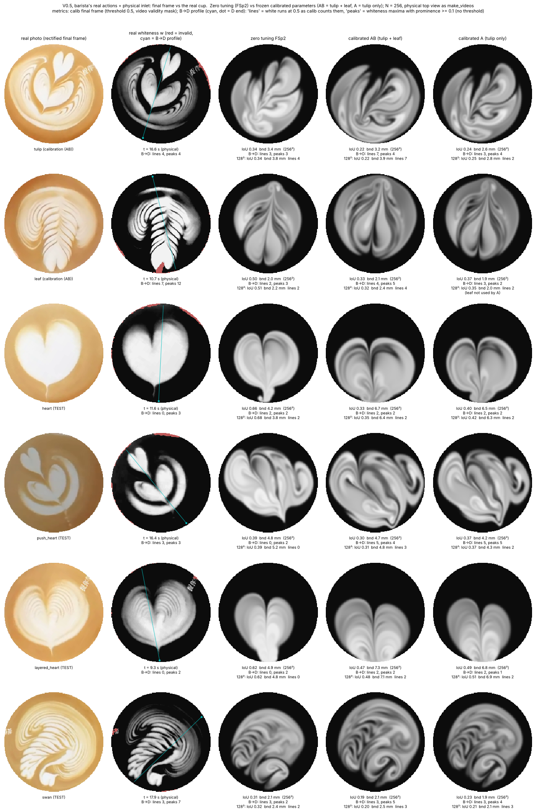
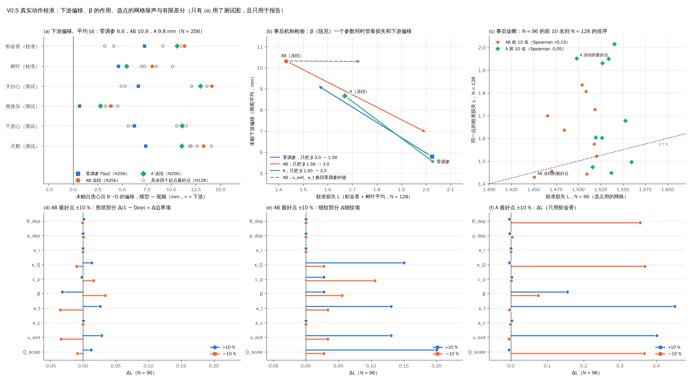

# 按学长协议标定 V0.5（咖啡师真实动作 + 物理入口）：结果（审稿后定稿）

> **问题**：按学长 V1 §5.1–5.4 的协议，在郁金香（A）+ 树叶（B）上标定共享参数、冻结，再预测大白心、推推乐、千层心、天鹅；同时用同一参数域、同一损失、同一预算做只用郁金香（A）的基线；校准拟合和测试预测分开报告；测试图案不用来选任何东西。
> **模型**：学长的 V0.5 单层模型（`latte_imex/solver.py`，闭合 'chi'，回流律 'v05'），求解器一行没改。动作是从视频读出的咖啡师动作（`latte_imex/stage_scripts`），经物理入口（`latte_imex/v05_adapter.py` 的 `V05Model`）送进求解器，接 `latte_imex/calib.py` 的校准框架。
> **单位**：D = 8 cm 杯径（1 D = 80 mm，0.05 D = 4 mm）；偏移、边界距离用 mm，速度 m/s，时间 s，奶量 mL。
> **本文**是这一轮的总结。细节在两份工作报告里：`calibration.md`（校准与辨识性）、`prediction.md`（冻结参数的六图评估）。两份报告和本文都已按审稿意见（`verify.md`，12 条：3 高、5 中、4 低）改过，逐条处理见 §9。图、校准记录、驱动和六段视频在 `latte_imex/v05_calibrated/`。

## 一句话结论

**不能：按学长协议标定后，V0.5 + 物理入口 + 咖啡师真实动作仍复现不出四个测试图案，而且标定后的预测比零调参更差。**

四个测试图案没有一个出现完整的定义结构；六组标定参数（AB、A 各三个起点）在测试图上的形状指标全部比零调参差（过程 IoU 0.24–0.39，零调参 0.49），白团的下游偏移从约 6.6 mm 加大到约 10–11 mm。标定的主要杠杆是把阻尼 β 从 3.0 降到约 1.6 /s：这让阶段末多保留一两道弧（损失里的细纹项因此下降），也让白随倒奶的前向动量漂得更远，而损失看不见这个整体平移。十个参数里只有约 4 个组合被约束住；AB 与 A 在测试上无法区分。

- **测试形状（主证据）**：四个测试图上，过程 IoU 0.492 → 0.364（AB）/ 0.391（A），1 − Dice 0.353 → 0.471 / 0.443，末帧 IoU 0.504 → 0.336 / 0.379。两组冻结参数在每一个测试图上这三项都变差。
- **损失 L**：四图平均 1.814 → 1.951 / 1.939，变差；但这一条由大白心决定，去掉大白心后三图平均是 2.063 → 1.904 / 1.968（§3）。
- **下游偏移**：末帧白质心沿 B→D 的偏移，零调参 +0.6…+7.4 mm，AB +3.8…+14.1 mm，A +2.8…+13.0 mm；平均 |d| 6.6 → 10.9 / 9.8 mm（N = 256，§5.2）。
- **细纹**：阶段末平均峰数 2.25 → 3.04 条（AB，测试三图，视频 5.08 条）；末帧基本没变多，仍是视频的一半以下（§5.1）。
- **辨识性**：AB 最好点上 B_dep、p_dep、κ_r、κ_c 四个参数完全是平的，κ_Q–Q_scale、κ_t–u_exit 两对乘积退化；最好点落在整数细纹计数的悬崖边上，连局部极小都不是（§2.4）。
- **按 senior §5.6**，这属于"校准好（部分成立），但测试差或参数解分歧大"。运行状态 completed，判断 review（没有预定的通过阈值），相对零调参的方向明确是变差。



`final_vs_real.png`：六图末帧，N = 256。列依次是真实照片（矫正后的末帧 RGB）、真实白度（青线是 B→D 剖线）、零调参 FSp2、AB 冻结、A 冻结；前两行是校准图，后四行是测试图。

## 1. 预注册设置

在任何校准运行之前固定，写在 `records/prereg.json` 和每个 `calib.json` 的 `driver.prereg` 里。

| 项 | 设置 |
|---|---|
| 模型 spec | `dict(kind='v05', base='FSp2', loss_delay=False, space_extra=dict(u_exit=(0.10, 0.27, 'lin'), Q_scale=(0.5, 2.0, 'log')))` |
| 参数（10 个） | 8 个闭合参数，用 `v05_adapter.SPACE` 的物理界：B_dep 300–6000 D/s²（log）、p_dep 1–8（lin）、κ_r 0.005–0.2（log）、κ_Q 0.7–5 /D（log）、c_p 0.68–2.07 D/s（log）、β 0.12–7.5 /s（log）、κ_t 0–1、κ_c 0–1（lin）；2 个入口冗余参数：出口水平速度 u_exit 0.10–0.27 m/s（lin），全局流量比例 Q_scale 0.5–2.0（log） |
| 固定 | ν = 1e-3 D²/s，D = 1e-7 D²/s，τ_spout = 0.08 s，V0 = 0.35 m/s，foot_scale = 1 |
| 损失 | `calib.loss_of(ev, delay=False)` = ⟨1 − Dice⟩ + ⟨d_bnd⟩ / 0.05 D + 阶段末细纹条数误差，在可靠的过程帧上算，校准图等权平均。V0.5 没有首白延迟机理，所以延迟项不进损失（照样报告） |
| 观测 | calib 预注册的一套：PSF 0.005 D，阈值 0.5，同一张视频有效区掩膜，同一套可观测量代码 |
| 优化器 | `calib.calibrate` 的 CMA-ES（cma 4.5.0），单位盒，N = 96，种群 12，σ0 = 0.25，每个起点 20 代，procs = 4 |
| 起点 | (1) FSp2 闭合 + u_exit 0.15 + Q_scale 1.0；(2) FS 闭合 + u_exit 0.15 + Q_scale 1.0；(3) 单位盒中心 |
| AB 与 A | 同一参数域、同一损失、同一预算（3 × 20 × 12 = 720 个候选）；AB 每个候选 2 次前向调用，A 1 次 |
| 选点 | 三个起点所有 CMA 样本里平均损失最低的点（`rec['best']`） |
| 评估 | 冻结的参数在六图上 N = 128 评估；末帧图 N = 256 |

**补充与偏离**（都已记录，没有一项用测试图案选过东西）：
- 随机种子：预注册没规定；用 seed = 1（三个起点 1、2、3），因为 cma 把 seed 0 当作按时钟取种子。
- 评估工具：预注册写的是 `v05_calibrate evaluate`，实际用新写的 `v05_predict.py`（要保存过程场，并评估各起点和基线），计算路径相同；审稿人独立复算 18 次 N = 128 评估，逐位一致。
- **Q_scale 与适配器文档冲突**：`v05_adapter.py` 写着 Q_scale 只作诊断、不校准；预注册把它放进了校准。后果见 §2.3：部分解收到的奶与 8 cm 杯不相容。
- 看过测试结果之后加的**事后诊断**（只用来解释）：白度 0.4–0.6 占比、面积 / 白度表、阶段末峰数统计、白质心偏移、边界长度比、千层心逐行峰数、有限差分、前 10 名 N = 128 复评、β 机制检验。其中会跑前向调用的（有限差分、前 10 名复评、β 检验）只用校准图。

**预算与运行**：AB 用 720 个候选、1440 次前向调用，A 用 720 个候选、720 次；0 次失败、0 次超时。墙钟 AB 2.36 h、A 1.20 h（4 进程，13.4 CPU·h）。CMA 历史和最好点可以只读缓存逐位重放（审稿 `cma_replay.py`；本文 `v05_calib_final.py probe` 再重放一次，最好点逐位相同）。冻结评估 48 次运行和 6 段视频全部 ok，层账本、奶账本残差 ≤ 1.0e−14。

## 2. 标定结果

### 2.1 参数

括号里是单位坐标（log 参数按对数），**粗体**表示落在边上（≤ 0.02 或 ≥ 0.98）。N = 96 的 L 是选点用的损失；N = 128 是同一点、同一损失的复评。

| 参数 | FSp2（零调参） | FS | AB 起点 1 | **AB 起点 2（冻结）** | AB 起点 3 | **A 起点 1（冻结）** | A 起点 2 | A 起点 3 |
|---|---|---|---|---|---|---|---|---|
| B_dep D/s² | 2149 | 1550 | 1902（0.62） | 5607（0.977，贴近上界） | 4375（0.89） | 2105（0.65） | **5990（1.00）** | 3309（0.80） |
| p_dep | 2.00 | 8.00 | 1.23（0.03） | 5.63（0.66） | 4.05（0.44） | 2.58（0.23） | 4.98（0.57） | 6.84（0.83） |
| κ_r | 0.0423 | 0.0373 | 0.0393（0.56） | **0.0050（0.00）** | 0.0753（0.74） | 0.0446（0.59） | 0.117（0.85） | 0.0265（0.45） |
| κ_Q /D | 2.00 | 2.00 | 1.96（0.52） | 2.18（0.58） | 1.30（0.31） | 1.25（0.29） | 0.96（0.16） | 1.54（0.40） |
| c_p D/s | 1.36 | 1.36 | 1.34（0.61） | 1.18（0.50） | 1.25（0.55） | 1.50（0.71） | 0.89（0.24） | 0.84（0.19） |
| β /s | 3.00 | 3.00 | 1.41（0.60） | 1.56（0.62） | 1.44（0.60） | 1.65（0.63） | 0.138（0.03） | 0.173（0.09） |
| κ_t | 0.70 | 0.70 | 0.62 | 0.72 | 0.96 | 0.74 | 0.40 | 0.39 |
| κ_c | 1.00 | 1.00 | 0.83 | 0.77 | 0.45 | 0.90 | 0.52 | 0.61 |
| u_exit m/s | 0.150 | 0.150 | 0.151（0.30） | 0.183（0.49） | 0.170（0.41） | 0.152（0.31） | 0.181（0.48） | 0.174（0.43） |
| Q_scale | 1.00 | 1.00 | 1.04（0.53） | 0.83（0.36） | 1.81（0.93） | 1.29（0.68） | **1.97（0.99）** | 1.33（0.71） |
| L，N = 96 | 2.013 / 2.405 | 2.018 / 2.502 | 1.526 | **1.451** | 1.504 | **1.498** | 1.520 | 1.527 |
| L，N = 128 | 2.024 / 2.396 | – | 1.556 | **1.430** | 1.836 | **1.952** | 1.605 | 1.603 |

FSp2、FS 的 L 写作"AB 两图 / A 郁金香"。AB 起点的 L 是郁金香 + 树叶的平均，A 起点的 L 只是郁金香。

### 2.2 三个起点的散布

- **损失几乎一样，参数相差很远**：三个起点的最好损失只差 0.075（AB）和 0.028（A），单位坐标上 κ_r、p_dep、Q_scale 相差 0.57–0.74（AB），β、p_dep、c_p 相差 0.52–0.61（A）。
- **唯一在六个起点上一致的方向是 β 下降**：零调参 3.0 /s，AB 三个起点 1.41–1.56 /s（单位坐标极差 0.02），A 三个起点 0.14–1.65 /s。§5.2 说明这正是下游偏移变大的原因。
- u_exit 在 0.15–0.18 m/s（单位坐标极差 0.17–0.19），比较一致；它和 κ_t 的乘积才是被约束的量（§2.4）。
- **CMA 没有收敛**：最后一代 σ 0.09–0.27（单位盒），协方差几乎没有适应（轴比 2.2–3.2，最大 |corr| 0.26–0.51）。
- **N = 96 的排序到 N = 128 不保持**（事后诊断，只用校准图）：把 N = 96 上损失最低的前 10 个候选在 N = 128 上复评，排序的 Spearman 相关只有 +0.19（AB）和 −0.05（A）。前 10 名之间形状两项之和只差 0.19（AB）和 0.11（A），细纹项却在 0.05–0.62 之间跳。AB 的冻结点碰巧在 N = 128 上仍是最低的（1.430）；A 的冻结点到 N = 128 是前 10 名里倒数第二（1.952），另外两个起点的最好点是 1.605、1.603。

### 2.3 落在边上的参数与奶量

- AB 冻结点的 κ_r 在下界、B_dep 贴近上界；A 起点 2 的 B_dep、Q_scale 顶上界。它们**不是物理区间太窄的证据，而是在平方向或补偿方向上漂过去的**（§2.4）：AB 点上 κ_r、B_dep ±10 % 的 |ΔL| ≤ 0.001；A 起点 2 的 B_dep 往盒内退 10 %，ΔL = −0.0001（χ 已饱和到 0.996）。但 A 起点 2 的 Q_scale 往盒内退 10 %，L 跳 +0.33，全是细纹计数：那个点要更多的奶，落在另一个计数悬崖上。
- **收到的奶量**（N = 128 账本；括号是相当的液位上升，按 8 cm 杯液面 50.3 cm²，不计含气）：

  | 参数组 | 郁金香 | 树叶 | 大白心 | 推推乐 | 千层心 | 天鹅 |
  |---|---|---|---|---|---|---|
  | 零调参 FSp2 | 154（3.1 cm） | 131（2.6） | 120（2.4） | 195（3.9） | 104（2.1） | 121（2.4） |
  | AB 冻结 | 127（2.5） | 108（2.1） | 99（2.0） | 161（3.2） | 86（1.7） | 100（2.0） |
  | A 冻结 | 198（3.9） | 168（3.3） | 155（3.1） | 251（5.0） | 134（2.7） | 156（3.1） |
  | AB 起点 3 | 274（5.4） | 237（4.7） | 218（4.3） | 325（6.5） | 188（3.7） | 219（4.4） |
  | A 起点 2 | 292（5.8） | 258（5.1） | 237（4.7） | 338（6.7） | 205（4.1） | 239（4.8） |

  本仓库的设计说明给的量级是"几十 mL 倒进约 150 mL"，`LATTE_MODEL_V3.md` 估的绘制阶段倒入量是 48–130 mL。所以 188–338 mL（液位升 3.7–6.7 cm）在 8 cm 杯里物理上不合理。模型里没有液位或杯容量约束，Q_scale 可以和 κ_Q 互换（下一节），所以奶量被推到哪里都不受罚。我们没有杯容量的独立测量，这里只给量级。

### 2.4 相关性与辨识性（有限差分）

AB 冻结点 ±10 %（物理值），N = 96，郁金香 + 树叶（审稿做的 42 次前向调用；本文重新分析同一批数据，并重跑其中三个探针，ΔL 逐位相同：κ_t +10 % +0.1566，Q_scale +2 % +0.0802，B_dep → 2149 +0.0239）。A 冻结点 ±10 %，N = 96，郁金香（本文补做，21 次）。

| 参数 | AB：ΔL +10 % / −10 % | A：ΔL +10 % / −10 % | 读法 |
|---|---|---|---|
| B_dep | +0.001 / −0.001 | −0.005 / **+0.355** | AB 点上平（χ 在各作画段饱和到 1.000）；A 点上单侧悬崖 |
| p_dep | −0.000 / +0.000 | −0.004 / +0.003 | 两点都平 |
| κ_r | +0.000 / −0.000 | +0.000 / −0.000 | 两点都平；AB 点上 ×8.5 也只 +0.029 |
| κ_Q | **+0.163** / +0.018 | −0.005 / **+0.368** | 单侧悬崖，几乎全是细纹计数 |
| c_p | +0.026 / **+0.121** | +0.002 / +0.001 | AB 点上主要是细纹计数 |
| β | −0.004 / +0.089 | **+0.155** / +0.075 | 形状项和细纹项方向相反 |
| κ_t | **+0.157** / −0.001 | **+0.451** / −0.004 | 很敏感；AB 点上 +2 % 就 +0.084 |
| κ_c | +0.000 / −0.000 | +0.002 / −0.001 | 两点都平（AB 点上换成 0.3 或 1.0 也只差 0.001） |
| u_exit | **+0.159** / −0.000 | **+0.401** / −0.005 | 与 κ_t 一样 |
| Q_scale | **+0.212** / +0.019 | −0.006 / **+0.367** | 悬崖；AB 点上 +2 % 就 +0.080，−2 % 是 −0.003 |

- **形状两项（1 − Dice、边界项）在 ±10 % 下每一项的变化都 ≤ 0.021（AB）和 ≤ 0.018（A）**；L 的大跳变都是阶段末整数计数。往另一个方向动，L 几乎不变或略降，所以两个冻结点都不是局部极小，而是碰巧对上的计数。
- **连续观测量的 Gauss–Newton**（每个形状帧的 1 − Dice 和 d_bnd / 0.05 D）：AB 点的 J^T J 只有 4 个特征值不小（0.46、0.24、0.024、0.014），其余 6 个 ≤ 6.8e−4；A 点只有 3 个（0.38、0.12、0.019），其余 ≤ 0.0022。
- **补偿的参数对**（线性化相关）：κ_Q–Q_scale r = −0.990（AB）/ −0.896（A），即源强 S_eff ∝ κ_Q·Q 的乘积退化；κ_t–u_exit r = −0.976 / −0.984，即沿壶嘴的目标速度 κ_t·u_exit 的乘积退化；A 点另有 B_dep–p_dep r = −0.884（χ 的两个参数）。六个起点最好点的 κ_Q 跨 2.3 倍、Q_scale 跨 2.4 倍，乘积只跨 1.47 倍。
- **机理更正**（审稿第 2 条）：`calibration.md` 初稿说"κ_t、κ_r、κ_c 只能通过 (1 − χ) 起作用"，与求解器不符。求解器的动量源是 dt (s + Λ) v*，s = χ S_eff K，Λ = κ_c (1 − χ) S_eff K，v* = κ_t u_in + κ_r V_R e_r（`solver.py` 第 335–349 行，`kernels.stepB_prepare`）。χ → 1 时只关掉 κ_c；κ_t、u_exit 通过沉积奶的动量起作用，而且很敏感；κ_r 在 AB 点上几乎无影响是经验事实。

数据：`records/review_fd_analysis_AB.json`（审稿）、`records/final_tables.json` 的 `fd_AB`、`fd_A`，`records/probe.json`。图 `offset_fd.png` 的 (c)–(f)。

## 3. 校准拟合与测试预测（分开报告，N = 128）

"校准拟合"是参数被校准过的图案（AB：郁金香 + 树叶；A：郁金香）；"测试预测"是四个测试图案的平均。树叶对 A 来说也是没用过的图案，单独列出。

| 参数组 | 校准拟合 L | 郁金香 L | 树叶 L | **测试四图 L** | 测试三图 L（去掉大白心） | **测试 1 − Dice** | **测试过程 IoU** | **测试末帧 IoU** | 测试边界 mm | 测试细纹项 |
|---|---|---|---|---|---|---|---|---|---|---|
| 零调参 FSp2 | 2.024（AB 两图）/ 2.396（郁金香） | 2.396 | 1.651 | **1.814** | 2.063 | **0.353** | **0.492** | **0.504** | 3.99 | 0.463 |
| AB 冻结（起点 2） | 1.430 | 1.591 | 1.269 | 1.951 | 1.904 | 0.471 | 0.364 | 0.336 | 4.84 | 0.270 |
| A 冻结（起点 1） | 1.952 | 1.952 | 1.387（未用） | 1.939 | 1.968 | 0.443 | 0.391 | 0.379 | 4.60 | 0.347 |
| AB 起点 1 | 1.556 | 1.763 | 1.349 | 1.912 | 1.914 | 0.470 | 0.365 | 0.349 | 4.61 | 0.291 |
| AB 起点 3 | 1.836 | 2.223 | 1.449 | 2.168 | 2.173 | 0.518 | 0.321 | 0.308 | 5.10 | 0.374 |
| A 起点 2 | 1.605 | 1.605 | 1.619（未用） | 2.197 | 2.295 | 0.620 | 0.237 | 0.223 | 4.33 | 0.493 |
| A 起点 3 | 1.603 | 1.603 | 1.793（未用） | 2.040 | 2.083 | 0.607 | 0.248 | 0.236 | 4.37 | 0.341 |

**与零调参比**：
- **校准拟合变好，测试形状变差**。AB 的校准 L 降 0.594（全靠细纹项：0.833 → 0.200），同时校准图的 1 − Dice 升 0.068、过程 IoU 降 0.066。迁移到测试图的只有一部分细纹项（−0.193），抵不过形状项的损失。所以这不是"形状拟合得太好"的经典过拟合，而是拟合了损失里的整数计数和 N = 96 网格。
- **六组校准参数的测试过程 IoU、1 − Dice、末帧 IoU 全部比零调参差**；测试四图 L 也全部更差（1.912–2.197 对 1.814）。
- **L 的结论依赖大白心**：大白心 ΔL = +1.03（AB）/ +0.79（A）。去掉它，AB、A、AB 起点 1 的三图 L 反而比零调参低（1.904 / 1.968 / 1.914 对 2.063），另外三组更高。所以主证据是形状指标，不是 L。
- **L 变好的测试图，改善来自边界项和细纹项**：AB 的千层心（ΔL −0.276，全靠细纹 −0.700，边界 +0.364）、天鹅（−0.227 = Dice +0.038、边界 −0.152、细纹 −0.112）；A 的推推乐（−0.124 = Dice +0.024、边界 −0.190、细纹 +0.042）、天鹅（−0.374，主要是细纹 −0.356）。过程边界在推推乐、天鹅上变好，在大白心、千层心上变差。

**A 与 AB 比**：
- 两个冻结点的测试四图 L 只差 0.012（AB 1.951，A 1.939）；A 的过程 IoU、末帧 IoU、边界略好。
- 但三个起点之间的测试散布，AB 是 1.912–2.168，A 是 1.939–2.197，宽度都约 0.26，是差值的 20 倍；按起点配对的 AB − A 是 −0.027、−0.246、+0.127，符号不定。
- 所以 **AB 与 A 无法区分**，"多加一个校准视频（树叶），预测就更好"本轮回答不了。A 在 N = 96 上选出的点到 N = 128 只保住了一小部分校准增益（郁金香 2.396 → 1.952，N = 96 上是 2.405 → 1.498），原因是细纹项 0.150 → 0.617。

逐图的完整表（每个图、每组参数的 L 分解、IoU、Dice、边界、阶段末细纹、末帧计数、首白误差）在 `prediction.md` §2–§4 和 `records/final_tables.json`。

## 4. 逐图结构判断

看 N = 256 末帧（`final_vs_real.png`）、过程接触图（`process_<图>_AB.png`）和视频（`videos/<图>.mp4`）。"有"= 结构清楚、位置大致对；"部分"= 有雏形但不完整，或位置、数目明显不对；"无"= 看不出来。按审稿第 8、9 条改严了三处（标 *）。

| 图案（定义结构） | 零调参 FSp2 | AB 冻结 | A 冻结 |
|---|---|---|---|
| **郁金香**（校准；叠起来的心） | 无（3 片扇叶） | 无（灰色漩涡场，几乎铺满杯面） | 无 |
| **树叶**（校准；细叶脉 + 中脉） | 叶脉无*（每侧 3 道宽暗缝）；中脉无 | 叶脉无*（宽暗缝 3–4 道，不是叶脉）；中脉无（中间一条宽白瓣） | 叶脉无*（宽暗缝 3 道）；中脉无 |
| **大白心**（白盘 + 缺口 + 底部尖） | 白盘有（偏灰）；缺口有；尖部分*（胖卷尾贴杯沿） | 白盘部分（灰，铺到杯沿）；缺口有；尖无；**新缺陷**：两瓣之间多一条视频里没有的中央暗缝 | 同 AB，略小，暗缝较浅 |
| **推推乐**（斜向的臂 + 单独的小心） | 臂无；小心无 | 臂无；小心无（漩涡更多，面积 2.25 倍） | 臂无；小心无 |
| **千层心**（嵌套线 + 底部尖） | 嵌套线无（每瓣 1–2 道很淡的弧）；尖部分（底部白柄） | 嵌套线部分（每瓣 3–4 道淡灰弧，照片上约 8 道）；**尖无**（白柄没了，心变宽、铺到杯沿） | 嵌套线部分（2–3 道）；尖无 |
| **天鹅**（脖子 + 头 + 羽毛） | 羽毛部分（3–4 道灰弧）；头部分（一个卷）；脖子无 | 羽毛部分（4–5 道）；头部分；脖子无 | 羽毛部分（4 道）；头部分；脖子无 |

- **四个测试图案没有一个出现完整的定义结构**；校准前后，零调参缺的结构照样缺（推推乐的臂和小心、天鹅的脖子、大白心与千层心的尖）。
- **校准后更完整的只有千层心的嵌套弧，而且很小**：右瓣逐行峰数（事后诊断）中位 / p90，视频 5/7，N = 256 上零调参 2/3、AB 3/4、A 2/3（N = 128 上 2/2、2/3、2/2；审稿用另一种取法得到视频 4/7、零调参 2/2、AB 2/4、A 2/3）。天鹅的羽毛多了一两道。
- **校准后变差的**：大白心（尖没了，白盘发灰、铺到杯沿，中央暗缝，过程 IoU 0.70 → 0.36）；千层心（零调参的白柄没了，末帧边界 4.9 → 7.3 mm）。
- **共同特征**：校准后的白更灰。白区内中位白度降 0.06–0.11（视频 0.59–0.96，零调参 0.63–0.82，AB 0.55–0.73）。

## 5. 剩下的差距是哪个机制造成的



`offset_fd.png`：(a) 末帧白质心沿 B→D 的偏移（只有这一格用了测试图，只用于报告）；(b) 事后 β 机制检验，校准图；(c) N = 96 前 10 名到 N = 128 的排序；(d)(e) AB 冻结点 ±10 % 的形状部分和细纹部分；(f) A 冻结点 ±10 % 的 ΔL。

### 5.1 细纹并掉

- **数目在生成时就不够**：每段摆动开始后 0.5–1 s，模型的弧数停在 2–4 道，视频继续增加到 8–11 道（郁金香第一摆结束时视频 11 个峰，零调参 3 个）。阶段末不设阈值的平均峰数，校准两图：视频 6.43，零调参 2.53，AB 3.93；测试三图：视频 5.08，零调参 2.25，AB 3.04，A 2.83。
- **生成的几道随后被抹平、灰化**：末帧峰数（N = 256，视频 / 零调参 / AB / A）郁金香 4/3/4/4，树叶 12/3/5/2，天鹅 7/2/5/4，推推乐 3/2/4/5，大白心 3/2/2/2，千层心 2/2/2/1。只有树叶、天鹅多了 2–3 个，仍不到视频的一半。
- **校准能动的只有"多活一会儿"**：把 β 降到约 1.6 /s 让阶段末的弧少被松弛掉（零调参只降 β，郁金香细纹项 0.967 → 0.500），但不增加生成的弧数，而且代价是下游偏移（§5.2）。阈值 0.5 下的"改善"还有一部分是假象：白场被压到 0.5 附近，同样的起伏被切成更多段（AB 郁金香末帧 7 个白段，不设阈值只有 4 个峰；校准两图上白段项降 0.633，峰数项只降 0.180）。
- **结论**：细纹数目不足是 V0.5 的结构问题，不是参数问题。上一轮已经显示调 χ 和足迹出不来细纹、加密网格（128² → 256²）只让阶段末误差少 0.3–0.6 条；本轮十个参数都放开也只多约 1 道灰弧。

### 5.2 下游偏移（校准把它加大了）

| 图案 | 零调参 FSp2（N256） | AB（N256） | A（N256） | 其余四个起点（N128）：AB 1 / AB 3 / A 2 / A 3 | 过程平均（N128）：零调参 → AB → A |
|---|---|---|---|---|---|
| 郁金香 | +7.3 | **+11.4** | +10.6 | +11.0 / +9.1 / +4.1 / +3.2 | +1.5 → **+5.2** → +4.3 |
| 树叶 | +4.6 | **+8.0** | +5.4 | +6.9 / +7.2 / +8.4 / +10.1 | +0.8 → **+4.4** → +1.5 |
| 大白心 | +6.6 | **+14.1** | +13.0 | +13.6 / +12.0 / +4.9 / +5.3 | +3.9 → **+12.3** → +10.2 |
| 推推乐 | +0.6 | **+3.8** | +2.8 | +2.9 / +4.0 / +4.5 / +3.3 | −2.0 → **+1.3** → +0.2 |
| 千层心 | +6.2 | **+11.2** | +11.1 | +11.5 / +10.6 / +5.6 / +6.1 | +3.2 → **+10.5** → +8.9 |
| 天鹅 | +7.4 | **+13.3** | +11.0 | +12.6 / +14.1 / +12.0 / +11.8 | −0.7 → **+5.9** → +4.2 |
| 平均 \|d\| | 6.6 mm | **10.9 mm** | 9.8 mm | 10.4 / 10.1 / 7.7 / 7.7 mm（零调参 N128 6.5） | — |

末帧白质心（阈值 0.5，视频有效区内）模型减视频，沿该图 B→D 剖线的分量，mm，+ = 下游；方法同上一轮 `v05video/extra/centroid2.py`。

- AB、A 在六个图上的末帧和过程平均都比零调参更偏下游（AB 末帧多偏 3.2–7.5 mm）。AB 起点 1、3 也是六个图都更偏；A 起点 2、3（β 0.14–0.17 /s，κ_t 0.39）在郁金香、大白心的末帧上偏得比零调参少，但过程平均在 5/6 个图上更偏，平均 |d| 也更大。
- **原因是 β**（事后机制检验，只用校准图，N = 128，`records/final_tables.json` 的 `mech`；图 (b)）：

  | 参数组（只改括号里的参数） | 两图平均 L | 郁金香末帧偏移 | 树叶末帧偏移 | 两图细纹项 | 两图过程 IoU |
  |---|---|---|---|---|---|
  | 零调参（β 3.0） | 2.024 | +7.0 mm | +4.5 mm | 0.833 | 0.461 |
  | 零调参，β → 1.556 | 1.559 | +11.1 | +7.2 | 0.394 | 0.402 |
  | AB 冻结（β 1.556） | 1.430 | +11.6 | +9.0 | 0.200 | 0.395 |
  | AB，β → 3.0 | 2.003 | +8.0 | +5.8 | 0.817 | 0.479 |
  | AB，u_exit → 0.15、κ_t → 0.7 | 1.737 | +11.0 | +9.6 | 0.558 | 0.417 |
  | AB，β → 3.0 且 u_exit、κ_t 换回 | 1.985 | +7.0 | +4.6 | 0.778 | 0.474 |
  | A 冻结（β 1.65） | 1.669 | +10.8 | +6.5 | 0.519 | 0.390 |
  | A，β → 3.0 | 2.039 | +6.8 | +4.2 | 0.828 | 0.442 |

  - 只把零调参的 β 降到 1.556，就拿到 AB 校准增益的约 80 %（L 2.024 → 1.559），同时多偏下游 2.7–4.1 mm；只把 AB 或 A 的 β 换回 3.0，增益几乎全部消失，偏移回到零调参附近。出口动量（u_exit、κ_t）换回零调参的值，偏移几乎不变。
  - 读法：β 是表层速度向静止的松弛率。阻尼减半后，摆动留下的弧多活一会儿（细纹项降），白也随倒奶的前向动量漂得更远。在 V0.5 里这两件事由同一个参数决定。
- **损失为什么看不见**：灰白场在 0.5 上下起伏、被切成碎边。过程边界长度比（模型白区边界 / 视频的）在郁金香上从 0.35 升到 0.62（AB），双向边界距离因此变小：郁金香过程边界 4.07 → 3.87 mm，而同期白质心多偏了 3.7 mm。损失里没有一项直接衡量白团的位置。
- **与输入的关系**：上一轮显示，u_exit 在 0.10–0.27 m/s 内变能把郁金香质心移 4.6 mm，但下游偏移在零调参里就存在、在 u_exit 换回 0.15 后也不消失（上表），所以本轮加大的那部分来自 β，不是来自出口速度。零调参本身的 +0.6…+7.4 mm 偏移，上一轮的结论（不能由动作脚本精度解释）不变。

### 5.3 面积

- 末帧白区面积比（模型 / 视频，N = 256）：郁金香 1.81 / 1.97 / 1.66，树叶 1.30 / 1.23 / 0.97，大白心 1.05 / 1.20 / 1.03，推推乐 2.13 / 2.25 / 2.04，千层心 0.90 / 1.11 / 0.90，天鹅 1.79 / 1.90 / 1.44（零调参 / AB / A）。AB 5/6 个图变大；A 5/6 个图略小，但郁金香、推推乐、天鹅仍是 1.4–2.0 倍。七组参数在推推乐上都是 1.8–2.6 倍。
- 校准没有修好面积，也修不好：面积与沉积到表面的奶量 χ·V 只弱相关（AB 冻结郁金香沉积 125 mL、面积 2.01；A 起点 2 沉积 291 mL、面积 1.69），还取决于铺展（c_p）和白场有多灰（阈值 0.5）。上一轮显示流量 ±50 % 能让面积比在 0.65–1.93 之间变，而脚本流量（flow × 15 mL/s）没有独立测量。所以面积偏大首先是输入问题；在流量被独立约束之前，让 Q_scale 自由只会换来不合理的奶量（§2.3）。

### 5.4 按 senior §5.5 固定回答

- **输入是否可信**：动作和入口与上一轮相同；流量没有独立测量，Q_scale 自由时奶量可到 338 mL，不可信。
- **数值测试到哪一级**：账本残差 ≤ 1.0e−14；零调参两条输出路径一致；网格依赖明显（N = 96 → 128，A 郁金香细纹项 0.150 → 0.617，前 10 名排序相关 ≤ 0.19）。
- **哪些动作响应对、哪些错**：对的是摆动开始时的 2–4 道弧、大白心和千层心的缺口与两瓣形、天鹅头部位置的卷；错的是新入流推旧图（推推乐的臂、郁金香的环和叠心）、细纹数目（只有视频一半）、收尾切线不留中脉、白团整体偏下游（校准后更偏）。
- **最早出错的时刻和模块**：每段摆动开始后 0.5–1 s（树叶 2.3 s、千层心 2.1 s、天鹅 3.7 s、郁金香 4.7 s）弧数停在 2–4 道；大白心的白盘从 2.6 s 起发灰、3.8 s 起偏下偏大。模块：动力学闭合（细纹生成与保持；β 同时管弧的寿命和白的漂移）、损失的相对尺度（整数白段权重大、依赖阈值和网格、看不见位置）、参数化（约 4 个可辨识组合）。

## 6. 按 senior §5.6 应提出的最小修改

§5.6 对"校准好，但测试差或参数解分歧大"的规定是：先查校准激励覆盖、参数混淆、相对尺度和输入不确定性；不得用测试挑解；必要时修订参数约束或采集新的校准动作，并作为新版本报告。所以最小修改是**修订参数约束和损失的相对尺度，不改物理**，作为新版本 V0.5-cal2 预注册后重新校准。本轮四个测试图已经被看过，对 V0.5-cal2 不再是完全独立的证据（§5.6 末段），这一点要写进新版本的报告。

**失败证据**（都在本轮记录里）：
1. 六组校准参数的测试形状指标全部比零调参差（§3）。
2. 校准把 β 降到约 1.6 /s，下游偏移平均 |d| 6.6 → 10.9 mm；单换 β 就能复现或撤销大部分校准增益和偏移（§5.2）。
3. 损失看不见白团的整体平移：碎边让边界距离变小（§5.2）。
4. 十个参数里约 4 个组合被约束住；4 个平方向、2 对乘积退化（§2.4）。
5. 最好点落在整数计数的悬崖边上；N = 96 的排序到 N = 128 不保持（Spearman +0.19 / −0.05）（§2.2）。
6. Q_scale 自由时奶量到 188–338 mL，与 8 cm 杯不相容（§2.3）。

**修改假设**：测试变差不是 V0.5 闭合在零调参附近的极限，而是参数化和损失让校准走了"降低 β 换阶段末白段"这条路。只要损失能看见白团的位置、细纹计数不能靠压灰刷分、退化方向被固定，校准就应停在 β ≈ 3 /s 附近，测试形状不比零调参差。

**具体修改**（全部在看测试之前写进新的 prereg）：
1. **参数化**（10 → 5 个自由参数）：固定平方向上的 κ_r、κ_c、p_dep（取 FSp2 值）；固定 u_exit = 0.15 m/s（上一轮的物理入口值）并只校准 κ_t，或者等价地校准乘积 V_t = κ_t·u_exit；固定 Q_scale = 1，或者用视频里的液位 / 杯容量独立估计流量（senior §5.1 允许，须标明来源），只校准 κ_Q（等价于 S = κ_Q·Q_scale）。自由参数：B_dep（或给 χ 一个由壶嘴高度和流量估出的先验）、κ_Q、c_p、β、κ_t。
2. **损失**：阶段末细纹改用不设阈值的峰数（显著度 0.1，与本轮诊断同定义），并加一项位置项：过程平均的白质心沿 B→D 偏移的绝对值 / 0.05 D（与边界项同尺度）。事后在校准图上算一下这样的损失（只为说明方向，不作为结果）：零调参 2.30，零调参 + 低 β 2.42，AB 冻结 2.64，AB 的 β 换回 3.0 且出口动量换回 2.22。也就是说，新损失不再偏好低 β。
3. **选点与网格**：在 N = 96 搜索，在 N = 128 上复评前 10 名再选；报告选中点在 N = 96 / 128 / 192 上的损失。
4. **预算**：与本轮相同（3 起点 × 20 代 × 12），AB 和 A 都做。

**预期改善**（事先写明，用来判断新版本成不成功）：
- 校准的 β 停在 ≥ 2.5 /s；测试过程 IoU ≥ 0.49、末帧 IoU ≥ 0.50（不比零调参差）；末帧平均 |d| ≤ 6.6 mm（不比零调参差）；五个自由参数的 J^T J 最小特征值 ≥ 1e−3。
- 可能有小的形状改善：事后在校准图上，AB 冻结点把 β、u_exit、κ_t 换回零调参值后，两图过程 IoU 0.474（零调参 0.461）。这只是一个点的提示，没有在测试图上评估。
- **不预期**细纹数目改善（§5.1：这是结构问题），也不预期面积问题在流量被独立约束之前改善。所以 V0.5-cal2 的目标是"校准不再让预测变差"，不是复现图案。

**新的回归测试**：
- R1 零调参基线逐位复现（N = 128：AB 两图 2.024、郁金香 2.396、测试四图 1.814），说明框架没变。
- R2 β 敏感性：在郁金香上把零调参的 β 从 3.0 换成 1.556，新损失必须变大（位置项的增量 > 细纹项的减量）。本轮的旧损失在这里降 0.52，说明它看不见偏移。
- R3 E3 合成回收（`calib.synthetic_clip`）：用零调参在 N = 128 生成郁金香 + 树叶，在 N = 96 上用新参数化反演，五个参数（或其可辨识组合）回到生成值 ±10 % 以内。
- R4 网格：选中点在 N = 96 / 128 / 192 上的损失差 ≤ 0.1；前 10 名在 N = 96 与 N = 128 的排序 Spearman ≥ 0.6。
- R5 奶量：六图收到的奶量都在脚本量 ±20 % 以内（或在独立估计的液位上限以内）；账本残差 ≤ 1e−12。
- R6 测试盲：校准缓存里只有郁金香和树叶；`v05_adapter` 单元测试通过。

**之后（不属于最小修改）**：细纹数目和面积要靠模型或输入的改动。按 §5.6 第一行（"总量守恒，但细纹消失"），先做冻结参数的收敛检查（N = 128 / 256 / 384，dt / 2）和入口核的检查，收敛后仍不足，才改有效混合或入口假设；面积要先有独立的流量估计。

## 7. 局限

- **单次运行、单个随机种子**：每个起点只跑了一个 CMA 种子，20 代没有收敛；"最好点"是 720 个样本的最小值，带挑选偏差（§2.2）。
- **损失本身是问题的一部分**：细纹项是整数、依赖阈值 0.5 和网格；本轮的结论（形状变差、偏移变大）用的是损失之外的指标，这些指标是看过测试之后才加的事后诊断，没有预定的通过阈值，所以判断只能是 review。
- **测试图已被看过**：六段视频都参与过设计讨论，四个测试图不是完全盲测；本轮之后它们对任何新版本都不再是独立证据。
- **网格**：校准在 N = 96，评估在 N = 128，末帧图 N = 256；没有做冻结参数的三档收敛检查。A 的冻结点在换网格后就不成立了。
- **输入**：动作脚本的流量和落点没有独立测量；Q_scale 的校准值与杯容量冲突（§2.3）；没有杯倾、液位上升。
- **机制检验是事后的**：β 与出口动量的交换只在校准图上、N = 128、单次做了 5 组，说明的是这两个参数组的因果方向，不是完整的敏感性分析。
- **结构判断是目测**：表 §4 的"有 / 部分 / 无"是人看图判断的，审稿指出的两处偏宽已改严；千层心逐行峰数只是辅助，两种取法给出的数略有不同。
- **AB 对 A**：每边只有三个起点，散布约 0.26，无法分辨 0.012 的差别；要回答"加树叶有没有用"需要更多起点或种子。

## 8. 文件与复现

`latte_imex/v05_calibrated/`（本任务新增，没有提交）：
- `CALIBRATION_RESULT.md`：本文。
- 图（都 < 1 MB）：`final_vs_real.png`（六图末帧，N = 256）、`offset_fd.png`（偏移、β 检验、选点噪声、有限差分）、`history.png`（损失历史）、`inits_N128.png`（各参数组末帧）、`lines_BD_N256.png`（末帧 B→D 剖线）、`process_<图>_AB.png`（AB 过程接触图）。
- `videos/<图>.mp4`：AB 冻结参数的 4 面板视频（原片、矫正俯视、模型 RGB、模型 C + 落点轨迹），N = 128，15 fps；`videos/<图>.json` 是元数据。
- `records/`：`calib_AB.json`、`calib_A.json`（`calib.calibrate` 的完整记录：每代历史、每个起点的最好点和完整评估、n_forward、n_failed、best、spread、driver 段）、`prereg.json`、`predict_setup.json`、`final_tables.json`（本文所有新表的数据）、`probe.json`（A 有限差分、前 10 名复评、AB 探针复现）、`review_fd_analysis_AB.json`（审稿的 AB 有限差分分析）。
- `v05_calib_final.py`：本步的驱动（`probe` / `mech` / `analyze` / `figs` / `export`）。
- `drivers/v05_calibrate.py`（sha1 a12954fc）、`drivers/v05_predict.py`（sha1 2c1ab41d）：产生本轮结果的两个驱动，取自 git 4caec97。仓库里 `latte_imex/v05_calibrate.py` 现在的工作区版本被另一个工作流改过（§10）。

复现（工作目录 = 仓库根；O = 本任务的 scratch 目录 `review/v05calib`，V = `review/v05video`）：
```
python -m latte_imex.v05_calibrate run --out $O                     # 校准 AB、A（3.56 h，4 进程）
python -m latte_imex.v05_predict run --cal $O --out $O --base $V --stages eval128,baseline,videos,final256
python -m latte_imex.v05_predict figs --cal $O --out $O --base $V
python3 latte_imex/v05_calibrated/v05_calib_final.py probe          # 60 次前向调用，617 s
python3 latte_imex/v05_calibrated/v05_calib_final.py mech           # 10 次前向调用，168 s
python3 latte_imex/v05_calibrated/v05_calib_final.py analyze
python3 latte_imex/v05_calibrated/v05_calib_final.py figs
python3 latte_imex/v05_calibrated/v05_calib_final.py export
```
`analyze` 还读审稿的 `verify_work/`（A 起点 2、3 的 N = 128 场和评估；AB 有限差分），这些由 `verify_work/recompute_ainits.py`、`fd.py`、`fd_extra.py` 生成。全部计算是确定性的（NUMBA_NUM_THREADS = 1），没有随机种子；CMA 用 calib.json 记录的种子 1、2、3。

## 9. 审稿意见的处理（`verify.md` §6，12 条）

| # | 严重度 | 问题 | 处理 |
|---|---|---|---|
| 1 | 高 | 下游偏移没有量化，而且被校准加大 | 照改。`prediction.md` 摘要、§7、§8、§9 加了质心表和"6.6 → 约 11 mm"，删掉"本轮没有改动"；用边界长度比说明损失为什么看不见。本文 §5.2。**另补**：其余四个起点的质心（A 起点 2、3 不是每个图都更偏，已如实写），以及 β 机制检验 |
| 2 | 高 | `calibration.md` §5.3 的机理与求解器不符 | 照改为"χ → 1 时只关掉 κ_c；κ_t、u_exit 很敏感；κ_r 几乎无影响是经验事实"，引用有限差分 |
| 3 | 高 | 辨识性没量化，"贴边界"被当成主要现象 | 照改。`calibration.md` 新增 §5.4（有限差分表、Gauss–Newton 特征值、相关、CMA 协方差），"贴边界"改写为"在平方向或补偿方向上漂移"。**另补** A 冻结点的有限差分和 A 起点 2 的两个探针。重新参数化写进本文 §6 |
| 4 | 中 | 最好点落在计数悬崖上，只定性提了挑选偏差 | 照改。`calibration.md` §3 加 N = 128 复评列，§7 给出悬崖数字。**另补**前 10 名 N = 128 复评（事后，只用校准图） |
| 5 | 中 | 没报告 A 多起点的测试散布 | 照改。`prediction.md` 新增 §4.2；结论改为"AB 与 A 无法区分；六组校准参数在测试上全部比零调参差" |
| 6 | 中 | 摘要的损失分解有错 | 照改为"L 变好的两个图，改善来自边界项和细纹项；IoU、Dice、末帧 IoU 四图全部变差；边界在推推乐、天鹅变好" |
| 7 | 中 | 测试 L 的结论依赖大白心 | 照改。摘要先给形状指标，再注明 L 的结论依赖大白心（三图 2.063 / 1.904 / 1.968） |
| 8 | 中 | 结构判断漏了千层心的尖、大白心的暗缝；嵌套弧没量化 | 照改。补逐行峰数（本文的取法与审稿的取法都列出） |
| 9 | 低 | 零调参大白心"尖有"、AB 树叶"叶脉部分"偏宽 | 照改为"尖部分（胖卷尾贴杯沿）""宽暗缝 3–4 道，不是叶脉"。树叶叶脉对三组用同一标准，都改为"无" |
| 10 | 低 | Q_scale 校准与适配器文档冲突；奶量不合理 | 照改。`calibration.md` §1 加说明和七组参数的奶量 / 液位表；下一版的流量约束写进本文 §6 |
| 11 | 低 | 评估工具与预注册不同；事后诊断没标明 | 照改。`prediction.md` 开头说明工具差异、复算一致、predict_smoke，并把事后诊断逐项标出 |
| 12 | 低 | 过时的说法；中位白度 0.07–0.11 应为 0.06–0.11；"未提交"已过时 | 照改。`calibration.md` 开头指向 `prediction.md` 和本文；白度改为 0.06–0.11；仓库状态见 §10 |

审稿复核后"成立"的部分（预算、失败数、各起点最好损失、损失面分位数、N = 96 → 128 的 AB 排序、χ、面积表、末帧峰数表、附录 B 的峰数脚本错误）没有改动。

## 10. 仓库状态（需要调度方确认）

- 本任务**没有提交、没有推送、没有发布**，也没有改 `latte_imex` 里已有的文件；本步只新增了 `latte_imex/v05_calibrated/`。
- 但别的提交者往当前分支 `claude/adoring-fermi-yt9iu6` 提交并推送了四次（作者都是 Claude，带同一个 session 链接，不是本任务做的）：

  | 提交 | 时间 | 内容 |
  |---|---|---|
  | 4caec97 | 13:29 | 把本任务的 `v05_calibrate.py`、`v05_predict.py` 作为 WIP 提交 |
  | 13243e2 | 13:37 | `calib.py` 加 'v05act' 分支，`v05_calibrate` 加可插拔 worker |
  | 9b14bdd | 13:58 | `v05_actfit.py`（另一个工作流的驱动），以及本步**还在写**的 `v05_calibrated/v05_calib_final.py` |
  | 2aee320 | 14:07 | 又一次提交了写到一半的 `v05_calib_final.py` |

  所以 `v05_calib_final.py` 现在在 git 里显示为"已修改"（工作区是最终版，HEAD 是 14:07 的半成品）；本步其余新文件都未跟踪。工作区里还有那个工作流对 `v05_calibrate.py` 的未提交改动（sha1 cab699f9），以及另外两个工作流的未跟踪文件 `v05_guessed_calib.py`、`v05_pitcher_check.py`。
- 影响：'v05' 路径、`v05_adapter.py`、`solver.py`、`kernels.py`、`video_extract.py` 的 sha1 都与 prereg.json 记录的相同；本步的 60 + 10 次前向调用也与校准、审稿的数逐位一致（例如 A 冻结点 1.4982、AB 三个探针、前 10 名第 1 名与 `runs/` 的 N = 128 评估），所以结果不受影响。本步的前向调用在 13:58–14:13 之间，几次抽查都没有看到别的计算进程；14:21 起另一个工作流（`v05_guessed_calib`）开始在本机用 4 个进程计算，那时本步只剩写文档。
- 这与本任务的约束（不提交、不改已有文件、同机不跑别的任务）相冲突。请调度方确认这四次提交、推送和并行工作流是否得到允许，以及 `v05_calibrated/` 的最终版由谁提交。
