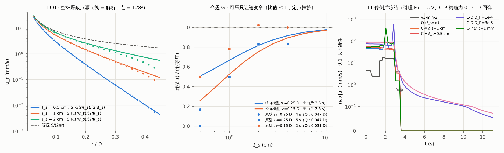
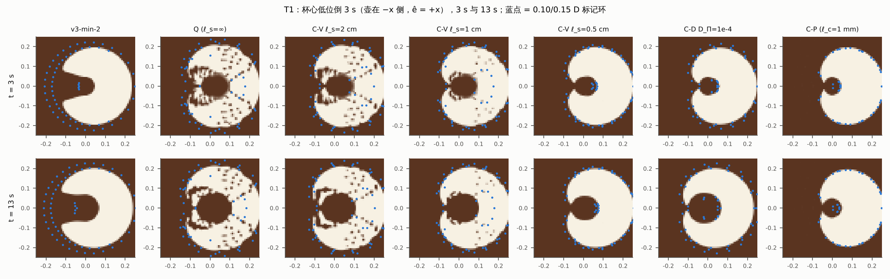
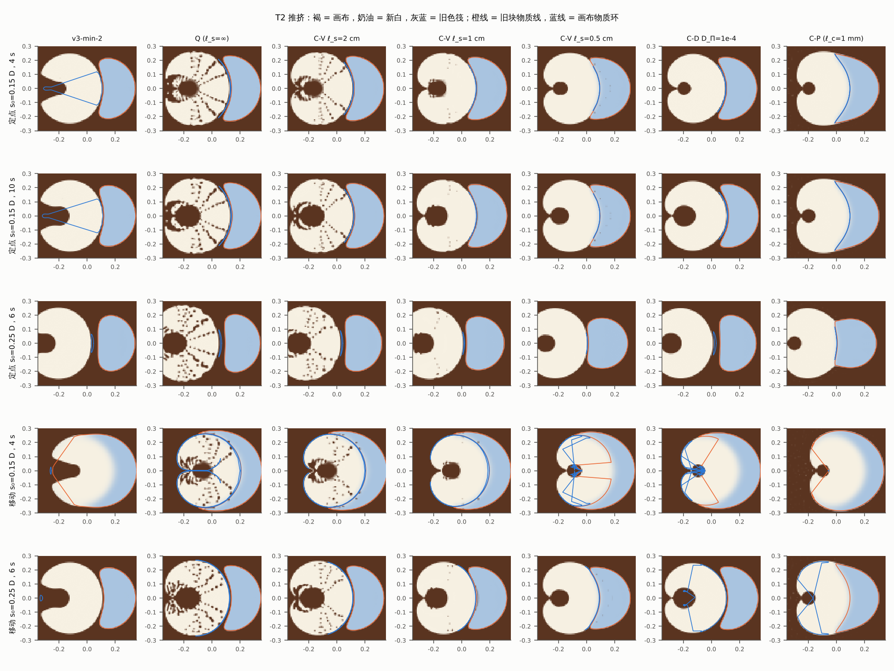
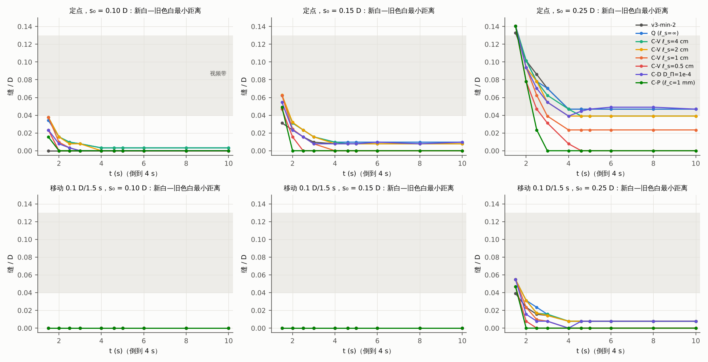
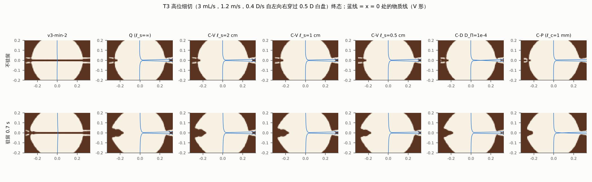
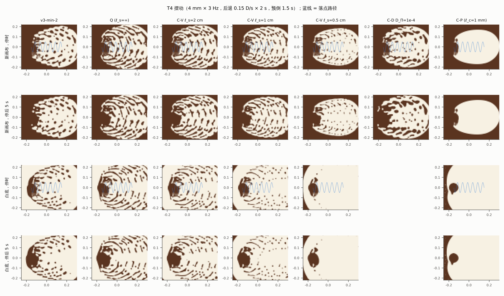
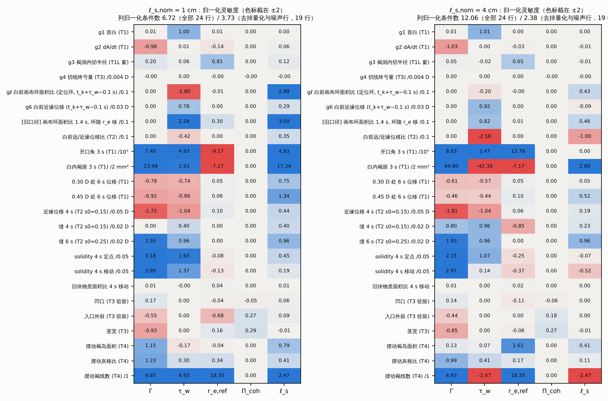

# 变体 C 原型实测：可压画布（L1 → L1C）+ 足迹推力 L5Q（DC.md §3 的实现与 T1–T5、可辨识性）

版本：test-C-1（2026-10-12）。被测模型是 `jetpush/DC.md`（DC-1）§2.2、§3 的变体 C，实现在 v3-min-2 原型的整目录副本 `jetpush/proto_DC/` 上。

- **主形式**：C-V（屏蔽画布，参数 ℓ_s）。
- **对照**：C-D（弹性、应变有记忆，参数 D_Π），DC §3.1 指定。
- **诊断**：C-P（坍塌平台）。它是 DC §2.2 的第三个子极限，DC §3 没有给离散，这里按"C-V 压缩支 ℓ_s → 0"的定义做了一个诊断版（§1.1），不属于推荐形式。

记号同 DC：ζ 为拖曳系数（Pa·s/m），φ 为漂浮层速度势（m²/s），表面压扰动 π = −ζφ。方程按 SI 写；"D"（8 cm）只在与视频比较时出现。

---

## 0. 结论先行

**实现**

- 按 DC §3 实现，只改 `px_model.py`：新增 136 行，改 2 行。
- 缺省字典 `V2` 时与 v3-min-2 逐位相同；`jetU = 1`、`canvas = 'iso'` 时与 `proto_DQ`（变体 Q）逐位相同。
- 四项单元检验全部通过：
  - T-C0：屏蔽点源对 K₁ 解析式，r ≤ 12 mm 处 ±2%，随网格收敛；
  - T-C1：ℓ_s → ∞ 回到 v3-min-2 / Q；
  - T-C2：C-V、C-P 停倒后精确冻结；
  - T-C3：账本 1 闭合到 ≤ 6×10⁻¹²。
- C-D 修了快速复核版的一处实现错误：应变 ε 被写进纯筏格（§1.2）。

**判定**

运行条件：128²，名义 Γ = 0.0395 m、τ_w = 1.4 s、r_{e,ref} = 3.72 mm（δ_e = 1 mm）、Π_coh = 300 Pa、α_j = 8°；ℓ_s 扫 20 / 4 / 2 / 1 / 0.5 cm，名义 1 cm；关键数在 192² 复现（§8）。

| 测试 | 结果 | 关键数字 |
|---|---|---|
| T1 回归（不得比 v3-min-2 差） | **✗（ℓ_s ≥ 1 cm）**；ℓ_s = 0.5 cm 时 v3-min 的两条形式断言都过，但 C 形开口仍变窄 | 见下方 T1 要点 |
| T2 缝（0.04–0.13 D 并保持） | **✗，且比 Q 更窄（命题 G 实测成立）** | 见下方 T2 要点 |
| T2 月牙（solidity < 0.85 且包住新白） | **与 Q 相同，只在接触后出现**；定点 ✗ | 见下方 T2 要点 |
| T2 白前推挤（V7 重测 ≤ 0.03 D） | 定点 ✓、移动 ✗ | 定点 s₀ = 0.15 D 近缘 0.015–0.027 D；移动 0.040–0.051 D |
| T3 切 | **凹口 ✓；切线 ✗（消失）；V ✗；外鼓偏小** | 驻留凹口 0.050–0.055 D（视频 ~0.05）；切线终亏量 0（v3-min-2 0.016 D）；物质线前拖是半宽 0.010 D 的细舌；外鼓 0.030–0.035 D（视频 ~0.05） |
| T4 摆动（新画布 / 白底） | **✗ / ✗** | 见下方 T4 要点 |
| T5 守恒、有界、锐度 | ✓ | 账本 1 ≤ 6×10⁻¹²，账本 2、3 ≤ 2×10⁻¹⁴；c ∈ [0, 1] 精确；界面 0.82–1.34 格 |
| C-D 对照 | **✗（不冻结）** | 见下方 C-D 要点 |
| C-P 诊断 | **✗** | 见下方 C-P 要点 |

T1 要点：

- 不变的量：首白 1.425 s、dA_r/dt = 3.7975 cm²/s；停倒冻结精确。
- 名义 ℓ_s = 1 cm 下变差的量：
  - C 形开口 75° → 25°；
  - 0.30 D 处出白前位移 0.0028 → 0.0071 D，超过 v3-min 的 T1 断言 ≤ 0.005 D；
  - 壶侧 0.15 D 处画布在出白前被吸进射流脚 0.008 → 0.089 D；
  - 褐洞 0.0475 → 0.064 D，出视频带。
- 唯一的正面作用：把 Q 的偶极局部化。白内褐斑 Q 34 → 1.6 / 0 mm²（192²：62 → 11.6 / 0），0.45 D 处远场位移 v3-min-2 0.012 → 0.006 / 0.001 D（ℓ_s = 1 / 0.5 cm）。

T2 要点：

- **缝**：缝(ℓ_s)/缝(Q) 在全部站位、全部时刻 ≤ 1（误差 1 格），192² 相同。
  - 定点 s₀ = 0.25 D，6 s：Q 0.047 D；C-V 0.039 / 0.039 / 0.023 / 0 D（ℓ_s = 4 / 2 / 1 / 0.5 cm）。
  - 定点 s₀ = 0.15 D：Q 0.010 D；C-V 0.008 / 0.008 / 0 / 0 D。
  - 定点 s₀ = 0.10 D：4 s 前接触（Q 剩 0.003 D）。全部 s₀ ≤ 0.15 D 的移动情形：出白即接触。
- **月牙**：
  - 移动 s₀ = 0.15 D（接触后）：满足月牙判据。Q solidity 0.395、包角 220°、0.145 × 0.571 D；C-V（4 / 2 / 1 cm）0.41 / 0.43 / 0.45，0.15 × 0.55–0.57 D（视频 0.10 × 0.5 D）。
  - ℓ_s = 0.5 cm：0.56，旧块被喂大 ×1.29（192² ×1.55）。
  - 定点 s₀ = 0.15 D：0.82–0.85、包角 110–120°、0.21 × 0.44 D。

T4 要点：

- **新画布**：ℓ_s ≥ 1 cm 时离轴有 3–4 条褐线（192² 4–5 条）。
  - 线宽 0.011–0.018 D，落在视频带内；
  - 节距 0.073–0.08 D，约 1.5 周一条。一周一弧应为 0.05 D，视频为 0.030–0.043 D；
  - 白内另有褐岛 165–221 mm²。
- **ℓ_s = 0.5 cm**：0 条。
- **白底**：中位数 0 条。

C-D 要点：

- 停倒后 max|u| 0.7–2.5 mm/s；D_Π ≤ 10⁻⁴ 时 0.30 D 处漂移 0.022–0.024 D，max|Δc| = 1。
- s₀ = 0.25 D 的缝在停倒后回弹 0.039 → 0.049 D。
- 白底摆动跑不动：Δt ≈ 3×10⁻⁵ s。

C-P 要点：

- s₀ ≤ 0.15 D 出白即无缝；s₀ = 0.25 D 时 2 s 0.078 D，4 s 归零。这就是"新白就地吃缝"。
- 移动时旧块被喂大 ×2.6–2.8。
- 摆动时白区实心。

**可辨识性**（五个拟合参数 Γ、τ_w、r_{e,ref}、Π_coh、ℓ_s；±20% 中心差分；ℓ_s,nom = 1 cm 与 4 cm）

1. **Π_coh 失锚**。带 W 时切线消失（g4 ≡ 0），Π_coh 在郁金香 + 树叶的拟合观测量里没有任何响应：sd(ln Π_coh) = 4.4×10²（1 cm）/ 1.0×10³（4 cm）。
   - 列归一化条件数（1.5–4.4）对"一整列只有噪声"不敏感，不能拿来说明它可辨识。
   - 在测试集里 Π_coh 只经茎宽、入口外鼓起作用（S = 0.27–0.29），与 Γ（S = −0.85 至 −0.93）补偿。
   - 这与变体 Q 相同，来自 L5Q，不来自可压性。
2. **ℓ_s 只有一个锚 gℓ**：出白前射流与旧块之间褐色画布的面积比，对应郁金香 6.6–8.5 s 的 B 侧，只有一个窗口，且未按固定杯沿参照重测。
   - 原型中 gℓ 从 Q 的 1.01 降到 0.79（1 cm）、0.57（0.5 cm）。
   - 郁金香 + 树叶 Fisher（Π_coh 拿掉，4 参数，σ_ℓ = 0.1 / 0.2 / 0.35）：
     - ℓ_s,nom = 1 cm：条件数 1.93 / 2.82 / 4.42，sd(ln ℓ_s) = 0.35 / 0.69 / 1.21；最大相关 r_{e,ref}–ℓ_s = −0.47 / −0.73 / −0.88，经 g3：褐洞对 ℓ_s 的 S = 0.12。
     - ℓ_s,nom = 4 cm：sd(ln ℓ_s) = 2.3–8.1，不可辨识，即 C ≡ Q。
3. **全部检验行**（去掉量化与噪声行后 19 行）：
   - 5 参数条件数 3.73（1 cm）/ 2.38（4 cm），4 个旧参数 2.55 / 1.78。v3-min-2 的 1.56 是 g1–g4 的 Fisher 条件数，口径不同；C 的 g1–g4 Fisher 因 g4 ≡ 0 而无意义（第 1 条）。
   - 计入白内褐斑、T4 褐线数等 24 行时为 6.72 / 12.06：ℓ_s 与 Γ 的列余弦 0.82（1 cm），经褐斑、远场、摆动褐岛互相补偿。

**代价**：见 §10，128² 单进程实测，T1 每模拟秒的墙钟：v3-min-2 1.17 s，Q 1.51 s（×1.29），C-V 1 cm 2.35 s（×2.0），C-V 0.5 cm 2.62 s（×2.2），C-D 6.87 s（×5.9），C-P 9.2 s（×7.9）。C-V 的 ×2.0 中，×1.29 来自足迹推力使 Courant 步数增加（Q 已有），其余来自 Helmholtz 求解。

**学长 V1 规则**：C 不新增冲突，详见 §11。

- §3.1：画布部分不再被投影。筏区的 c(∇·u − σ_f) = 0 与 W 的投影继承自 v3-min-2 / Q；在物理先验 ℓ_s ≥ 7 cm 下 C 退化为 Q，冲突同 DQ。
- §1.2：不新增奶泡场与下沉；局部吸收是褐量账本的汇，已入账。
- §4、§5.4：相容。
- §5.6：**变更申请不应提交**。预期改善"缝作为被压缩的画布留下"的符号在实测中相反（命题 G）。能支持提交的证据见 §11。

**结论**：同意 DC 的裁决，变体 C 不作 v3-min-3 的主干。

- 在 v3.1 材料先验下它就是 Q。
- 把 ℓ_s 放到能起作用的 0.5–1 cm：
  - 缝更窄；
  - 月牙与 Q 相同；
  - 切线照样消失；
  - 摆动无弧；
  - T1 的开口与白前吸入变差。
- C-D 破坏冻结，且与 L11′ 在白上起倒时不相容。
- 唯一可保留的是 C-V 作为"画布局部吸收"的消融开关：它便宜，并能证明 Q 在 T1 的回退来自偶极的远场尾巴。

---

## 1. 实现：只改 (P) 这一行

### 1.1 改了什么

`proto_DC/` 是 `min/spec_v2/` 的整目录副本。

- 改动只在 `px_model.py`：新增 136 行，改动 2 行，全部改动在 `proto_DC/px_model_C.diff`。
- `px_tests.py`、`v2_tests.py` 一字未动。
- 新的测试层 `DC_tests.py` 沿用变体 I 的 `DI_tests.py`（T1x–T4x，同一套观测量），所以 I、Q、C 三份报告的数字可以逐项对照。

v3-min-2 的 (P) 换成 DC §3.1 的 (P_C)：

```
(P_C)\quad u=\nabla\phi+W,\qquad \nabla^2\phi-\frac{(1-c)}{\ell_s^2}\,\phi=\sigma_c+\sigma_f+\sigma_e-\nabla\cdot W,\qquad \partial_n\phi=w_{\partial\Omega}\cdot n
(L5Q)\quad W=\big[v\sin\alpha_j\,\hat e+\dot x_j\big]\,\chi_{fp}(x;x_j,r_0)\,\mathbb 1[Q>0],\qquad \int\chi_{fp}\,dA=\pi r_0^2=Q/v
\dot A_{abs}=-\int_\Omega\frac{(1-c)\,\phi}{\ell_s^2}\,dA\quad(\text{画布吸收面积，记入账本 1}),\qquad \pi=-\zeta\phi,\qquad \ell_s=\sqrt{E\tau_s/\zeta}
```

- **v3-min-2 的哪一项被换掉**："全杯均匀零压吸收" −ė(1 − c) 换成"与表面压成正比的局部吸收" +(1 − c)φ/ℓ_s²。
  - ė 不再出现，不再需要钉点与 Σ RHS = 0 的配平。
  - ℓ_s → ∞ 时精确回到 v3-min-2（无 W）或 Q（有 W），见 §2.2。
- **足迹推力 W**：与 `proto_DQ` 的 L5Q 逐行相同；缺省 `jetU = 0` 时完全不进入。
- **离散**：
  - 算子：保留未钉点的 5 点 Neumann 拉普拉斯 L_h（h² 标度），每步组装 A = L_h − diag(h²(1 − cⁿ)/ℓ_s²)。c 取步初值：对 φ 隐式，对 c 显式。
  - 求解：PCG，以最近一次分解的 A 的 LU（SuperLU，`MMD_AT_PLUS_A`）作预条件子，相对残差 10⁻¹²，初值取上一步 φ。迭代超过 12 次时重新分解并直接回代。
  - 速度：面心速度 u_f = ∇_fφ + W_f。W 的面心值取相邻格心均值，壁面置零。离散散度精确等于 σ + (1 − c)φ/ℓ_s²，吸收面积按同一离散式逐步累加。
  - 其余不变：时间步、VOF、标记点、源、核、L11′ 压入、L12 打散核、在途液面包。Courant 数按含 W 的 u_f 计。
- **新参数**：1 个，ℓ_s（m）。名义取 1 cm，即 DC 认为可压性开始起作用的上端；扫 20 / 4 / 2 / 1 / 0.5 cm。
- **C-D 对照**（`canvas='elastic'`，DC §3.1 的 (P_CD)）：

```
\nabla^2\phi-\frac{(1-c^n)}{D_\Pi\,\Delta t}\,\phi=\sigma-\nabla\cdot W+(1-c^n)\frac{\varepsilon^\ast}{\Delta t},\qquad \varepsilon^{n+1}=-\phi/D_\Pi,\qquad D_\Pi=E/\zeta
\varepsilon^\ast=\frac{(1-c^n)\,[\varepsilon^n-\Delta t\,u^n\cdot\nabla\varepsilon^n]}{(1-c^n)+\Delta t\,\sigma_e^+}\quad(\text{一阶迎风；新液面以 }\varepsilon=0\text{ 出生})
```

  D_Π 扫 10⁻³、10⁻⁴、3×10⁻⁵ m²/s。

- **C-P 诊断**（`canvas='plateau'`）：DC §2.2 把 C-P 定义为"压缩处 π = Π_c（障碍问题），扩张处弹性；即 C-V 的压缩支 ℓ_s → 0"，§3 没有给离散。这里取 C-V 的非对称形式：
  - 压缩支 ℓ_c = 1 mm（1.6 格，即网格上的 ℓ → 0）；
  - 扩张支 ℓ_a = 4 cm（v3.1 先验 ℓ_a = √(Eτ_a/ζ) = 1.2–7.4 cm 的中段）。

```
\nabla^2\phi-(1-c)\,\kappa(\phi)\,\phi=\sigma-\nabla\cdot W,\qquad \kappa(\phi)=\ell_c^{-2}\ (\phi<0,\ \text{即 }\pi>0\text{ 压缩}),\qquad \kappa(\phi)=\ell_a^{-2}\ (\phi\ge0)
```

  - 它是 (V) 中分段二次凸势的 Euler–Lagrange 方程，所以用半光滑牛顿求解：按 φ 的符号定活动集，每步 ≤ 16 次，活动集全部收敛（`active_mismatch = 0`）。
  - 它对应"全杯已在坍塌平台"的状态。按 DC §1.2 第 3 条，这是全局状态，不是局部机制。
  - 只用来回答"平台局部吸收压缩时会怎样"。

### 1.2 与快速复核 `DC_check/px_model.py` 的差别

- **C-V、L5Q**：方程与离散相同。
- **C-D 改了一处**：快速版在每步末把 ε = −φ/D_Π 写到所有格。
  - 纯筏格里的 φ 是乘子，不是应变；这个值随后经迎风输运进入相邻画布格。
  - 白底上起倒（T4b）时，L11′ 第一步把 r_e 内的筏压入、同步重浮。快速版的 ε 第一步到 10⁷，下一步 10¹¹，Δt 塌到 10⁻¹⁴ s；运行 35 min 停在 t = 1.5×10⁻⁹ s。
  - 本版按 DC 的定义（ε 是画布场，新液面以 ε = 0 出生），只在有画布的格里存 ε，迎风只取有画布的邻格。
  - 改后 C-D 在 T1–T4f 上的数与快速版差 ≤ 1 格。D_Π = 3×10⁻⁵ 时 T1 的远场位移从 0.096 降到 0.048 D：快速版的数受伪应变污染。
  - T4b 改后仍然几乎推进不了，见 §6.2。全部 C-D 运行都用改后的版本重跑。
- **C-P**：新增，快速版没有。
- **测试层**：快速版用 `px_tests` 的 T1–T4。本版用与变体 I 相同的扩展测试：
  - T1 观察到 13 s；
  - T2 加 s₀ = 0.10 D、近缘与远缘的时间序列、画布物质环；
  - T3 加 V 形物质线；
  - T4 加白底与离轴褐线计数。

### 1.3 零参数回归（逐位）

`dcx_scripts/bitrun.py` 用两份代码各跑一次 T1（倒 3 s，到 6 s）与 T2 定点（s₀ = 0.15 D，到 3 s）：

- **缺省字典 `V2`（jetU = 0，canvas = 'iso'）对 `min/spec_v2`**：1.5 s、3 s、6 s 的 c 场与 T2 的 c 场 `np.array_equal = True`；步数 419 / 247 对 419 / 247。
- **`jetU = 1`（变体 Q）对 `proto_DQ`**：同样逐位相等；步数 624 / 465。

所以下文"v3-min-2""Q"两列就是两份原型本身。

---

## 2. 先于图案的单元检验

### 2.1 T-C0：空杯中的屏蔽点源

设定：空杯，杯心放一个 1 mm 圆盘面积源 S = 3.8 cm²/s，求 (P_C)。比较 u_r 与无界解析式

```
u_r(r)=\frac{S}{2\pi\ell_s}\,K_1(r/\ell_s)
```

数值 / 解析 − 1（`proto_DC/out/unit_C0.txt`）：

| ℓ_s | r = 4 mm | 8 mm | 12 mm | 20 mm | max\|∇·u − σ − κ²φ\| (1/s) |
|---|---|---|---|---|---|
| 0.5 cm，128² / 256² | +1.3% / +0.7% | +0.9% / +0.6% | +0.9% / +0.6% | +0.7% / +0.5% | 2×10⁻¹³ / 3×10⁻¹² |
| 1 cm，128² / 256² | +0.7% / +0.2% | +0.2% / +0.1% | +0.0% / −0.1% | −1.3% / −1.3% | 6×10⁻¹³ / 3×10⁻¹² |
| 2 cm，128² / 256² | +0.3% / −0.1% | −0.7% / −0.8% | −2.0% / −2.1% | −8.2% / −8.2% | 2×10⁻¹¹ / 4×10⁻¹¹ |

- r ≤ 12 mm 处 ±2%，随网格加密收敛。
- ℓ_s = 2 cm、r = 20 mm 处的 −8% 不随网格变：杯壁 Neumann 条件截断了 K₁ 的尾（R = 4 cm 只有 2ℓ_s），符号符合预期。
- 与 DC §3.3 的复核值逐项一致。



### 2.2 T-C1：ℓ_s → ∞ 的极限

取 ℓ_s = 20 cm（= 5R）：

- **无 W 对 v3-min-2**（T1）：
  - 褐洞 ray 半径 3 s / 6 s：0.0475 / 0.0688 D；
  - 开口 105 / 75 / 65°；
  - 0.30 D 处出白前 / 6 s 位移 0.0028 / 0.041 D；0.45 D 处 0.0122 对 0.0123 D。
  - 逐项相同到第 3 位。
- **有 W 对 Q**：
  - T2 定点 s₀ = 0.15 D：缝 0.031 / 0.010 / 0.010 / 0.010 D、solidity 0.842、轴向厚 × 横跨 0.206 × 0.466 D，与 Q 逐项相同；
  - T2 移动：solidity 0.395、0.145 × 0.571 D，与 Q 相同；
  - T1：开口 0°，褐洞 0.0575 对 0.0588 D，白内褐斑 37.5 对 34.4 mm²。差别来自 ℓ_s = 20 cm 仍有 ψ(R/ℓ_s) = 0.95 的屏蔽。

### 2.3 T-C2：停倒冻结（引理 F）

| 变体 | t_s + t_r 后 max\|u\| | 13 s 时 max\|u\| | 停后 10 s 内 max\|Δc\| | 0.30 D 环停后漂移 |
|---|---|---|---|---|
| v3-min-2、Q、C-V（全部 ℓ_s，有无 W）、C-P | **0**（严格） | 0 | 0 | 0 |
| C-D D_Π = 10⁻³ m²/s | 0.69 mm/s | 6×10⁻¹⁰ mm/s | 0.34 | 0.002 D |
| C-D 10⁻⁴ | 1.98 mm/s | 0.055 mm/s | **1.0** | **0.022 D** |
| C-D 3×10⁻⁵ | 2.49 mm/s | 0.073 mm/s | **1.0** | **0.024 D** |
| C-D 10⁻⁴ 无 W | 1.81 mm/s | 0.022 mm/s | 1.0 | 0.017 D |

- **C-V 与 C-P 精确冻结**。停倒后 σ = 0、W = 0，齐次 Helmholtz 问题加齐次 Neumann 的唯一解是 φ ≡ 0。C-P 的活动集问题同样只有零解。
- **C-D 不冻结**。残余应变以 L²/D_Π 回弹：D_Π = 10⁻⁴ 时 13 s 仍有 0.055 mm/s。
  - V2 要求 > 10 s 无可见变化。C-D 只在 D_Π ≥ 10⁻³ 附近接近冻结，而那里它与 Q 已不可区分（§3）。
  - T2 中 C-D 的停倒后蠕变见 §4：近缘 4.6 → 10 s 再走 0.007–0.027 D。

### 2.4 T-C3：账本 1（面积与散度）

```
\int_0^t\!\!\int_\Omega\sigma\,dA\,dt'-A_{abs}(t)=\sum\text{div}_h u\;h^2\Delta t,\qquad A_{abs}=\begin{cases}\int\dot e\int(1-c)\,dA\,dt & \text{v3-min-2、Q}\\-\int\!\!\int(1-c)\phi/\ell^2\,dA\,dt & \text{C-V、C-P}\\\sum\int(1-c)(\varepsilon^{n+1}-\varepsilon^\ast)\,dA & \text{C-D（逐步累加）}\end{cases}
```

- 全部 128² 运行的最差相对误差：v3-min-2 / Q 2×10⁻¹⁶，C-V ≤ 6×10⁻¹²，C-D ≤ 6×10⁻¹²，C-P ≤ 3×10⁻¹⁴。量级由 PCG 残差 10⁻¹² 决定。
- 逐步 (∇·u − RHS)Δt ≤ 1.6×10⁻¹¹。
- C-D 另有画布物质账本 ∫(1 − c)(1 + ε) dA = 初值 + 新液面 − 吞汇。本实现用非守恒的一阶迎风输运 ε，这一账本**未检**。若 C-D 进入正式实现，须改用守恒形式（DC §2.4 已注明）。

### 2.5 命题 G 的数值检验（缝 / 等压缝 ≤ 1）

DC §2.5 的命题 G：新白（不可压筏）以面积速率 S 长大；可压画布只能在途中把这部分面积吸收掉，旧块近缘只会走得更慢，所以缝只会比等压时窄：

```
\frac{d}{dt}\big(r_b^2-R^2\big)=-\frac{S}{\pi}\Big(1-\frac{\psi(r_b/\ell_s)}{\psi(R/\ell_s)}\Big)\le0,\qquad \psi(x)=xK_1(x)
```

原型（定点推挤；缝 = 新白与旧色白的最小距离）在全部 ℓ_s、全部时刻满足"缝(ℓ_s)/缝(Q) ≤ 1 + 1 格"：

- s₀ = 0.25 D，4 s：Q 0.047 D；ℓ_s = 4 / 2 / 1 / 0.5 cm 的比值为 1.00 / 0.83 / 0.49 / 0.17。
- s₀ = 0.25 D，6 s：1.00 / 0.83 / 0.49 / 0。
- s₀ = 0.15 D，2 s：Q 0.031 D；比值 1.00 / 1.03 / 0.78 / 0.50。1.03 是 1 格内的亚格差。

径向模型（出白后 2.6 s，s₀ = 0.25 D）给出 0.91 / 0.82 / 0.67 / 0.50。原型比径向模型收窄得更快：C 形供给偏向旧块一侧，屏蔽同时作用在近场。次序与命题 G 一致：**没有任何 ℓ_s 使缝比等压时宽**（`test_Ccompres_unit.png` 中图）。192² 复现（§8）。

---

## 3. T1 回归：单次低位倒奶 3 s、停倒（观察到 13 s）

设定同变体 I：

- 杯心，Q = 15 mL/s，z_s = 1.5 cm，ê = +x（壶在 −x 侧）；
- 倒 0–3 s，观察到 13 s；
- 标记环 r = 0.10–0.45 D，各 32 点；t_s + t_r = 3.576 s。

下表"v3-min-2"一列就是 spec_v2 本身（§1.3）。

**T1 回归（128²）**

| 变体 | 首白 (s) | dA_r/dt (cm²/s) | dA_vis/dt | 首白环内径 τ_w+0.1 (mm) | 褐洞 ray 3 s / 6 s | 褐洞内切 (D) | 开口 2 / 3 / 6 s | 白内褐斑 3 s | 0.30 D 位移 白前 / 6 s | 0.45 D 6 s | 停倒+t_r 后 max\|u\| (mm/s) | 13 s max\|u\| | 停后 max\|Δc\| | 停后 0.30 D 漂移 |
|---|---|---|---|---|---|---|---|---|---|---|---|---|---|---|
| v3-min-2 | 1.425 | 3.7975 | 3.786 | 5.4 | 0.0475 / 0.0688 | 0.0506 | 105 / 75 / 65° | 0 个 0 mm² | 0.0028 / 0.041 | 0.0123 | 0 | 0 | 0 | 0 |
| Q | 1.425 | 3.7975 | 3.843 | 6.5 | 0.0588 / 0.0800 | 0.0598 | 45 / 0 / 15° | 44 个 34.4 mm² | 0.0143 / 0.058 | 0.0282 | 0 | 0 | 0 | 0 |
| C-V 20 cm | 1.425 | 3.7975 | 3.840 | 6.5 | 0.0575 / 0.0813 | 0.0598 | 45 / 0 / 15° | 44 个 37.5 mm² | 0.0142 / 0.057 | 0.0278 | 0 | 0 | 0 | 0 |
| C-V 4 cm | 1.425 | 3.7975 | 3.882 | 6.5 | 0.0550 / 0.0838 | 0.0592 | 45 / 15 / 25° | 30 个 22.7 mm² | 0.0116 / 0.052 | 0.0212 | 0 | 0 | 0 | 0 |
| C-V 2 cm | 1.425 | 3.7975 | 3.840 | 6.2 | 0.0600 / 0.0762 | 0.0594 | 45 / 15 / 25° | 30 个 22.7 mm² | 0.0110 / 0.051 | 0.0119 | 0 | 0 | 0 | 0 |
| C-V 1 cm | 1.426 | 3.7975 | 3.819 | 6.1 | 0.0638 / 0.0800 | 0.0583 | 55 / 25 / 25° | 4 个 1.6 mm² | 0.0071 / 0.038 | 0.0059 | 0 | 0 | 0 | 0 |
| C-V 0.5 cm | 1.425 | 3.7975 | 3.788 | 6.3 | 0.0500 / 0.0650 | 0.0502 | 75 / 35 / 35° | 0 个 0 mm² | 0.0015 / 0.018 | 0.0012 | 0 | 0 | 0 | 0 |
| C-V 20 cm 无 W | 1.425 | 3.7975 | 3.792 | 5.4 | 0.0475 / 0.0688 | 0.0506 | 105 / 75 / 65° | 0 个 0 mm² | 0.0028 / 0.041 | 0.0122 | 0 | 0 | 0 | 0 |
| C-V 2 cm 无 W | 1.425 | 3.7975 | 3.793 | 5.3 | 0.0475 / 0.0675 | 0.0498 | 105 / 65 / 65° | 0 个 0 mm² | 0.0020 / 0.039 | 0.0074 | 0 | 0 | 0 | 0 |
| C-V 1 cm 无 W | 1.425 | 3.7975 | 3.795 | 5.2 | 0.0475 / 0.0650 | 0.0479 | 105 / 65 / 65° | 0 个 0 mm² | 0.0009 / 0.030 | 0.0044 | 0 | 0 | 0 | 0 |
| C-V 0.5 cm 无 W | 1.429 | 3.7975 | 3.787 | 5.0 | 0.0475 / 0.0612 | 0.0456 | 95 / 45 / 45° | 0 个 0 mm² | 0.0001 / 0.015 | 0.0009 | 0 | 0 | 0 | 0 |
| C-D 10⁻³ | 1.425 | 3.7975 | 3.827 | 6.1 | 0.0588 / 0.0838 | 0.0590 | 45 / 15 / 15° | 30 个 23.4 mm² | 0.0114 / 0.056 | 0.0274 | 0.69 | 6.3e-10 | 0.34 | 0.0022 |
| C-D 10⁻⁴ | 1.426 | 3.7975 | 3.788 | 5.7 | 0.0475 / 0.0788 | 0.0458 | 85 / 35 / 15° | 0 个 0 mm² | 0.0049 / 0.048 | 0.0131 | 1.98 | 0.055 | 1.00 | 0.0215 |
| C-D 3×10⁻⁵ | 1.429 | 3.7975 | 3.791 | 5.0 | 0.0462 / 0.0912 | 0.0450 | 95 / 35 / 15° | 0 个 0 mm² | 0.0003 / 0.048 | 0.0093 | 2.49 | 0.073 | 1.00 | 0.0241 |
| C-D 10⁻⁴ 无 W | 1.434 | 3.7975 | 3.806 | 4.9 | 0.0475 / 0.0838 | 0.0473 | 95 / 65 / 65° | 0 个 0 mm² | 0.0011 / 0.045 | 0.0097 | 1.81 | 0.022 | 1.00 | 0.0170 |
| C-P | 1.431 | 3.7975 | 3.795 | 5.0 | 0.0462 / 0.0488 | 0.0444 | 85 / 45 / 45° | 0 个 0 mm² | 0.0161 / 0.028 | 0.0101 | 0 | 0 | 0 | 0 |
| C-P 无 W | 1.433 | 3.7975 | 3.805 | 5.2 | 0.0462 / 0.0488 | 0.0444 | 115 / 45 / 45° | 0 个 0 mm² | 0.0026 / 0.003 | 0.0005 | 0 | 0 | 0 | 0 |

白前位移按方向拆开（0.15 D 环，1.4 s；+ 为 +x；单位 D）：

| 变体 | 下游（+x，射流前方） | 上游（−x，壶侧） |
|---|---|---|
| v3-min-2 | −0.008（朝射流，吞汇） | +0.008（朝射流） |
| Q | +0.024 | **+0.084** |
| C-V 4 / 2 / 1 / 0.5 cm | +0.026 / +0.029 / +0.029 / +0.019 | **+0.093 / +0.104 / +0.089 / +0.043** |
| C-V 1 cm 无 W | −0.005 | +0.005 |
| C-D 10⁻⁴ / 3×10⁻⁵ | +0.020 / +0.007 | +0.049 / +0.012 |
| C-P | +0.009 | **+0.199** |

上游那一点是被足迹拖曳从壶侧吸进射流脚的画布：W 的 Leray 投影在足迹后方是汇。上表 T1 总表中的"白前位移"最大值都来自它。

**逐项对 v3-min-2（"不得变差"）**

| 量 | v3-min-2 | Q | C-V 1 cm（名义） | C-V 0.5 cm | C-V 1 cm 无 W | 判定 |
|---|---|---|---|---|---|---|
| 首白、dA_r/dt | 1.425 s、3.7975 cm²/s | 同 | 同 | 同 | 同 | 不变 ✓ |
| 首白环内径（τ_w + 0.1 s） | 5.4 mm | 6.5 | 6.1 | 6.3 | 5.2 | 稍大 |
| 褐洞 ray 半径 3 s（视频 0.025–0.06 D） | 0.0475 | 0.059 | **0.064** | 0.050 | 0.0475 | 1 cm 出带 |
| C 形开口 3 s（视频"半环"） | 75° | 0° | **25°** | 35° | 65° | **变差** |
| 白内褐斑 3 s（v3-min 断言 < 2 mm²） | 0 | 34 mm² | 1.6 mm²（192² 11.6） | 0 | 0 | Q ✗；1 cm 在 192² ✗；0.5 cm 过 |
| 0.30 D 出白前位移（v3-min 断言 ≤ 0.005 D） | 0.0028 | 0.014 | **0.0071** | 0.0015 | 0.0009 | **1 cm ✗**，0.5 cm 过 |
| 0.15 D 上游白前位移 | 0.008 | 0.084 | **0.089** | 0.043 | 0.005 | **变差** |
| 0.30 / 0.45 D 处 6 s 位移（"远端几乎不动"） | 0.041 / 0.012 | 0.058 / 0.028 | 0.038 / 0.006 | 0.018 / 0.001 | 0.030 / 0.004 | C-V 改善 |
| 停倒冻结 | 精确 | 精确 | 精确 | 精确 | 精确 | ✓ |

**判定**

1. **带 W 的 C-V 在名义 ℓ_s = 1 cm 处比 v3-min-2 差**：
   - 开口 75° → 25°；
   - v3-min 自己的 T1 断言（0.30 D 出白前 ≤ 0.005 D）不过：0.0071 D；
   - 壶侧画布在出白前被吸进射流脚 0.089 D；
   - 褐洞 0.064 D 落到视频带（≤ 0.06 D）之外；
   - 白内褐斑在 192² 升到 11.6 mm²，超过 2 mm² 的断言。
2. **ℓ_s = 0.5 cm** 时两条形式断言都过：褐斑 0，0.30 D 处 0.0015 D；远场位移是 v3-min-2 的 1/2–1/10。但开口仍只有 35°，壶侧白前吸入仍有 0.043 D。
3. **C 的唯一正面作用在这里**：屏蔽把 Q 的偶极局部化。
   - 白内褐斑 34 → 1.6 → 0 mm²；
   - 开口 0° → 25° → 35°；
   - 远场位移降到 v3-min-2 以下。
   - 代价见 §4：缝更窄。这与 DC §5.1 的复核一致。
4. **不带 W 的 C-V**（只有可压性）与 v3-min-2 在 T1 上几乎相同：开口 65°，远场更小。但它对 T2–T4 没有作用（§4–§6）。
5. **C-D** 不冻结（§2.3）：D_Π = 10⁻⁴ 时，停倒后 10 s 内整个白盘边缘翻色（max|Δc| = 1）。**C-P** 远场最小（0.45 D 处 0.010 D），开口 45°，但壶侧吸入 0.199 D。



---

## 4. T2 推挤（旧块 0.33 D 圆盘，第二笔低位倒奶）

**设定**（与变体 I 相同，`DC_tests.T2x`）

- 旧块圆心 x = 0.12 D，半径 0.165 D。射流起点在其后缘之后 s₀ = 0.10 / 0.15 / 0.25 D。
- "移动"：1.5 s 内沿 +x 前进 0.1 D，之后不动。"定点"：不动。倒 0–4 s，观察到 10 s。
- 近缘、远缘：旧块物质线（720 点）与轴的交点位移，+ 为朝前。
- 缝：新白与旧色白之间的最小距离减 1 格（128² 下 1 格 = 0.0078 D）。
- 月牙判据：物质线 solidity < 0.85，且从新白质心看旧块的包角 ≥ 120°。
- 轴向厚 = 0.33 D + 远缘 − 近缘（物质线在轴上的厚度）；横跨 = 物质线的 y 向全宽。
- **画布物质环**（新增，即 DC §4 给 ℓ_s 的锚）：
  - t = 0 时放一个画布圆环，圆心在射流排除区边缘（x_j + r_e）与旧块近缘的正中，半径 0.025 D（s₀ = 0.10 D 时 0.024 D）。
  - 报告它在出白前（1.4 s）的面积比。等压画布中它只按全杯均匀的 ė 变化（≈ 1）；可压时局部吸收使它变小。
  - 这就是 DC 提出的"白前推挤中褐线与白弧面积比的变化"在原型里的对应量。
  - 移动情形中射流扫过环所在处，这一列不作判据。

**T2 定点，s₀ = 0.10 D（128²；位移以朝前（远离壶）为正，D）**

| 变体 | 近缘 1 / 1.4 / 2 / 4 s | 远缘 1 / 2 / 4 s | 画布环面积比 1.4 s | 缝 2 / 4 / 6 / 10 s | solidity 4 s | 包角 4 s | 轴向厚 × 横跨 4 s | 物质面积比 4 s | 停倒后近缘蠕变 4.6→10 s |
|---|---|---|---|---|---|---|---|---|---|
| v3-min-2 | -0.014 / -0.014 / -0.040 / -0.192 | -0.003 / 0.011 / 0.060 | 0.912 | 0 / 0 / 0 / 0 | 0.775 | 130 | 0.582 × 0.464 | 1.571 | 0 |
| Q | 0.035 / 0.047 / 0.105 / 0.220 | -0.001 / 0.014 / 0.064 | 1.017 | 0.016 / 0.003 / 0.003 / 0.003 | 0.596 | 150 | 0.174 × 0.530 | 0.995 | 0 |
| C-V 4 cm | 0.036 / 0.048 / 0.105 / 0.217 | 3.2e-04 / 0.015 / 0.063 | 0.992 | 0.016 / 0.003 / 0.003 / 0.003 | 0.612 | 150 | 0.175 × 0.524 | 0.994 | 0 |
| C-V 2 cm | 0.038 / 0.050 / 0.102 / 0.211 | 0.002 / 0.016 / 0.059 | 0.922 | 0.016 / 0 / 0 / 0 | 0.633 | 150 | 0.178 × 0.516 | 0.992 | 0 |
| C-V 1 cm | 0.036 / 0.047 / 0.093 / 0.198 | 0.003 / 0.013 / 0.049 | 0.728 | 0.010 / 0 / 0 / 0 | 0.648 | 150 | 0.181 × 0.501 | 0.983 | 0 |
| C-V 0.5 cm | 0.028 / 0.036 / 0.076 / 0.189 | 0.002 / 0.007 / 0.040 | 0.434 | 0 / 0 / 0 / 0 | 0.624 | 160 | 0.181 × 0.504 | 0.973 | 0 |
| C-V 1 cm 无 W | -0.008 / -0.008 / -0.050 / -0.211 | -7.6e-04 / 0.007 / 0.042 | 1.038 | 0 / 0 / 0 / 0 | 0.686 | 150 | 0.583 × 0.471 | 1.443 | 0 |
| C-D 10⁻⁴ | 0.026 / 0.036 / 0.079 / 0.197 | 0.002 / 0.008 / 0.050 | 0.864 | 0.008 / 0 / 0 / 0 | 0.644 | 150 | 0.182 × 0.495 | 0.992 | 0.0009 |
| C-D 3×10⁻⁵ | 0.012 / 0.017 / 0.065 / 0.189 | 3.9e-04 / 0.004 / 0.041 | 0.806 | 0 / 0 / 0 / 0 | 0.634 | 160 | 0.182 × 0.497 | 0.983 | 0.0131 |
| C-P | 0.022 / 0.028 / 0.066 / 0.195 | -0.003 / -0.002 / 0.031 | 1.024 | 0 / 0 / 0 / 0 | 0.493 | 190 | 0.167 × 0.542 | 0.956 | 0 |

**T2 定点，s₀ = 0.15 D（128²；位移以朝前（远离壶）为正，D）**

| 变体 | 近缘 1 / 1.4 / 2 / 4 s | 远缘 1 / 2 / 4 s | 画布环面积比 1.4 s | 缝 2 / 4 / 6 / 10 s | solidity 4 s | 包角 4 s | 轴向厚 × 横跨 4 s | 物质面积比 4 s | 停倒后近缘蠕变 4.6→10 s |
|---|---|---|---|---|---|---|---|---|---|
| v3-min-2 | -0.009 / -0.009 / 0.043 / 0.159 | -0.003 / 0.010 / 0.057 | 1.011 | 0.023 / 0.008 / 0.008 / 0.008 | 0.935 | 100 | 0.228 × 0.429 | 0.996 | 0 |
| Q | 0.015 / 0.023 / 0.073 / 0.185 | -0.002 / 0.013 / 0.060 | 1.015 | 0.031 / 0.010 / 0.010 / 0.010 | 0.842 | 110 | 0.206 × 0.466 | 0.995 | 0 |
| C-V 20 cm | 0.015 / 0.023 / 0.073 / 0.184 | -0.002 / 0.013 / 0.060 | 1.014 | 0.031 / 0.010 / 0.010 / 0.010 | 0.842 | 110 | 0.206 × 0.466 | 0.995 | 0 |
| C-V 4 cm | 0.017 / 0.025 / 0.072 / 0.179 | -1.8e-04 / 0.013 / 0.056 | 0.993 | 0.031 / 0.010 / 0.008 / 0.008 | 0.845 | 110 | 0.207 × 0.463 | 0.995 | 0 |
| C-V 2 cm | 0.019 / 0.027 / 0.069 / 0.169 | 0.001 / 0.012 / 0.048 | 0.933 | 0.032 / 0.008 / 0.008 / 0.008 | 0.848 | 110 | 0.209 × 0.457 | 0.994 | 0 |
| C-V 1 cm | 0.018 / 0.025 / 0.059 / 0.151 | 0.002 / 0.008 / 0.035 | 0.776 | 0.024 / 0 / 0 / 0 | 0.846 | 110 | 0.214 × 0.444 | 0.990 | 0 |
| C-V 0.5 cm | 0.011 / 0.015 / 0.040 / 0.140 | 6.5e-04 / 0.003 / 0.025 | 0.568 | 0.016 / 0 / 0 / 0 | 0.817 | 120 | 0.215 × 0.437 | 0.978 | 0 |
| C-V 2 cm 无 W | -0.007 / -0.007 / 0.038 / 0.144 | -0.001 / 0.007 / 0.041 | 1.029 | 0.023 / 0 / 0.003 / 0.003 | 0.916 | 100 | 0.227 × 0.427 | 0.995 | 0 |
| C-V 1 cm 无 W | -0.004 / -0.004 / 0.033 / 0.134 | -4.9e-04 / 0.004 / 0.029 | 1.057 | 0.016 / 0 / 0 / 0 | 0.891 | 100 | 0.226 × 0.423 | 0.990 | 0 |
| C-V 0.5 cm 无 W | -0.001 / -0.001 / 0.027 / 0.126 | -9.1e-05 / 0.002 / 0.021 | 1.082 | 0.008 / 0 / 0 / 0 | 0.852 | 110 | 0.225 × 0.419 | 0.982 | 0 |
| C-D 10⁻⁴ | 0.011 / 0.017 / 0.046 / 0.153 | 8.2e-04 / 0.005 / 0.037 | 0.873 | 0.023 / 0.008 / 0.010 / 0.010 | 0.853 | 110 | 0.215 × 0.444 | 0.994 | 0.0070 |
| C-D 3×10⁻⁵ | 0.003 / 0.006 / 0.028 / 0.141 | 1.2e-04 / 0.001 / 0.027 | 0.842 | 0.008 / 0 / 0 / 0 | 0.841 | 120 | 0.216 × 0.440 | 0.986 | 0.0158 |
| C-P | 0.007 / 0.009 / 0.023 / 0.142 | -0.003 / -0.004 / 0.016 | 1.024 | 0 / 0 / 0 / 0 | 0.721 | 140 | 0.204 × 0.491 | 0.969 | 0 |

**T2 定点，s₀ = 0.25 D（128²；位移以朝前（远离壶）为正，D）**

| 变体 | 近缘 1 / 1.4 / 2 / 4 s | 远缘 1 / 2 / 4 s | 画布环面积比 1.4 s | 缝 2 / 4 / 6 / 10 s | solidity 4 s | 包角 4 s | 轴向厚 × 横跨 4 s | 物质面积比 4 s | 停倒后近缘蠕变 4.6→10 s |
|---|---|---|---|---|---|---|---|---|---|
| v3-min-2 | -0.006 / -0.006 / 0.026 / 0.118 | -0.003 / 0.010 / 0.052 | 1.012 | 0.102 / 0.047 / 0.047 / 0.047 | 1.000 | 70 | 0.264 × 0.393 | 0.996 | 0 |
| Q | 0.001 / 0.004 / 0.038 / 0.135 | -0.002 / 0.011 / 0.055 | 1.013 | 0.102 / 0.047 / 0.047 / 0.047 | 0.992 | 70 | 0.250 × 0.408 | 0.996 | 0 |
| C-V 4 cm | 0.003 / 0.006 / 0.036 / 0.125 | -8.4e-04 / 0.010 / 0.047 | 0.999 | 0.102 / 0.047 / 0.039 / 0.039 | 0.992 | 70 | 0.252 × 0.405 | 0.996 | 0 |
| C-V 2 cm | 0.005 / 0.008 / 0.032 / 0.106 | 4.6e-04 / 0.007 / 0.033 | 0.959 | 0.094 / 0.039 / 0.039 / 0.039 | 0.991 | 70 | 0.257 × 0.397 | 0.996 | 0 |
| C-V 1 cm | 0.005 / 0.007 / 0.021 / 0.078 | 6.1e-04 / 0.003 / 0.017 | 0.862 | 0.094 / 0.023 / 0.023 / 0.023 | 0.992 | 70 | 0.268 × 0.378 | 0.995 | 0 |
| C-V 0.5 cm | 0.002 / 0.002 / 0.008 / 0.057 | 1.2e-04 / 6.2e-04 / 0.007 | 0.775 | 0.078 / 0.008 / 0 / 0 | 0.991 | 70 | 0.280 × 0.357 | 0.993 | 0 |
| C-V 1 cm 无 W | -0.001 / -0.001 / 0.011 / 0.067 | -2.0e-04 / 0.002 / 0.014 | 1.031 | 0.094 / 0.023 / 0.023 / 0.023 | 0.997 | 70 | 0.277 × 0.369 | 0.996 | 0 |
| C-D 10⁻⁴ | 0.002 / 0.004 / 0.013 / 0.085 | 2.1e-04 / 0.001 / 0.019 | 0.910 | 0.094 / 0.039 / 0.049 / 0.047 | 0.992 | 70 | 0.264 × 0.385 | 0.996 | 0.0205 |
| C-D 3×10⁻⁵ | 2.1e-04 / 5.5e-04 / 0.002 / 0.064 | 7.4e-06 / 1.0e-04 / 0.009 | 0.914 | 0.086 / 0.016 / 0.031 / 0.039 | 0.993 | 70 | 0.275 × 0.366 | 0.993 | 0.0267 |
| C-P | -0.002 / -0.003 / -0.001 / 0.052 | -0.003 / -0.004 / -3.6e-04 | 1.025 | 0.078 / 0 / 0 / 0 | 0.967 | 90 | 0.277 × 0.346 | 0.986 | 0 |

**T2 移动 0.1 D / 1.5 s，s₀ = 0.10 D（128²；位移以朝前（远离壶）为正，D）**

| 变体 | 近缘 1 / 1.4 / 2 / 4 s | 远缘 1 / 2 / 4 s | 画布环面积比 1.4 s | 缝 2 / 4 / 6 / 10 s | solidity 4 s | 包角 4 s | 轴向厚 × 横跨 4 s | 物质面积比 4 s | 停倒后近缘蠕变 4.6→10 s |
|---|---|---|---|---|---|---|---|---|---|
| v3-min-2 | -0.016 / -0.010 / -0.050 / -0.176 | -0.002 / 0.020 / 0.075 | 0.458 | 0 / 0 / 0 / 0 | 1.000 | 330 | 0.581 × 0.565 | 3.102 | 0 |
| Q | 0.059 / 0.086 / 0.165 / 0.293 | -8.8e-04 / 0.019 / 0.076 | 1.250 | 0 / 0 / 0 / 0 | 0.317 | 340 | 0.113 × 0.596 | 1.035 | 0 |
| C-V 4 cm | 0.060 / 0.087 / 0.168 / 0.295 | 7.9e-04 / 0.021 / 0.080 | 1.176 | 0 / 0 / 0 / 0 | 0.315 | 330 | 0.115 × 0.595 | 1.024 | 0 |
| C-V 2 cm | 0.061 / 0.088 / 0.169 / 0.297 | 0.003 / 0.024 / 0.084 | 1.049 | 0 / 0 / 0 / 0 | 0.318 | 330 | 0.117 × 0.590 | 1.012 | 0 |
| C-V 1 cm | 0.060 / 0.087 / 0.153 / 0.287 | 0.004 / 0.024 / 0.083 | 0.754 | 0 / 0 / 0 / 0 | 0.339 | 320 | 0.126 × 0.577 | 1.019 | 0 |
| C-V 0.5 cm | 0.054 / 0.079 / 0.069 / 0.061 | 0.003 / 0.020 / 0.079 | 0.349 | 0 / 0 / 0 / 0 | 0.803 | 335 | 0.348 × 0.575 | 2.352 | 0 |
| C-V 1 cm 无 W | -0.014 / -0.010 / -0.047 / -0.155 | -6.3e-04 / 0.019 / 0.075 | 0.473 | 0 / 0 / 0 / 0 | 1.000 | 320 | 0.560 × 0.561 | 2.991 | 0 |
| C-D 10⁻⁴ | 0.048 / 0.073 / 0.061 / 0.048 | 0.002 / 0.019 / 0.081 | 1.137 | 0 / 0 / 0 / 0 | 0.953 | 360 | 0.364 × 0.566 | 2.783 | -0.0089 |
| C-D 3×10⁻⁵ | 0.027 / 0.049 / 0.039 / 0.039 | 6.5e-04 / 0.017 / 0.080 | 0.511 | 0 / 0 / 0 / 0 | 0.982 | 360 | 0.371 × 0.568 | 2.849 | 0.0127 |
| C-P | 0.043 / 0.066 / 0.039 / 0.038 | -0.003 / 0.011 / 0.079 | 1.212 | 0 / 0 / 0 / 0 | 0.972 | 350 | 0.370 × 0.585 | 2.759 | 0 |

**T2 移动 0.1 D / 1.5 s，s₀ = 0.15 D（128²；位移以朝前（远离壶）为正，D）**

| 变体 | 近缘 1 / 1.4 / 2 / 4 s | 远缘 1 / 2 / 4 s | 画布环面积比 1.4 s | 缝 2 / 4 / 6 / 10 s | solidity 4 s | 包角 4 s | 轴向厚 × 横跨 4 s | 物质面积比 4 s | 停倒后近缘蠕变 4.6→10 s |
|---|---|---|---|---|---|---|---|---|---|
| v3-min-2 | -0.016 / -0.023 / -0.065 / -0.200 | -0.003 / 0.015 / 0.066 | 0.402 | 0 / 0 / 0 / 0 | 1.000 | 250 | 0.596 × 0.519 | 2.793 | 0 |
| Q | 0.028 / 0.048 / 0.129 / 0.253 | -0.001 / 0.016 / 0.068 | 1.023 | 0 / 0 / 0 / 0 | 0.395 | 220 | 0.145 × 0.571 | 0.995 | 0 |
| C-V 20 cm | 0.028 / 0.048 / 0.129 / 0.253 | -0.001 / 0.016 / 0.068 | 1.022 | 0 / 0 / 0 / 0 | 0.395 | 220 | 0.145 × 0.571 | 0.994 | 0 |
| C-V 4 cm | 0.030 / 0.049 / 0.129 / 0.253 | 1.5e-04 / 0.017 / 0.070 | 0.995 | 0 / 0 / 0 / 0 | 0.410 | 210 | 0.147 × 0.568 | 0.993 | 0 |
| C-V 2 cm | 0.031 / 0.051 / 0.128 / 0.251 | 0.002 / 0.019 / 0.070 | 0.918 | 0 / 0 / 0 / 0 | 0.433 | 200 | 0.149 × 0.561 | 0.990 | 0 |
| C-V 1 cm | 0.030 / 0.049 / 0.123 / 0.242 | 0.002 / 0.017 / 0.064 | 0.698 | 0 / 0 / 0 / 0 | 0.450 | 200 | 0.152 × 0.549 | 0.984 | 0 |
| C-V 0.5 cm | 0.023 / 0.040 / 0.031 / 0.012 | 0.001 / 0.012 / 0.058 | 0.358 | 0 / 0 / 0 / 0 | 0.562 | 225 | 0.375 × 0.550 | 1.290 | 0 |
| C-V 1 cm 无 W | -0.010 / -0.019 / -0.069 / -0.192 | -8.4e-04 / 0.011 / 0.057 | 0.460 | 0 / 0 / 0 / 0 | 0.999 | 240 | 0.578 × 0.526 | 2.788 | 0 |
| C-D 10⁻⁴ | 0.021 / 0.037 / 0.016 / -3.6e-04 | 0.001 / 0.012 / 0.064 | 0.841 | 0 / 0 / 0 / 0 | 0.812 | 245 | 0.394 × 0.539 | 1.914 | -0.0028 |
| C-D 3×10⁻⁵ | 0.007 / 0.017 / -0.011 / -0.012 | 2.1e-04 / 0.009 / 0.058 | 0.834 | 0 / 0 / 0 / 0 | 0.912 | 280 | 0.401 × 0.542 | 2.439 | 0.0143 |
| C-P | 0.016 / 0.029 / -0.010 / -0.012 | -0.003 / 0.003 / 0.053 | 1.059 | 0 / 0 / 0 / 0 | 0.919 | 290 | 0.394 × 0.568 | 2.586 | 0 |

**T2 移动 0.1 D / 1.5 s，s₀ = 0.25 D（128²；位移以朝前（远离壶）为正，D）**

| 变体 | 近缘 1 / 1.4 / 2 / 4 s | 远缘 1 / 2 / 4 s | 画布环面积比 1.4 s | 缝 2 / 4 / 6 / 10 s | solidity 4 s | 包角 4 s | 轴向厚 × 横跨 4 s | 物质面积比 4 s | 停倒后近缘蠕变 4.6→10 s |
|---|---|---|---|---|---|---|---|---|---|
| v3-min-2 | -0.008 / -0.009 / 0.044 / 0.159 | -0.003 / 0.011 / 0.057 | 0.611 | 0.023 / 0.008 / 0.008 / 0.008 | 0.936 | 100 | 0.228 × 0.430 | 0.996 | 0 |
| Q | 0.005 / 0.011 / 0.064 / 0.179 | -0.002 / 0.012 / 0.059 | 1.015 | 0.031 / 0.008 / 0.008 / 0.008 | 0.868 | 100 | 0.210 × 0.459 | 0.995 | 0 |
| C-V 4 cm | 0.006 / 0.013 / 0.063 / 0.175 | -6.4e-04 / 0.012 / 0.055 | 0.994 | 0.031 / 0.008 / 0.008 / 0.008 | 0.868 | 100 | 0.211 × 0.457 | 0.995 | 0 |
| C-V 2 cm | 0.008 / 0.015 / 0.060 / 0.165 | 7.4e-04 / 0.011 / 0.048 | 0.937 | 0.031 / 0.008 / 0.008 / 0.008 | 0.866 | 110 | 0.212 × 0.453 | 0.994 | 0 |
| C-V 1 cm | 0.008 / 0.013 / 0.051 / 0.148 | 8.8e-04 / 0.007 / 0.034 | 0.784 | 0.023 / 0 / 0 / 0 | 0.858 | 110 | 0.216 × 0.441 | 0.990 | 0 |
| C-V 0.5 cm | 0.003 / 0.006 / 0.035 / 0.138 | 2.2e-04 / 0.003 / 0.025 | 0.574 | 0.008 / 0 / 0 / 0 | 0.823 | 120 | 0.216 × 0.436 | 0.979 | 0 |
| C-V 1 cm 无 W | -0.002 / -0.003 / 0.034 / 0.134 | -3.3e-04 / 0.004 / 0.030 | 0.752 | 0.016 / 0 / 0 / 0 | 0.890 | 100 | 0.225 × 0.424 | 0.990 | 0 |
| C-D 10⁻⁴ | 0.004 / 0.008 / 0.041 / 0.151 | 3.2e-04 / 0.004 / 0.037 | 0.825 | 0.016 / 0 / 0.008 / 0.008 | 0.864 | 110 | 0.216 × 0.442 | 0.994 | 0.0071 |
| C-D 3×10⁻⁵ | 3.4e-04 / 0.001 / 0.025 / 0.140 | 1.1e-05 / 0.001 / 0.027 | 0.774 | 0 / 0 / 0 / 0 | 0.844 | 120 | 0.216 × 0.440 | 0.987 | 0.0157 |
| C-P | -6.4e-04 / 9.9e-04 / 0.020 / 0.142 | -0.003 / -0.003 / 0.016 | 1.024 | 0 / 0 / 0 / 0 | 0.728 | 140 | 0.205 × 0.489 | 0.969 | 0 |

（s₀ = 0.10 D 的 v3-min-2 与无 W 各行：物质线在接触后被吞汇吸入，近缘读数为负，不作月牙判据；与变体 I 报告的处理相同。）

### 4.1 判定

**缝（视频 0.04–0.13 D 并保持）：全部 ✗，且 C 比 Q 更窄。**

- **定点 s₀ = 0.15 D**：Q 从 4 s 起为 0.010 D。C-V 在 ℓ_s = 4 / 2 cm 时为 0.008–0.010 D，在 1 / 0.5 cm 时为 0（接触）。
- **定点 s₀ = 0.25 D**：Q 0.047 D，数值落带，但机制是 v3-min 的运动学变薄 w ∝ 1/R。C-V 为 0.039 / 0.039 / 0.023 / 0 D（ℓ_s = 4 / 2 / 1 / 0.5 cm）。
- **定点 s₀ = 0.10 D**：所有变体在 4 s 前接触（Q 剩 0.003 D）。
- **移动**：s₀ = 0.10、0.15 D 时所有变体出白即接触。s₀ = 0.25 D 时 Q 0.008 D，C-V 在 ℓ_s ≤ 1 cm 时为 0。
- 次序严格符合命题 G（§2.5）：缝(ℓ_s)/缝(Q) 从 1 单调降到 0，没有一个 ℓ_s 让缝变宽。
- **C-D**：s₀ = 0.25 D 定点时，缝在停倒后回弹：0.039 → 0.049 D（10⁻⁴）、0.016 → 0.039 D（3×10⁻⁵）。
  - 这是"被压缩的褐缝"唯一可见的痕迹，但它出现在停倒之后。
  - 同时旧块近缘蠕变 0.020–0.027 D，违反 V2。
- **C-P**：s₀ ≤ 0.15 D 出白即无缝；s₀ = 0.25 D 定点时 2 s 0.078 D，4 s 归零。这是 v3.1 C6 预言的"新白就地吃缝"。

**月牙：与 Q 相同，C 没有加东西。**

| 情形 | Q | C-V 4 / 2 / 1 / 0.5 cm | 视频 |
|---|---|---|---|
| 定点 s₀ = 0.15 D：solidity / 包角 / 厚 × 跨（4 s） | 0.842 / 110° / 0.206 × 0.466 | 0.845–0.848 / 110° / 0.21 × 0.44–0.46；0.5 cm：0.817 / 120° / 0.215 × 0.437 | 0.10 × 0.5 D |
| 定点 s₀ = 0.10 D（4 s 时已接触） | 0.596 / 150° / 0.174 × 0.530 | 0.61–0.65 / 150–160° / 0.175–0.18 × 0.50–0.52 | |
| 移动 s₀ = 0.15 D | 0.395 / 220° / **0.145 × 0.571** | 0.41 / 0.43 / 0.45 / 0.56；210–225°；0.147–0.152 × 0.55–0.57（0.5 cm：0.375 × 0.550，被喂 ×1.29） | |
| 移动 s₀ = 0.10 D | 0.317 / 340° / 0.113 × 0.596 | ℓ_s ≥ 1 cm 同 Q；0.5 cm：0.803，被喂 ×2.35 | |
| s₀ = 0.25 D（定点、移动） | 0.87–0.99 / 70–100° | 0.82–0.99 / 70–120° | |

- 月牙形状只在足迹进入旧块近场（接触，或 s₀ ≤ 0.10 D）时出现，来自 Q 的足迹偶极。
- 最接近视频的是 Q 与 C-V ≥ 1 cm 的移动 s₀ = 0.15 D：0.15 × 0.55–0.57 D，solidity 0.40–0.45。但这时缝为 0。
- ℓ_s = 0.5 cm 时，移动射流推不动旧块：
  - 近缘在 1.4 s 走到 +0.040 D，4 s 时退回 +0.012 D；
  - 近缘物质被吞汇带回，在供给环重浮；
  - 旧块被喂大 ×1.29（s₀ = 0.15 D；192² 为 ×1.55）与 ×2.35（s₀ = 0.10 D）。
- 不带 W 的 C-V（1 cm）：定点 s₀ = 0.15 D 的 solidity 0.891（v3-min-2 0.935）。这是屏蔽本身给出的弱月牙：远缘比近缘少走（DC §2.5 不依赖偶极的机制），量级不够。
- C-P 定点 s₀ = 0.15 D 满足形式判据（0.721 / 140°），但轴向厚 0.204 D：这是被新白顶凹的旧块，不是 0.10 D 的薄月牙，且缝为 0。

**白前推挤（V7 重测：≤ 0.03 D）**

- 定点 s₀ = 0.15 D：Q 0.023 D，C-V 0.025 / 0.027 / 0.025 / 0.015 D ✓。
- 移动 s₀ = 0.15 D：Q 0.048 D，C-V 0.049 / 0.051 / 0.049 / 0.040 D ✗。
- 移动 s₀ = 0.10 D：0.079–0.088 D ✗。
- 屏蔽只在 ℓ_s = 0.5 cm 时把它降低 20–35%。

**近缘与远缘，1 / 2 / 4 s**（定点 s₀ = 0.15 D，单位 D）

| | Q | C-V 1 cm | C-V 0.5 cm | v3-min-2 |
|---|---|---|---|---|
| 近缘 | 0.015 / 0.073 / 0.185 | 0.018 / 0.059 / 0.151 | 0.011 / 0.040 / 0.140 | −0.009 / 0.043 / 0.159 |
| 远缘 | −0.002 / 0.013 / 0.060 | 0.002 / 0.008 / 0.035 | 0.001 / 0.003 / 0.025 | −0.003 / 0.010 / 0.057 |

- 屏蔽使远缘少走：4 s 时 0.060 → 0.035 → 0.025 D。近缘也少走。
- 旧块在轴向变厚而不是变薄：0.206 → 0.214 → 0.215 D。新白推出的面积在途中被画布吸收，到旧块时已所剩不多。

**画布物质环（ℓ_s 的锚）**

定点 s₀ = 0.15 D，1.4 s 时的面积比：

| v3-min-2 | Q | C-V 4 cm | 2 cm | 1 cm | 0.5 cm | C-D | C-P |
|---|---|---|---|---|---|---|---|
| 1.011 | 1.015 | 0.993 | 0.933 | 0.776 | 0.568 | 0.84–0.87 | 1.024（环在扩张支，ℓ_a = 4 cm） |

- 这是本测试里对 ℓ_s 最敏感、又与四个旧参数无关的量（§9）。
- 物理上：射流与旧块之间的褐色画布在出白前已丢失 22%（1 cm）或 43%（0.5 cm）的面积，而白块面积不变。
- 视频中能对照的只有郁金香 6.6–8.5 s（"B 侧弧被压缩"），未重测。





---

## 5. T3 切（细流 3 mL/s、1.2 m/s，0.4 D/s 穿过 0.5 D 白盘；另做入口驻留 0.7 s）

**T3 切，不驻留（128²；D）**

| 变体 | 2r_d | 切线亏量 即时 / 终 | 终可见宽 | 凹口 r_eq | 入口外鼓 max / 入口缘最小偏移 | 出口外鼓 | 茎 入 / 出 | V：物质线前拖 \|y\| = 0.005 / 0.02 / 0.04 / 0.08 D（切后 3 s） | V 半宽 | 盘面积变化 (cm²) |
|---|---|---|---|---|---|---|---|---|---|---|
| v3-min-2 | 0.0172 | 0.0149 / 0.0162 | 0.0156 | 0.0068 | 0.0087 / 0.0062 | 0.0075 | 0.0111 / 0.0375 | -0.0001 / -0.0002 / -0.0012 / -0.0020 | — | 0.445 |
| Q | 0.0172 | 1.2e-06 / 4.0e-06 | 0 | 0.0170 | 0.0075 / 0.0037 | 0.0012 | 0.0112 / 0.0442 | 0.3522 / 0.0049 / -0.0011 / -0.0037 | 0.0100 | 0.683 |
| C-V 4 cm | 0.0172 | 9.7e-07 / 1.3e-06 | 0 | 0.0175 | 0.0062 / 0.0025 | 0.0025 | 0.0111 / 0.0446 | 0.3523 / 0.0059 / -0.0001 / -0.0028 | 0.0100 | 0.681 |
| C-V 2 cm | 0.0172 | 3.7e-06 / 7.0e-07 | 0 | 0.0186 | 0.0050 / 0.0025 | 0.0025 | 0.0109 / 0.0450 | 0.3522 / 0.0072 / 0.0012 / -0.0014 | 0.0100 | 0.678 |
| C-V 1 cm | 0.0172 | 2.3e-06 / 4.9e-07 | 0 | 0.0200 | 0.0037 / 0.0012 | 0.0062 | 0.0106 / 0.0459 | 0.3524 / 0.0085 / 0.0026 / -0.0001 | 0.0100 | 0.672 |
| C-V 0.5 cm | 0.0172 | 1.2e-06 / 1.3e-06 | 0 | 0.0210 | 0.0037 / 0.0012 | 0.0087 | 0.0103 / 0.0470 | 0.3529 / 0.0092 / 0.0032 / 0.0005 | 0.0100 | 0.659 |
| C-V 1 cm 无 W | 0.0172 | 0.0148 / 0.0158 | 0.0156 | 0.0066 | 0.0087 / 0.0050 | 0.0100 | 0.0111 / 0.0386 | 0.0016 / 0.0015 / 0.0004 / -0.0003 | 0.0350 | 0.445 |
| C-D 10⁻⁴ | 0.0172 | 7.8e-07 / 1.4e-06 | 0 | 0.0212 | 0.0012 / -0.0013 | -0.0013 | 0.0116 / 0.0449 | 0.3456 / 0.0090 / 0.0012 / -0.0019 | 0.0125 | 0.333 |
| C-D 3×10⁻⁵ | 0.0172 | 9.5e-08 / 0.0002 | 0 | 0.0390 | -0.0075 / -0.0138 | -0.0075 | 0.0077 / 0.0465 | 0.3483 / 0.0348 / 0.0049 / -6.6e-05 | 0.0200 | -0.390 |
| C-P | 0.0172 | 7.0e-12 / 1.7e-07 | 0 | 0.0170 | 0.0025 / -0.0013 | 0.0050 | 0.0102 / 0.0478 | 0.3511 / 0.0092 / 0.0016 / -0.0014 | 0.0150 | 0.343 |

**T3 切，入口驻留 0.7 s（128²；D）**

| 变体 | 2r_d | 切线亏量 即时 / 终 | 终可见宽 | 凹口 r_eq | 入口外鼓 max / 入口缘最小偏移 | 出口外鼓 | 茎 入 / 出 | V：物质线前拖 \|y\| = 0.005 / 0.02 / 0.04 / 0.08 D（切后 3 s） | V 半宽 | 盘面积变化 (cm²) |
|---|---|---|---|---|---|---|---|---|---|---|
| v3-min-2 | 0.0172 | 0.0149 / 0.0162 | 0.0156 | 0.0164 | 0.0237 / 0.0112 | 0.0100 | 0.0127 / 0.0378 | 0.0063 / 0.0060 / 0.0048 / 0.0035 | 0.1000 | 0.848 |
| Q | 0.0172 | 1.1e-06 / 2.0e-06 | 0 | 0.0548 | 0.0350 / -0.0513 | 0.0050 | 0.0089 / 0.0446 | 0.3522 / 0.0122 / 0.0061 / 0.0029 | 0.0100 | 0.954 |
| C-V 4 cm | 0.0172 | 5.5e-07 / 1.0e-06 | 0 | 0.0548 | 0.0350 / -0.0525 | 0.0050 | 0.0087 / 0.0449 | 0.3524 / 0.0127 / 0.0066 / 0.0034 | 0.0100 | 0.955 |
| C-V 2 cm | 0.0172 | 1.5e-06 / 5.3e-08 | 0 | 0.0546 | 0.0350 / -0.0513 | 0.0062 | 0.0086 / 0.0453 | 0.3528 / 0.0134 / 0.0073 / 0.0041 | 0.0100 | 0.956 |
| C-V 1 cm | 0.0172 | 3.7e-07 / 3.0e-06 | 0 | 0.0534 | 0.0337 / -6.1e-16 | 0.0087 | 0.0082 / 0.0462 | 0.3527 / 0.0140 / 0.0079 / 0.0046 | 0.0100 | 0.955 |
| C-V 0.5 cm | 0.0172 | 1.5e-06 / 8.6e-07 | 0 | 0.0496 | 0.0300 / 0.0062 | 0.0100 | 0.0072 / 0.0473 | 0.3517 / 0.0138 / 0.0077 / 0.0044 | 0.0100 | 0.947 |
| C-V 1 cm 无 W | 0.0172 | 0.0148 / 0.0158 | 0.0156 | 0.0156 | 0.0250 / 0.0112 | 0.0112 | 0.0140 / 0.0388 | 0.0059 / 0.0058 / 0.0047 / 0.0033 | 0.0975 | 0.848 |
| C-D 10⁻⁴ | 0.0172 | 1.0e-06 / 5.1e-09 | 0 | 0.0439 | 0.0275 / -0.0038 | 0.0012 | 0.0030 / 0.0453 | 0.3460 / 0.0137 / 0.0061 / 0.0025 | 0.0150 | 0.594 |
| C-D 3×10⁻⁵ | 0.0172 | 2.4e-08 / 1.4e-06 | 0 | 0.0413 | 0.0075 / -0.0175 | -0.0050 | 5.7e-06 / 0.0447 | 0.3483 / 0.0344 / 0.0087 / 0.0034 | 0.0200 | -0.171 |
| C-P | 0.0172 | 1.7e-07 / 9.9e-07 | 0 | 0.0322 | 0.0200 / 0.0037 | 0.0050 | 0.0001 / 0.0479 | 0.3511 / 0.0114 / 0.0038 / 0.0004 | 0.0125 | 0.513 |

**判定**

| 项 | v3-min-2 | Q | C-V 4 / 2 / 1 / 0.5 cm | C-V 1 cm 无 W | 视频 |
|---|---|---|---|---|---|
| 切线（终积分亏量，g4 的锚） | 0.0162 D ✓ | **0** | **0**（全部） | 0.0158 ✓ | ~0.01 D，紧跟射流，不愈合 |
| 驻留凹口 r_eq | 0.016 ✗ | 0.055 ✓ | 0.055 / 0.055 / 0.053 / 0.050 ✓ | 0.016 ✗ | ~0.05 D |
| 不驻留凹口 | 0.007 | 0.017 | 0.018–0.021 | 0.007 | — |
| 入口外鼓（驻留） | +0.024 | +0.035 | +0.035 / +0.035 / +0.034 / +0.030 | +0.025 | ~0.05 D |
| 入口楔形缺口（入口缘最小偏移，驻留） | +0.011（无） | −0.051 | −0.053 / −0.051 / 0 / +0.006（192²：1 cm −0.049） | +0.011 | 有 |
| x = 0 物质线前拖（驻留，切后 3 s，\|y\| = 0.005 / 0.04 / 0.08 D） | 0.006 / 0.005 / 0.004 | 0.35 / 0.006 / 0.003 | 0.35 / 0.007–0.008 / 0.003–0.005 | 0.006 / 0.005 / 0.003 | 条纹被拉成 ~0.1 D 宽、指向 D 的 V |
| 前拖半宽 | 0.10 D（均匀小平移） | 0.010 D | 0.010 D | 0.10 D | ~0.05 D |

1. **切线消失 ✗（与 Q 相同）**。
   - 足迹内液面以 U_J/2 运动，Π_L = |U_J|/(2V) = 3.1 > 1。打散核留下的槽在 t_r 内被足迹拖着走，两侧白合拢。
   - 可压性只会让足迹内画布更接近 U_J，不会保线。
   - g4（Π_coh 的唯一锚）随之失锚（§9）。
2. **凹口 ✓、外鼓偏小**：驻留凹口 0.050–0.055 D，在视频值上；外鼓 0.030–0.035 D，对视频 ~0.05 D。ℓ_s 越小，外鼓越小。
3. **V 形 ✗**：
   - 物质线只在 |y| ≤ 0.01 D 内被拖成一条 0.35 D 长的细舌：足迹内的画布随射流一路走到出口。|y| ≥ 0.02 D 处的前拖 ≤ 0.014 D。视频是 ~0.1 D 宽的人字。
   - 入口处，Q 与 C-V 都有 ~0.05 D 的楔形缺口。入口缘最小偏移这一读数在 128² 与 192² 之间、在 ℓ_s = 1 与 2 cm 之间跳动（0 ↔ −0.05 D），是楔形宽度刚好在 ±2.5 mm 的排除带边上；凹口面积稳定。
4. **C-D**：3×10⁻⁵ 时不驻留也出现 0.039 D 凹口，但盘面积减少 0.39 cm²，入口缘整体内缩 0.014 D（停倒后应变回弹，非物理）。**C-P**：凹口 0.032 D，外鼓 0.020 D，切线 0。
5. 不带 W 的 C-V 与 v3-min-2 不可区分：切线 ✓、凹口小 3 倍 ✗、无 V ✗。可压性没有在"保线"与"出凹口"之间开出窗口：二者都由足迹拖曳决定，ℓ_s 分不开它们。



---

## 6. T4 摆动（预倒 1.5 s，再在 2 s 内以 0.15 D/s 后退并做 4 mm × 3 Hz 摆动，停后观察 5 s）

**一周一弧的目标**：6 个周期，节距 V_r/f = 0.05 D（视频近源 0.030–0.043 D），褐线 0.01–0.02 D，停后 > 10 s 不变。

**计数方法**：沿 y = 0、±0.02、±0.04 D 五条平行于后退方向的线计褐线，只计两侧都是白的褐极小。

**T4 摆动，新画布（128²）**

| 变体 | 轴线条纹 停时 / 5 s 后 | y = 0, ±0.02, ±0.04 D 褐线数（停时） | 中位数 停时 / 5 s 后 | y=+0.02 节距 / 线宽 | 白内封闭褐岛 | 灰格比 | 停后 max\|Δc\| |
|---|---|---|---|---|---|---|---|
| v3-min-2 | 0 / 0 | 0, 0, 0, 3, 4 | 0 / 0 | — / — | 34 个 137 mm² | 0.368 | 0 |
| Q | 1 / 1 | 1, 3, 2, 4, 3 | 3.0 / 3.0 | 0.113 / 0.017 | 40 个 221 mm² | 0.558 | 0 |
| C-V 4 cm | 1 / 1 | 1, 4, 3, 4, 3 | 3.0 / 3.0 | 0.073 / 0.018 | 39 个 221 mm² | 0.556 | 0 |
| C-V 2 cm | 0 / 0 | 0, 4, 3, 4, 3 | 3.0 / 3.0 | 0.073 / 0.018 | 42 个 214 mm² | 0.525 | 0 |
| C-V 1 cm | 0 / 0 | 0, 3, 3, 4, 4 | 3.0 / 3.0 | 0.074 / 0.012 | 60 个 165 mm² | 0.474 | 0 |
| C-V 0.5 cm | 0 / 0 | 0, 0, 0, 0, 0 | 0 / 0 | — / — | 32 个 50 mm² | 0.319 | 0 |
| C-V 1 cm 无 W | 0 / 0 | 0, 0, 1, 0, 2 | 0 / 0 | — / — | 37 个 91 mm² | 0.290 | 0 |
| C-D 10⁻⁴ | 0 / 0 | 0, 1, 1, 0, 0 | 0 / 1.0 | — / 0.009 | 32 个 154 mm² | 0.405 | 1.00 |
| C-D 3×10⁻⁵ | 0 / 0 | 0, 0, 0, 0, 0 | 0 / 0 | — / — | 12 个 42 mm² | 0.205 | 1.00 |
| C-P | 0 / 0 | 0, 0, 0, 0, 0 | 0 / 0 | — / — | 1 个 4 mm² | 0.094 | 0 |

**T4 摆动，白底（128²）**

| 变体 | 轴线条纹 停时 / 5 s 后 | y = 0, ±0.02, ±0.04 D 褐线数（停时） | 中位数 停时 / 5 s 后 | y=+0.02 节距 / 线宽 | 白内封闭褐岛 | 灰格比 | 停后 max\|Δc\| |
|---|---|---|---|---|---|---|---|
| v3-min-2 | 0 / 0 | 0, 0, 0, 1, 1 | 0 / 0 | — / — | 43 个 239 mm² | 0.167 | 0 |
| Q | 0 / 0 | 0, 0, 0, 1, 3 | 0 / 0 | — / — | 76 个 395 mm² | 0.277 | 0 |
| C-V 4 cm | 0 / 0 | 0, 0, 0, 3, 2 | 0 / 0 | — / — | 80 个 375 mm² | 0.279 | 0 |
| C-V 2 cm | 0 / 0 | 0, 0, 0, 1, 2 | 0 / 0 | — / — | 82 个 316 mm² | 0.254 | 0 |
| C-V 1 cm | 0 / 0 | 0, 0, 0, 1, 0 | 0 / 0 | — / — | 60 个 174 mm² | 0.185 | 0 |
| C-V 0.5 cm | 0 / 0 | 0, 0, 0, 0, 0 | 0 / 0 | — / — | 3 个 80 mm² | 0.072 | 0 |
| C-V 1 cm 无 W | 0 / 0 | 0, 0, 0, 0, 0 | 0 / 0 | — / — | 23 个 127 mm² | 0.107 | 0 |
| C-P | 0 / 0 | 0, 0, 0, 0, 0 | 0 / 0 | — / — | 1 个 45 mm² | 0.078 | 0 |

### 6.1 判定：✗（新画布与白底都不过）

1. **新画布，Q 与 C-V ℓ_s ≥ 1 cm**：
   - 离轴线上有 3–4 条褐线（192²：4–5 条），宽 0.011–0.018 D，落在视频带内；停后不变（冻结精确）。
   - 节距 0.073–0.08 D（y = +0.02 D 上的位置为 −0.04、+0.035、+0.105、+0.17 D），约每 1.5 个周期一条。按一周一弧应是 6 条、节距 0.05 D。
   - 轴线（y = 0）上只有 0–1 条：这些不是跨轴的弧，而是落点两侧被 W 横向拖出的条纹。
   - 白内有 40–60 个封闭褐岛（165–221 mm²），灰格 47–56%。
2. **ℓ_s = 0.5 cm**：0 条褐线；褐岛减到 50 mm²，灰格 32%。强屏蔽把白区"抹实"，方向与视频（细褐线要存活）相反。
3. **白底**：所有变体的中位数都是 0 条（个别离轴线上有 1–3 个交点）；褐岛 174–395 mm²（ℓ_s ≥ 1 cm）。
4. **C-D**：停后 max|Δc| = 1（不冻结），新画布上 0–1 条。**C-P**：白区完全实心（1 个褐岛）。
5. C 没有任何项产生"每周期一次"的供给调制。DC §5.4 的估计也是这样：ℓ_s = 1 cm 时近源局部吸收率 φ/ℓ_s² 约为均匀 ė 的 5 倍，只会让褐线更难存活。

### 6.2 白底上的 C-D：几乎推进不了

T4b（射流在 0.25 D 白盘上起倒）中，C-D 推进不下去（`dcx_scripts/diag_t4b.py`，`proto_DC/out/diag_T4b_cd1e4.txt`）。

- **第一步**：L11′ 把 r_e 内的筏压入，同步在供给环重浮。这一步的源 ΔA_in/Δt 使 smax·Δt 与 Δt 无关，试步 8 次后以 Δt ≈ 1.5×10⁻⁹ s 被接受，Courant 数 ≫ 1。v3-min-2 与 C-V 在白底上也这样起步（修正前 c 最高 2.2–2.8，见 §7），下一步就恢复。
- **C-D 的不同**：C-D 的画布把这次瞬时位移存成应变。
  - 修正 ε 伪值之前：ε 发散，Δt → 10⁻¹⁵ s。
  - 修正之后：画布薄片中的 ε 达 68（6800% 压缩），之后以 D_Π∇ε 回弹，max|u| = 7–9 m/s，Δt ≈ 3.3×10⁻⁵ s。150 s 墙钟只推进到 t = 0.017 s，全程估计约 20 h。
- 这说明 L11′ 的 t_cl → 0 极限与有记忆的弹性画布不相容：瞬时压入—重浮的位移必须由画布以应变形式即时吸收。这是 C-D 的又一条失败，不是数值实现问题。



---

## 7. T5 守恒、有界、锐度

**T5 账本、有界、锐度（128²，各测试中的最差值）**

| 变体 | 账本 1 相对误差 | 账本 2（奶泡）相对 | 账本 3 (cm²) | max (∇·u − RHS)Δt | c 修正前 [min, max] | c 修正后 | 重分配搬动 (cm²) | 净裁剪 (cm²) | 界面宽（格） |
|---|---|---|---|---|---|---|---|---|---|
| v3-min-2 | 1.8e-16 | 5.7e-15 | 7.5e-15 | 6.4e-12 | [-0.007, 2.2189] | [0, 1.0000] | 0.044 | 0 | 0.83–1.03 |
| Q | 1.2e-17 | 1.6e-14 | 7.8e-15 | 6.4e-12 | [-0.005, 2.2189] | [0, 1.0000] | 0.045 | 0 | 0.99–1.09 |
| C-V 20 cm | 1.8e-12 | 7.1e-16 | 8.7e-15 | 1.0e-12 | [-8.3e-05, 1.0002] | [0, 1.0000] | 2.2e-04 | 0 | 1.02–1.12 |
| C-V 4 cm | 2.2e-13 | 1.5e-14 | 7.9e-15 | 1.2e-12 | [-0.004, 2.3086] | [0, 1.0000] | 0.049 | 0 | 0.99–1.10 |
| C-V 2 cm | 1.2e-13 | 9.9e-15 | 6.6e-15 | 1.0e-12 | [-0.004, 2.4500] | [0, 1.0000] | 0.058 | 0 | 0.99–1.15 |
| C-V 1 cm | 1.6e-13 | 6.8e-15 | 8.2e-15 | 1.0e-12 | [-0.005, 2.6205] | [0, 1.0000] | 0.072 | 0 | 0.97–1.20 |
| C-V 0.5 cm | 9.2e-13 | 4.7e-15 | 1.6e-14 | 1.1e-12 | [-0.003, 2.7516] | [0, 1.0000] | 0.090 | 0 | 0.92–1.29 |
| C-V 20 cm 无 W | 5.6e-12 | 7.1e-16 | 2.0e-15 | 2.5e-13 | [-3.3e-19, 1.0001] | [0, 1.0000] | 4.8e-05 | 0 | 0.97–0.97 |
| C-V 2 cm 无 W | 1.0e-14 | 1.7e-16 | 2.6e-15 | 3.9e-13 | [-2.4e-08, 1.0005] | [0, 1.0000] | 1.8e-04 | 0 | 0.93–0.96 |
| C-V 1 cm 无 W | 6.3e-14 | 4.9e-15 | 5.1e-15 | 5.0e-13 | [-1.7e-04, 2.6205] | [0, 1.0000] | 0.070 | 0 | 0.82–1.07 |
| C-V 0.5 cm 无 W | 2.7e-14 | 2.8e-15 | 1.7e-15 | 5.4e-13 | [-1.6e-07, 1.0028] | [0, 1.0000] | 9.6e-04 | 0 | 0.92–0.99 |
| C-D 10⁻³ | 4.2e-12 | 1.1e-15 | 5.4e-16 | 4.9e-12 | [-1.9e-15, 1.0032] | [0, 1.0000] | 3.3e-04 | 0 | 1.05–1.05 |
| C-D 10⁻⁴ | 1.6e-12 | 7.6e-15 | 8.7e-15 | 9.4e-12 | [-0.002, 1.0221] | [0, 1.0000] | 0.003 | 0 | 0.88–1.05 |
| C-D 3×10⁻⁵ | 6.0e-12 | 1.5e-14 | 1.1e-14 | 1.6e-11 | [-0.002, 1.0837] | [0, 1.0000] | 0.008 | 0 | 0.91–1.00 |
| C-D 10⁻⁴ 无 W | 4.4e-13 | 1.4e-16 | 1.2e-15 | 5.6e-12 | [-8.2e-16, 1.0035] | [0, 1.0000] | 6.4e-04 | 0 | 0.90–0.90 |
| C-P | 3.2e-14 | 6.2e-15 | 1.6e-14 | 1.9e-12 | [-0.001, 3.1334] | [0, 1.0000] | 0.357 | 0 | 0.89–1.34 |
| C-P 无 W | 1.5e-14 | 8.5e-16 | 3.8e-15 | 5.5e-13 | [-2.2e-19, 1.0157] | [0, 1.0000] | 0.022 | 0 | 0.93–0.93 |

- **账本**：
  - 账本 1（面积与散度，含 C 的吸收项）全部 ≤ 6×10⁻¹² 相对；
  - 账本 2（能成白的奶泡体积）≤ 1.6×10⁻¹⁴；账本 3（表面涡）≤ 1.6×10⁻¹⁴ cm²；
  - (∇·u − RHS)Δt ≤ 1.6×10⁻¹¹。
  - C 不改变账本 2、3：筏的方程不变，c(∇·u − σ_f) = 0 仍成立。
- **有界性**：保守重分配后 c ∈ [0, 1] 严格成立，∫c 净改变 0（净裁剪 0）。
  - 修正前的越界：T1–T4f 中 ≤ 1.003（C-V）、≤ 1.08（C-D）、≤ 1.03（C-P）。
  - 白底 T4b 的第一步到 2.2（v3-min-2、Q）、2.3–2.8（C-V）、3.1（C-P）。原因见 §6.2，这是 v3-min-2 的 L11′ 在白上起倒时的性质，不是 C 新引入的；v3-min-2 的 T5 没有包括白底情形。
  - 重分配搬动量 ≤ 0.09 cm²（C-V）、0.36 cm²（C-P）。
- **界面宽**：0.82–1.34 格（C-V 0.92–1.29，v3-min-2 0.83–1.03，Q 0.99–1.09）。C 的局部吸收在混合格里给出额外的 VOF 散度，界面略宽，仍 ≤ 2 格。

---

## 8. 192² 复核

v3-min-2、Q、C-V 1 cm、C-V 0.5 cm 全部测试，外加 C-D 10⁻⁴ 的 T1 与定点 s₀ = 0.15 D，共 38 个运行（`proto_DC/out/scan_A192.jsonl`，`out/tables_192.md`）。

| 量（128² → 192²） | v3-min-2 | Q | C-V 1 cm | C-V 0.5 cm | C-D 10⁻⁴ |
|---|---|---|---|---|---|
| T1 褐洞内切 (D) | 0.0506 → 0.0513 | 0.0598 → 0.0585 | 0.0583 → 0.0581 | 0.0502 → 0.0510 | 0.0458 → 0.0460 |
| T1 开口 3 s | 75° | 0° → 5° | 25° | 35° | 35° |
| T1 白内褐斑 3 s (mm²) | 0.0 | 34.4 → 61.8 | 1.6 → 11.6 | 0.0 | 0.0 |
| T1 0.30 D 白前位移 | 0.0028 | 0.0143 | 0.0071 | 0.0015 | 0.0049 |
| T1 0.45 D 6 s 位移 | 0.0123 | 0.0282 → 0.0281 | 0.0059 → 0.0060 | 0.0012 | 0.0131 → 0.0132 |
| T1 停倒后 max\|u\| (mm/s) / max\|Δc\| | 0.00 / 0.00 | 0.00 / 0.00 | 0.00 / 0.00 | 0.00 / 0.00 | 1.98 / 1.00 → 2.00 / 1.00 |
| T2 定点 s₀=0.15：画布环 1.4 s | 1.011 | 1.015 → 1.013 | 0.776 → 0.775 | 0.568 | 0.873 → 0.870 |
| T2 定点 s₀=0.15：缝 2 / 4 / 10 s | 0.023 / 0.008 / 0.008 → 0.021 / 0.005 / 0.005 | 0.031 / 0.010 / 0.010 → 0.036 / 0.011 / 0.010 | 0.024 / 0.000 / 0.000 → 0.026 / 0.002 / 0.002 | 0.016 / 0.000 / 0.000 | 0.023 / 0.008 / 0.010 → 0.025 / 0.005 / 0.010 |
| T2 定点 s₀=0.15：solidity / 包角 | 0.935 / 100° | 0.842 / 110° → 0.843 / 110° | 0.846 / 110° → 0.845 / 110° | 0.817 / 120° → 0.818 / 120° | 0.853 / 110° |
| T2 定点 s₀=0.25：缝 4 / 6 / 10 s | 0.047 / 0.047 / 0.047 → 0.052 / 0.047 / 0.047 | 0.047 / 0.047 / 0.047 | 0.023 / 0.023 / 0.023 → 0.021 / 0.021 / 0.021 | 0.008 / 0.000 / 0.000 → 0.005 / 0.005 / 0.005 | 0.039 / 0.049 / 0.047（仅 128²） |
| T2 移动 s₀=0.15：solidity / 厚 × 跨 / 面积比 | 1.000 / 0.596 × 0.519 / 2.79 → 0.999 / 0.597 × 0.520 / 2.81 | 0.395 / 0.145 × 0.571 / 0.99 → 0.393 / 0.145 × 0.573 / 1.00 | 0.450 / 0.152 × 0.549 / 0.98 → 0.447 / 0.152 × 0.552 / 0.99 | 0.562 / 0.375 × 0.550 / 1.29 → 0.662 / 0.376 × 0.551 / 1.55 | 0.812 / 0.394 × 0.539 / 1.91（仅 128²） |
| T2 移动 s₀=0.25：缝 4 / 6 s | 0.008 / 0.008 → 0.006 / 0.005 | 0.008 / 0.008 → 0.010 / 0.010 | 0.000 / 0.000 | 0.000 / 0.000 | 0.000 / 0.008（仅 128²） |
| T3 切线终亏量 | 0.0162 → 0.0156 | 0.0000 | 0.0000 | 0.0000 | 0.0000（仅 128²） |
| T3 驻留凹口 / 入口外鼓 | 0.0164 / 0.0237 → 0.0142 / 0.0250 | 0.0548 / 0.0350 → 0.0546 / 0.0337 | 0.0534 / 0.0337 → 0.0543 / 0.0325 | 0.0496 / 0.0300 → 0.0501 / 0.0312 | 0.0439 / 0.0275（仅 128²） |
| T4 新画布褐线中位数 / 褐岛 (mm²) | 0 / 137 → 1 / 144 | 3 / 221 → 4 / 268 | 3 / 165 → 4 / 179 | 0 / 50 → 0 / 61 | 0 / 154（仅 128²） |
| T4 白底褐线中位数 / 褐岛 (mm²) | 0 / 239 → 0 / 248 | 0 / 395 → 1 / 408 | 0 / 174 → 0 / 196 | 0 / 80 → 0 / 78 | — |
| 界面宽（格，T1 末） | 0.99 → 0.91 | 1.09 | 1.13 → 1.20 | 0.93 → 0.92 | 0.97 → 0.92 |

- **所有判定在 192² 不变**：
  - 缝在 1 格内（192² 的 1 格 = 0.0052 D）；
  - 命题 G 的次序相同；
  - 画布环面积比相同到 0.002；
  - 月牙 solidity 相同到 0.003（ℓ_s = 0.5 cm 移动除外）；
  - 切线 0、凹口 0.050–0.055 D、外鼓 0.031–0.034 D；
  - 摆动无一周一弧；
  - 冻结与 C-D 的回弹逐项相同。
- **随网格变的量**：
  - 白内褐斑随网格增多：Q 34 → 62 mm²，C-V 1 cm 1.6 → 11.6 mm²。与变体 I 报告的结论相同：褐岛 / 褐斑的个数与面积随分辨率变，只作定性。
  - ℓ_s = 0.5 cm 移动射流的"喂大"：×1.29 → ×1.55，solidity 0.56 → 0.66。它取决于吞汇—重浮循环吃进多少近缘物质，对分辨率敏感；结论（推不动、被喂大）不变。
  - 摆动离轴褐线数 3–4 → 4–5 条，节距 0.073 D 不变。

---

## 9. 可辨识性（五个拟合参数 Γ、τ_w、r_{e,ref}、Π_coh、ℓ_s）

**做法**（`proto_DC/sens/sens_C.py`、`sens_C_loop.py`、`analyze_C.py`；128²；结果在 `sens/sensC_0.01_0.04.json`、`analysisC_0.01_0.04.json`，打印在 `out/analysisC.txt`）

- **差分**：每个参数取 ±20% 中心差分。r_{e,ref} 沿用 v3-min-2 `sens2.py` 的取法：δ_e ±20%，即 r_{e,ref} ±5.4%，按 ln r_{e,ref} 换算。
- **名义点**：ℓ_s,nom = 1 cm（可压性起作用的上端）与 4 cm（接近 Q）。变体为 C-V + L5Q。
- **每个参数点跑一整套观测**：
  - T1（到 13 s）；
  - g3 窗（定点倒 4.5 s，首白后 1.0–2.5 s 的褐洞内切半径）；
  - T2 定点 s₀ = 0.15 D（到 10 s）与 0.25 D（到 6 s）、T2 移动 s₀ = 0.15 D；
  - T3 不驻留与驻留；
  - T4 新画布。
  - 共 22 套，1320 s 墙钟（4 进程）。
- **ℓ_s 的锚 gℓ 按视频可测的方式重做**（`sens_C_loop.py`）：
  - 画布环位置固定（用名义 r_e 定位，不随 δ_e 移动）；
  - 在首白前 0.1 s（t_k + τ_w − 0.1 s）读数。
  - 原口径（1.4 s、环随 r_e 移）把 r_e 混进了这个量；定位后 δ_e 的 S 从 0.30 降到 −0.01。两种口径都列在表中。
  - 定位口径下 τ_w 的 S = −1.80 是真实的：白前推挤持续 τ_w，持续越久，画布丢得越多。τ_w 由 g1 单独钉住（S = 1.00），在 Fisher 中不与 ℓ_s 混淆。
- **归一化**：正值量用 S = ∂ln O/∂ln θ。可能为 0 或带号的量用 (∂O/∂ln θ)/s，s 为视频容差：
  - g4、缝：0.004 / 0.02 D；位移：0.03 / 0.05 D；solidity：0.05；
  - 画布环面积比：0.1；开口：10°；褐斑：2 mm²；褐线数：1。

### 9.1 归一化灵敏度矩阵（ℓ_s,nom = 1 cm；4 cm 的全表见色图与 `out/analysisC.txt`）

| 观测量 | Γ | τ_w | r_{e,ref} | Π_coh | ℓ_s | 名义值 |
|---|---|---|---|---|---|---|
| g1 首白（T1） | 0.01 | **1.00** | 0.01 | 0 | 0.00 | 1.426 s |
| g2 dA/dt（T1） | **−0.98** | 0.01 | −0.14 | 0 | 0.06 | 3.82 cm²/s |
| g3 褐洞内切半径（T1L 窗） | 0.20 | 0.06 | **0.81** | 0 | 0.12 | 0.057 D |
| g4 切线终亏量（/0.004 D） | 0.00 | 0 | 0.00 | **0.00** | 0.00 | 5×10⁻⁷ D（≡ 0） |
| gℓ 白前画布环面积比（定位环，首白前；/0.1） | 0 | −1.80 | −0.01 | 0 | **2.89** | 0.789 |
| g6 白前近缘位移（首白前；/0.03 D） | 0 | 0.78 | 0.00 | 0 | 0.29 | 0.023 D |
| 白前远 / 近缘位移比（/0.1） | 0 | −0.42 | 0.00 | 0 | 0.35 | 0.10 |
| 0.30 / 0.45 D 处 6 s 位移（T1） | −0.78 / −0.92 | −0.74 / −0.86 | 0.05 / 0.06 | 0 | 0.75 / **1.34** | 0.038 / 0.0059 D |
| 白内褐斑 3 s（/2 mm²） | 13.5 | 1.9 | −7.2 | 0 | **17.3** | 1.6 mm² |
| 近缘位移 4 s（T2 s₀ = 0.15，/0.05 D） | −1.72 | −1.04 | 0.10 | 0 | 0.44 | 0.151 D |
| 缝 6 s（T2 s₀ = 0.25，/0.02 D） | 1.93 | 0.96 | 0 | 0 | 0.96 | 0.023 D |
| solidity 4 s 定点 / 移动（/0.05） | 3.16 / 3.96 | 1.93 / 1.38 | −0.08 / −0.13 | 0 | 0.45 / 0.19 | 0.846 / 0.450 |
| 凹口（T3 驻留） | 0.17 | 0 | −0.04 | −0.05 | 0.06 | 0.053 D |
| 入口外鼓（T3 驻留） | −0.55 | 0 | −0.68 | **0.27** | 0.09 | 0.034 D |
| 茎宽（T3） | −0.93 | 0 | 0.16 | **0.29** | −0.02 | 0.028 D |
| 摆动褐岛面积 / 灰格比（T4） | 1.15 / 1.23 | −0.17 / 0.30 | −0.04 / 0.34 | 0 | 0.79 / 0.41 | 165 mm² / 0.47 |

ℓ_s,nom = 4 cm 时，ℓ_s 列的连续量只剩 gℓ 0.43、0.45 D 远场 0.52、白前远/近缘比 −1.0（/0.1）、移动 solidity −0.52、摆动褐岛 0.41；其余是量化跳变（缝 6 s 0.96 即 1 格、褐线数 −2.5、褐斑 2.9）或 ≤ 0.2。ℓ_s 在 4 cm 处几乎不进入拟合观测量（g1–g4 全部 ≤ 0.013）。



### 9.2 条件数、列余弦与 Fisher

| | ℓ_s,nom = 1 cm | ℓ_s,nom = 4 cm |
|---|---|---|
| 全部 24 行，5 参数，列归一化条件数 | 6.72 | 12.06 |
| 去掉量化行（开口角、T4 褐线数）、噪声行（白内褐斑）、g4（≡ 0）与旧口径 gℓ 后 19 行：5 参数 / 4 个旧参数 | **3.73** / 2.55 | **2.38** / 1.78 |
| 最大的列余弦（19 行） | Γ–τ_w 0.71（经 T2、T4：供给量与起始时刻一起决定推挤与褐岛）；ℓ_s–τ_w −0.37 | Γ–τ_w 0.45；ℓ_s–τ_w 0.48 |
| 全部 24 行时 ℓ_s 与 Γ 的余弦 | **0.82**（白内褐斑、远场、摆动褐岛三行同号：ℓ_s 与 Γ 互相补偿） | 0.61 |
| **Fisher，郁金香 + 树叶**（v3-min-2 口径：不加组权 χ²，σ 同 v3-min §7.2；条数 g1 3、g2 2、g3 2、g4 3、gℓ 1；σ_ℓ = 0.2），5 参数 | sd(ln θ) = 0.10 / 0.05 / 0.16 / **441** / 0.69 | 0.08 / 0.05 / 0.16 / **1035** / 4.6 |
| 同上，拿掉 Π_coh（4 参数 Γ、τ_w、r_{e,ref}、ℓ_s），σ_ℓ = 0.1 / 0.2 / 0.35 | 条件数 1.93 / 2.82 / 4.42；sd(ln ℓ_s) = **0.35 / 0.69 / 1.21**；r_{e,ref}–ℓ_s 相关 −0.47 / −0.73 / −0.88 | 条件数 1.59 / 2.33 / 3.60；sd(ln ℓ_s) = **2.3 / 4.6 / 8.1** |
| 同上，加 g6 白前近缘位移（1 条，σ = 0.03 D） | sd(ln ℓ_s) 0.35 / 0.68 / 1.15（几乎不加信息） | 2.3 / 4.3 / 6.5 |
| Fisher，六段条数（g1 9、g2 2、g3 3、g4 9、gℓ 3），4 参数 | sd(ln ℓ_s) = 0.20 / 0.40 / 0.70 | 1.3 / 2.7 / 4.7 |
| v3-min-2 原值（六段，g1–g4，4 参数） | 条件数 1.56；sd = 0.07 / 0.03 / 0.10 / 0.12 | |

**列余弦（19 行；上三角 ℓ_s,nom = 1 cm，下三角 4 cm）**

| | Γ | τ_w | r_e,ref | Π_coh | ℓ_s |
|---|---|---|---|---|---|
| Γ | 1 | +0.71 | -0.02 | -0.17 | +0.12 |
| τ_w | +0.45 | 1 | -0.08 | +0.00 | -0.37 |
| r_e,ref | -0.20 | -0.15 | 1 | -0.30 | +0.05 |
| Π_coh | -0.19 | +0.00 | -0.01 | 1 | +0.01 |
| ℓ_s | -0.01 | +0.48 | +0.22 | -0.00 | 1 |

### 9.3 解读

1. **Π_coh 不可辨识（L5Q 造成，不是可压性）**。
   - 带 W 时切线终亏量 ≡ 0，与 Π_coh 无关（S = 0.00）。
   - 郁金香 + 树叶的四个锚组里再没有响应 Π_coh 的量，sd(ln Π_coh) 为 10²–10³ 量级。
   - 列归一化条件数（5 参数 Fisher 1.5–4.4）在这里会误导：它对列的绝对尺度不敏感，一整列噪声在归一化后看起来"正交"。
   - 测试集里 Π_coh 只经茎宽、入口外鼓起作用（S = 0.27–0.29），而这两行对 Γ 的灵敏度是它的 2–3 倍、符号相反：Π_coh 被 Γ 补偿。
   - 这违反用户的"每个参数对应一个独立观测量"。变体 Q 有同样的问题。
2. **ℓ_s 只在它真的小（≤ 1–2 cm）且 gℓ 测得准时可辨识**。
   - 在 ℓ_s = 1 cm、σ_ℓ ≤ 0.2 时，郁金香 + 树叶给出 sd(ln ℓ_s) ≤ 0.7，即一个 2 倍的区间。
   - 但 gℓ 只有郁金香 6.6–8.5 s 一个窗口，未按固定杯沿参照重测。视频里那条褐线宽 2–5 px，面积比的测量误差估计 0.2–0.35，此时 sd(ln ℓ_s) = 0.7–1.2，r_{e,ref}–ℓ_s 相关 −0.73 至 −0.88。
   - 在 v3.1 先验处（ℓ_s ≥ 7 cm），以及 4 cm 处，ℓ_s 不可辨识（sd(ln ℓ_s) ≥ 2.3）：变体退化为 Q 加一个不起作用的参数。DC §4 的"零参数版本 = Q"在这里得到量化。
3. **r_{e,ref}–ℓ_s 的相关来自 g3**：褐洞内切半径对 ℓ_s 的 S = 0.12。屏蔽改变内区附近 C 形供给的流向，褐洞随之变化。gℓ 的定位口径已去掉了 gℓ 自身的 r_e 依赖（S：0.30 → −0.01），相关不变，说明它不是测量设计的假象。
4. **补偿通道**：在测试集（heart 等）的三类量上，ℓ_s 与 Γ 的灵敏度量级相当，全部 24 行的列余弦 0.82：
   - 白内褐斑：ℓ_s 17.3，Γ 13.5（同号）；
   - 0.45 D 远场：ℓ_s 1.34，Γ −0.92（异号：两者同增时互相抵消）；
   - 摆动褐岛：ℓ_s 0.79，Γ 1.15（同号）。
   - 用测试集挑 ℓ_s 等于让它吸收 Γ 的结构误差。按校准协议这些行不进拟合，但预测带会被它们放宽。
5. **四个旧参数在 C 下的状态**：
   - Γ、τ_w、r_{e,ref} 仍干净：郁金香 + 树叶 sd 0.08–0.10 / 0.05 / 0.13–0.16。
   - g3 的名义值从 0.050 D 变为 0.057 D：W 使褐洞变大（§3）。

---

## 10. 代价（128²，单进程，`proto_DC/run_timing.py`，`out/timing_128.jsonl`）

| 变体 | T1 墙钟 / 模拟秒 | T1 ms/步（其中 Poisson/Helmholtz） | T1 步数 | T4f 墙钟 / 模拟秒 | T4f 步数 | PCG 迭代/次 | 相对 v3-min-2（T1） |
|---|---|---|---|---|---|---|---|
| v3-min-2 | 1.17 s | 17.3（5.8） | 880 | 1.42 s | 644 | 0.00 | ×1.00 |
| Q | 1.51 s | 17.6（6.0） | 1112 | 1.73 s | 829 | 0.00 | ×1.29 |
| C-V 1 cm（名义） | 2.35 s | 27.2（14.5） | 1124 | 3.29 s | 834 | 1.86 | ×2.01 |
| C-V 0.5 cm | 2.62 s | 29.0（16.9） | 1176 | 3.40 s | 878 | 2.34 | ×2.24 |
| C-V 1 cm 无 W | 1.76 s | 25.6（14.2） | 893 | 2.90 s | 639 | 1.88 | ×1.50 |
| C-D 10⁻⁴ | 6.87 s | 64.5（51.5） | 1384 | 8.12 s | 1092 | 8.76 | ×5.87 |
| C-P | 9.20 s | 93.9（81.6） | 1274 | 10.95 s | 940 | 7.83 | ×7.86 |

- **C-V 的额外开销分两部分**：
  - 足迹推力 W：Courant 数计入 U_J（~9 cm/s），T1 步数 880 → 1112–1124，Q 已有这部分；
  - Helmholtz 求解：每步 +8.5 ms（T1）至 +15 ms（T4f，摆动时画布份额变化快），PCG 1.9–3.8 次 / 步，全程只分解 1–3 次。
- **C-D**：Δt 进入算子（κ² = (1 − c)/(D_ΠΔt)），每次变步长都要重新分解（T1 126 次），PCG 8–9 次 / 步，步数再增 25%。
- **C-P**：每步活动集迭代最多 16 次。
- **批量运行**（4 进程并行，与其它会话共享 CPU）中测得的比值与单进程相近（相差 ≤ 10%），见本节末的表。
- **本机状态**：本次 v3-min-2 测得 1.17 s / 模拟秒，比 v3-min 文档的 0.68–0.91 慢。代码逐位相同，差别来自本机负载；比值才是可靠的量。
- **六段一次评估**（约 85 s 倒奶）：C-V 约为 v3-min-2 的 2–2.3 倍墙钟。按 v3-min §6.2 的 58–77 s（128² 单核）折算约 120–180 s，4 核按图并行约 35–50 s，仍满足 v3-min 硬约束 7。C-D（×6）、C-P（×8）不适合进联合拟合。

**代价（128²，批量运行中测得，4 进程并行、与其它会话共享 CPU；只作相对比较）**

| 变体 | T1 墙钟/模拟秒 | T1 ms/步 | T1 步数 | T4f 墙钟/模拟秒 | T4f 步数 | Helmholtz PCG 迭代/次 | 分解次数 (T1) |
|---|---|---|---|---|---|---|---|
| v3-min-2 | 1.07 | 15.8 | 880 | 1.51 | 644 | 0 | 0 |
| Q | 1.51 | 17.7 | 1112 | 1.86 | 829 | 0 | 0 |
| C-V 20 cm | 1.86 | 21.7 | 1114 | — | — | 0.92 | 1 |
| C-V 4 cm | 1.90 | 21.9 | 1124 | 2.66 | 829 | 1.24 | 1 |
| C-V 2 cm | 2.13 | 24.6 | 1124 | 2.99 | 826 | 1.49 | 1 |
| C-V 1 cm | 2.13 | 24.6 | 1124 | 3.36 | 834 | 1.86 | 1 |
| C-V 0.5 cm | 2.39 | 26.4 | 1176 | 3.48 | 878 | 2.34 | 2 |
| C-V 20 cm 无 W | 1.39 | 20.6 | 877 | — | — | 0.97 | 1 |
| C-V 2 cm 无 W | 1.56 | 23.0 | 880 | — | — | 1.44 | 1 |
| C-V 1 cm 无 W | 1.69 | 24.6 | 893 | 2.65 | 639 | 1.88 | 1 |
| C-V 0.5 cm 无 W | 1.91 | 27.2 | 912 | — | — | 2.49 | 2 |
| C-D 10⁻³ | 3.91 | 45.2 | 1125 | — | — | 5.76 | 91 |
| C-D 10⁻⁴ | 6.02 | 56.5 | 1384 | 7.13 | 1092 | 8.76 | 126 |
| C-D 3×10⁻⁵ | 6.89 | 56.2 | 1592 | 9.62 | 1308 | 9.29 | 144 |
| C-D 10⁻⁴ 无 W | 4.42 | 62.9 | 913 | — | — | 11.56 | 86 |
| C-P | 8.48 | 86.5 | 1274 | 10.27 | 940 | 7.83 | 283 |
| C-P 无 W | 2.70 | 35.4 | 991 | — | — | 4.02 | 23 |

---

## 11. 与学长 V1（2026-10-10）规则的对照

| 学长规则 | 变体 C 的做法 | 冲突？ | 若冲突，§5.6 变更申请所需的失败证据 |
|---|---|---|---|
| §3.1 允许局部展开与压缩，不得另加二维无散度投影 | **画布不再被投影**：(P_C) 是 Helmholtz 问题，画布按 (1 − c)φ/ℓ_s² 局部压缩，散度 ∇·u = σ + (1 − c)φ/ℓ_s² 由解决定，不是规定的。C-D 就是学长 (ℓ, q) 方程去掉惯性、取 ν = D = 0、ℓ ≈ 1 的准静态极限：ℓ − 1 ↔ ε，p_eff = ½c_p²ℓ² ↔ π，β ↔ ζ，D_Π = c_p²/β，Λ(v* − u) ↔ 足迹拖曳 ζ(U_J − u)χ_fp。**继承的残留**：筏区 c(∇·u − σ_f) = 0（L3）与 W 在筏区的投影，与 v3-min-2 / Q 相同 | **画布部分不冲突**。继承部分与 v3-min-2 / DQ 同一状态。在物理先验 ℓ_s ≥ 7 cm 下 C 退化为 Q，W 的处理退化为 Leray 投影，与 DQ 一样直接冲突 | 见下文"§5.6"。学长的可压层（C-D 是其准静态极限）的失败证据本测试新增两条：停流后回弹（§2.3），与 L11′ 白上起倒不相容（§6.2） |
| §1.2 无独立奶泡场、无主动下沉 | 不新增奶泡场；不新增下沉（L11′ 压入是 v3-min-2 的 CR-1，原样继承）。C-V 的松弛项是**画布（褐）物质的去吸附 / 坍塌汇**，不是已沉积白的下沉 | 不新增冲突。但学长的褐量守恒 d/dt∫(ℓ − m) = 0 不成立（与 v3-min-2 的 ė 相同），须显式入账：A_abs 账本闭合 ≤ 6×10⁻¹²（§2.4） | — |
| §4 渲染（α(C;k) 首帧锚定，k 在动力学冻结后学） | 渲染只读 c；画布应变不改变外观（学长："相同 c 不因 ℓ 改变外观"） | 不冲突 | C-V 强屏蔽下的"抹实"（T4）与 C-D 的停后翻色都是动力学结果，不得用 k 或照明图掩盖 |
| §5.4 度量 | M_m = ∫c 精确；M_b 由 A_abs 闭合；"停流位移、速度反向"两项把 C-V（停流后严格 0）与 C-D（0.30 D 环漂移 0.022 D、max\|Δc\| = 1）分开 | 不冲突（只增加报告项） | — |
| §5.6 失败诊断与变更 | 见下文 | — | — |

### §5.6：变体 C 的变更申请（L1 → L1C，+ L5Q）

- **失败证据**（v3-min-2）：
  - T2 定点缝 0.008 D，移动接触，solidity ≥ 0.93；
  - T3 凹口 0.016 D；
  - T4 0 条。
- **修改假设**：L1 → L1C（局部画布吸收，1 个参数 ℓ_s），加 L5Q（零参数）。
- **预期改善**（DC 提出时的假设）：射流前方的画布条带被就地压缩，作为"被压缩的褐缝"留下。
- **新回归测试**：T-C0–T-C3、T2 站位扫描（缝 / 等压缝之比）、画布物质环。
- **回归测试实测**：

| 回归测试 | 实测 | 结果 |
|---|---|---|
| T-C0、T-C1、T-C2（C-V）、T-C3 | 通过 | ✓ |
| T1 不得变差 | ℓ_s = 1 cm：开口、0.30 D 白前、壶侧吸入变差；0.5 cm：形式断言过、开口仍窄 | ✗ |
| T2 缝 | 缝(ℓ_s)/缝(Q) = 1 → 0，**符号与预期相反**（命题 G） | ✗ |
| T2 月牙 | 与 Q 相同（接触后） | 无增益 |
| T3 切线 | 消失（L5Q 的后果） | ✗ |
| T4 条纹 | 无一周一弧 | ✗ |
| C-D 冻结 | 停后回弹、白上起倒推进不了 | ✗ |

- **按 §5.6，这份变更申请不应提交**：它要修的 T2 缝，实测改善的符号相反。
- **将来能支持提交的证据**（任一），且即便出现，C 也只能改善 T1 的远场与褐斑，不能改善 T2 的缝：
  - (a) 台架 E7 测得 Eτ_d ≲ 10⁻⁴ N·s/m（或 E ≲ 1 mN/m 且 τ ≲ 0.1 s），即 ℓ_s ≲ 1 cm；
  - (b) 三脚架重测（E1）中，白前推挤期间郁金香 B 侧褐线面积减少 ≥ 15–20%，而白弧面积不变（原型 ℓ_s = 1 cm 给出 21%）；
  - (c) E2a 定点射流远场示踪的位移随距离按 e^{−r/ℓ_s}/√r 衰减，而不是 1/r。
- 学长 §5.6 表中"停流后图案反复回缩"一行正是 C-D 的失效形态（§2.3），应作为 C-D 的否决条件写进回归。

---

## 12. 判词与建议

1. **变体 C 按 DC §3 实现无误，DC 的五条预测全部被原型复现**：
   - 命题 G：缝只会更窄；
   - C ≡ Q（ℓ_s ≥ 4 cm）；
   - 月牙同 Q；
   - 切线同 Q 消失；
   - C-D 破坏冻结。
   单元检验、账本、逐位回归、192² 复核全部通过，所以这是干净的负结果，不是数值问题。
2. **可压性的符号是错的**。新白是不可压的筏，以 S 长大；可压画布只能在途中吸收这部分面积，不能把它更多地传给旧块。实测缝(ℓ_s)/缝(等压) 从 1 单调降到 0（s₀ = 0.25 D：1.00 / 0.83 / 0.49 / 0.17，4 s）。被压缩的画布只在 C-D 中存在，而且以停倒后回弹的形式出现，违反 V2。
3. **能用的数值窗口不存在**：

| 需求 | 所需 ℓ_s | 结果 |
|---|---|---|
| T1 白内褐斑消失、远场更小 | ≤ 0.5–1 cm | 得到，但开口仍窄，壶侧白前吸入 0.04–0.09 D |
| T2 缝 | 无（任何 ℓ_s 都只更窄） | ✗ |
| T2 月牙 | 无（来自 W，与 ℓ_s 无关；ℓ_s ≤ 0.5 cm 反而喂大旧块） | 同 Q |
| T3 凹口 | 无关（来自 W） | 同 Q ✓ |
| T3 切线 | 无（W 使它消失，ℓ_s 不救） | ✗ |
| T4 条纹 | 无（强屏蔽只"抹实"） | ✗ |
| 可辨识（郁金香 + 树叶） | ≤ 1–2 cm 且 gℓ 误差 ≤ 0.2 | 仅在先验之外成立 |

4. **不作 v3-min-3 的主干**。可保留的结论（交给裁判与后续变体）：
   - (a) C-V 是一个便宜的"画布局部吸收"消融开关：只改 (P) 一项，墙钟约 ×1.3（相对 Q），冻结精确。它证明 Q 在 T1 的回退（白内褐斑、开口闭合）来自足迹偶极的远场尾巴：屏蔽到 1 cm 以下时这两项基本恢复。
   - (b) 远场位移的衰减形状（1/r 对 e^{−r/ℓ_s}/√r）与白前褐线面积损失是 E1、E2a 可以直接判别 L1 的量。
   - (c) 任何新变体都应报告 T2 站位扫描的"缝 / 等压缝"之比。命题 G 给出可压类机制的上界 1。
   - (d) 本测试新增的两条失败证据：C-D 与 L11′ 瞬时压入—重浮不相容（§6.2）；带 W 时 Π_coh 失锚（§9.3 第 1 条）。后者对 Q 同样成立，影响 L5Q 是否能进主干。
5. **缝真正缺的是"切向排出的阻力"或"画布面积源"，不是面积可压性**（DC §8 第 4 条）。两端开口的缝在无剪切抗力的达西膜里自由排空。要保缝，须：
   - 缝壁抵抗变形（刚性旧块与新白，PX-R）加画布表面剪切粘度（缝的润滑数 Bq_g = 12η_s/(ζw²) ≫ 1）；
   - 或画布面积源 F_net(π̄) > 0（v3.1 C5）。
   这两条都不是 L1 的解除，应作为另外的变体一次放开一个地检验。

## 附：文件

| 文件 | 内容 |
|---|---|
| `proto_DC/px_model.py` | 变体 C 模型（C-V 主形式；C-D 对照；C-P 诊断；L5Q） |
| `proto_DC/px_model_C.diff` | 相对 v3-min-2 的改动（+136 行，改 2 行） |
| `proto_DC/DC_tests.py` | T-C0、T1x–T4x（沿用 DI_tests，新增画布物质环、离轴褐线计数、C 的账本 1） |
| `proto_DC/run_scan.py`、`batch128.sh`、`batch128_cd.sh`、`chain2.sh` | 128² 与 192² 扫描 |
| `proto_DC/run_timing.py` | 单进程代价 |
| `proto_DC/tables.py`、`gen_md.py`、`assemble.py`、`make_figs.py` | 汇总、本文表格、作图 |
| `proto_DC/sens/sens_C.py`、`sens_C_loop.py`、`analyze_C.py` | 可辨识性 |
| `proto_DC/out/scan_A128.jsonl`、`scan_A192.jsonl` | 全部观测量（`scan_A128_withold_cd.jsonl.bak`：修正前的 C-D 运行，只作对照） |
| `proto_DC/out/tables_128.md`、`tables_192.md` | 完整表 |
| `proto_DC/out/snap_*.npz` | 快照（c、旧色、物质线、画布环） |
| `proto_DC/out/unit_C0.txt`、`diag_T4b_cd1e4.txt`、`analysisC.txt`、`timing_128.jsonl` | 单元检验、C-D 白底诊断、可辨识性打印、代价 |
| `proto_DC/sens/sensC_0.01_0.04.json`、`analysisC_0.01_0.04.json` | 灵敏度原始数据与分析 |
| `scratchpad/dcx_scripts/bitrun.py`、`diag_t4b.py`、`diag_t4b2.py` | 逐位回归、C-D 白底诊断 |
| `jetpush/test_Ccompres_unit.png`、`_T1.png`、`_T2.png`、`_T2gap.png`、`_T3.png`、`_T4.png`、`_sens.png` | 图 |
