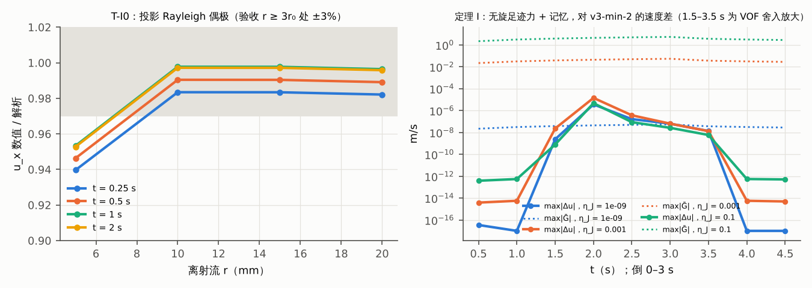
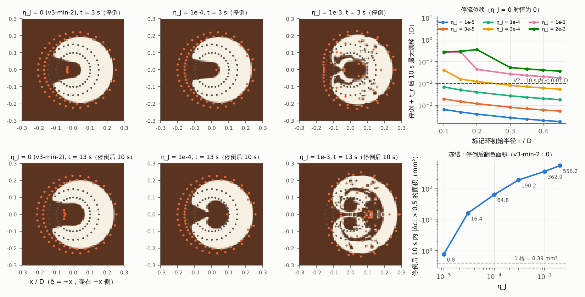
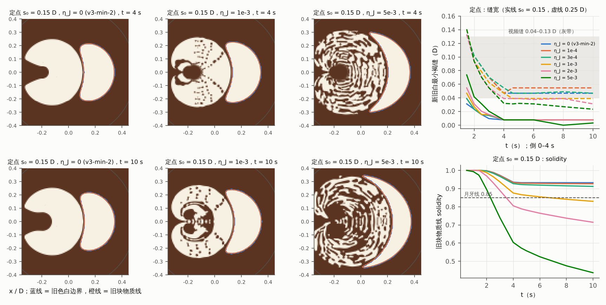
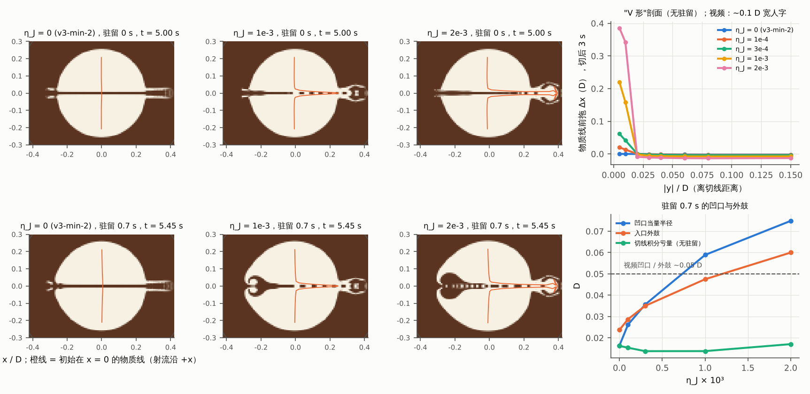
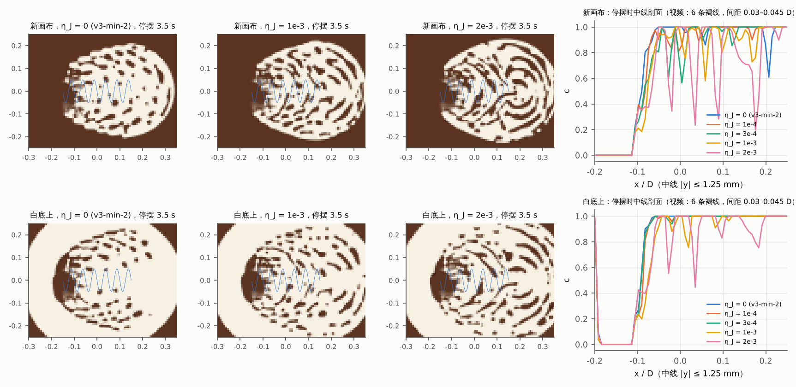
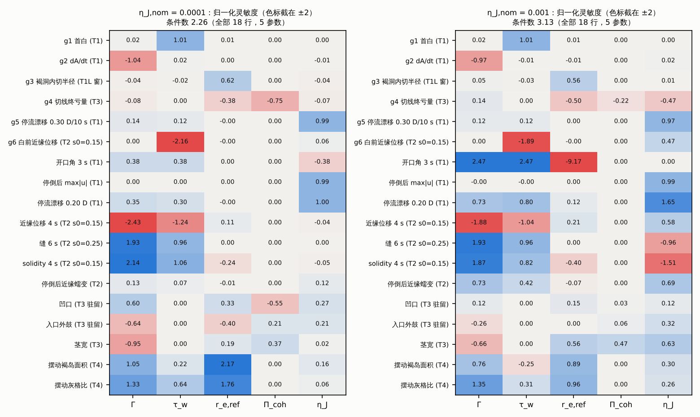

# 变体 I 原型实测：带边界层动量记忆的面积不可压漂浮层（DI.md §3 的实现与 T1–T5、可辨识性）

版本：test-I-1（2026-10-12）。被测模型：`jetpush/DI.md`（DI-1）§3 的变体 I，实现在 v3-min-2 原型的副本 `jetpush/proto_DI/` 上。

## 0. 结论先行

**实现**

- 按 DI §3 逐条实现，只改 `px_model.py`（新增 97 行，改 3 行）。
- η_J = 0 时与 v3-min-2 逐位相同。
- T-I0 通过：r ≥ 3r_0 处与解析偶极差 ≤ 1.8%。
- 冲量账在双精度下精确。
- 定理 I 的离散检验通过：无旋足迹力加任意强的 √t 记忆（Ḡ 到 5 m/s），速度差到舍入为止（≤ 2×10⁻¹³ Ḡ）。旧闭合的"活塞"在面积不可压层里不存在，这一点实测确认。

**判定**（128²，名义 Γ = 0.0395 m、τ_w = 1.4 s、r_{e,ref} = 3.72 mm、Π_coh = 300 Pa、α_j = 8°；η_J 扫 0、10⁻⁵、3×10⁻⁵、10⁻⁴、3×10⁻⁴、10⁻³、2×10⁻³，T2 另加 5×10⁻³；关键数在 192² 复现）

| 测试 | 结果 | 关键数字 |
|---|---|---|
| T1 回归（不得比 v3-min-2 差） | **✗（η_J > 10⁻⁵）** | 首白 1.425 s、dA/dt 3.7975 cm²/s、褐洞 0.0475 D 与 η_J 无关（无旋部分被 λ 吸收）。停倒后 max\|u\| = 2.67 mm/s × (η_J/10⁻⁴)，v3-min-2 为 0。停倒后 10 s 内翻色面积 0.8 / 16 / 65 / 363 mm²（η_J = 10⁻⁵ / 3×10⁻⁵ / 10⁻⁴ / 10⁻³）。C 形开口 75° → 15°，白内褐斑 0 → 15 mm²（10⁻³）。**严格冻结要求 η_J ≲ 10⁻⁵**，标记口径（0.10 D 以外 ≤ 0.01 D）要求 η_J ≲ 1.4×10⁻⁴ |
| T2 缝 | **✗（任何 η_J）** | 定点 s₀ = 0.15 D：η_J 从 0 到 5×10⁻³，4 s 缝都是 1 格（0.0078 D；192² 为 0.005–0.010 D）。s₀ = 0.25 D：0.047 D（η_J = 0），随 η_J 增大反而变窄到 0.031 / 0.023 D。移动：s₀ ≤ 0.15 D 接触，s₀ = 0.25 D 收到 1 格。视频 0.05–0.10 D |
| T2 月牙 | **✗（η_J ≤ 2×10⁻³）**；η_J = 5×10⁻³ 时形状出现，但代价全部出带 | solidity 0.935 / 0.876 / 0.805 / **0.604**（η_J = 0 / 10⁻³ / 2×10⁻³ / 5×10⁻³，s₀ = 0.15 D，4 s）。张角 100° / 100° / 110° / 130°。5×10⁻³ 时为 0.16 × 0.60 D。代价：白前就被推 0.049 D（V7 ≤ 0.01–0.03），停倒后再蠕变 0.025 D、solidity 降到 0.44，新白被撕碎，η_J 是冻结界的 500 倍 |
| T3 切 | **凹口、外鼓 ✓（η_J ≈ 10⁻³）；V 形 ✗；茎 ✗；切线 ✓（η_J ≤ 10⁻³）** | 驻留 0.7 s 时凹口 0.016 → 0.059 D（192²：0.065），外鼓 0.024 → 0.048 D（视频各约 0.05）。但"V"是半宽 0.015 D 的前拖舌，切后 3 s 内从 0.10 长到 0.22 D；视频是 0.1 D 宽人字、切后静止。出口茎 0.038 → 0.062 D。切线亏量 0.014–0.017 D、可见宽 0.0156 D |
| T4 摆动（新画布 / 白底） | **✗ / ✗** | η_J ≤ 10⁻³ 时 0 条。2×10⁻³ 时新画布 4 条（间距 0.065 D）、5 s 后 0 条；白底 1 条。停后 max\|Δc\| = 1（不冻结）。视频每周一弧，6 条，间距 0.03–0.045 D，> 10 s 不变 |
| T5 守恒、有界、锐度 | ✓ | 账本 2、3、冲量账、(∇·u − RHS)Δt 全部为 0。c ∈ [0, 1] 精确，∫c 净改变 0。界面 0.78–1.16 格 |

**可辨识性**（Γ、τ_w、r_{e,ref}、Π_coh、η_J，±20% 中心差分）

- 列归一化条件数：
  - 18 行观测：2.26（η_J,nom = 10⁻⁴）/ 3.13（10⁻³）；
  - 去掉两条量化行后：2.15 / 2.40；
  - v3-min-2 口径的 Fisher：六段 1.91 / 1.93，郁金香 + 树叶 1.70 / 1.63（v3-min-2 原值 1.56）。
- η_J 几乎正交：|cos| ≤ 0.11 / ≤ 0.40。它只由停流漂移钉住（S = 0.97–0.99）。
- 但在冻结允许的 η_J ≲ 10⁻⁵ 处，这个信号（0.30 D 环 2.8×10⁻⁴ D）低于 1 px，η_J 只剩单边上界，变体退化成 v3-min-2。
- 在 T3 需要的 10⁻³ 处，切线这条锚被 η_J 改写：Π_coh 的 sd(ln) 从 0.13 / 0.21 升到 0.53 / 0.86。
- 郁金香 + 树叶协议内部，g5（抬缸后静止）与 video_obs 的郁金香白前推移读数要求的 η_J 相差 2.5–3 个量级。

**代价**：128² 单进程每模拟秒 1.08 s（η_J = 0）→ 1.28–1.64 s（η_J = 10⁻⁴–10⁻³，+19–34%）。η_J ≥ 2×10⁻³ 时步数 ×1.3–6.7。

**学长 V1 规则**

- 与 §3.1 冲突：投影继承自 v3-min-2，又被 P G 加深。
- 与 §1.2、§4、§5.4 不新增冲突。§5.4 新增必须报告的停流位移。
- 按 §5.6，**变更申请不应提交**：它自己的回归测试（T1 冻结、T2 缝、T4 条纹）全部失败，与 DI 的预测一致。

**结论**：变体 I 不作为 v3-min-3 的主体，作为负结果记录（§12）。


---

## 1. 实现：只改了 (P) 这一行

### 1.1 改了什么

`proto_DI/` 是 `min/spec_v2/` 的整目录副本，只改了 `px_model.py`。相对 v3-min-2 的全部改动在 `proto_DI/px_model_I.diff`：新增 97 行，改动 3 行。`px_tests.py`、`v2_tests.py` 一字未动。v3-min-2 的 (P) 换成 DI §3.1 的 (I-1)–(I-4)：

```
(I-1)\quad u=\nabla\chi+\bar{\mathbf G}
(I-2)\quad \nabla_h^2\chi=\sigma_c+\sigma_f+\sigma_e-\dot e\,(1-c)-\nabla_h\cdot\bar{\mathbf G},\qquad \partial_n\chi=w_{\partial\Omega}\cdot n,\quad \bar{\mathbf G}\cdot n=0\ \text{(壁面面)}
(I-3)\quad \mathbf G(x,t)=\frac{1}{\sqrt{\pi\rho_l\mu_l}}\int_{-\infty}^{t}\frac{\mathbf f_J(x,t')}{\sqrt{t-t'}}\,dt'\ \approx\ \sum_{k=1}^{31}\mathbf G_k,\qquad \partial_t\mathbf G_k=-s_k\mathbf G_k+\frac{c_k}{\sqrt{\rho_l\mu_l}}\,\mathbf f_J
(I-4)\quad \mathbf f_J=\eta_J\,\rho_j Q\,\mathbf u_h\,K_J(x-x_j),\qquad \mathbf u_h=v\sin\alpha_j\,\hat e+\dot{\mathbf x}_j,\qquad \rho_j=(1-\phi_j)\rho_l
s_k=e^{y_k},\quad y_k=\ln 10^{-6}+0.9(k-1),\quad c_k=\frac{0.9}{\pi}e^{y_k/2}\ \ (\mathrm{s^{-1/2}})
```

- **物性与参数**：ρ_l = 1005 kg/m³，μ_l = 1.0×10⁻³ Pa·s（物性，不拟合），√(πρ_lμ_l) = 0.0562 kg m⁻² s⁻¹ᐟ²。η_J 是唯一的新参数（无量纲，缺省 0）。α_j = 8°、φ_j = 0.25、v 都沿用 v3-min-2。
- **离散**：完全按 DI §3.3。
  - G_k 存在 MAC 面上。
  - 每步沿路径细分 M 段，逐段累加面平均力 f̄。
  - Ḡ 用步内精确平均 a_k = (1 − e^{−s_kΔt})/(s_kΔt)。
  - RHS′ = RHS − div_h Ḡ，与 v3-min-2 共用同一个 LU 和钉住格。
  - u_f = ∇_fχ + Ḡ_f，Courant 数按含 Ḡ 的 u_f 计。
  - G_k 只在步被接受后更新。
- **其余一律不变**：(C)、全部源与核、L11′ 压入、打散核、在途包、ė、账本 1–3。

### 1.2 与探索版 `DI_work/px_model.py` 的差别（都不改方程）

1. **删去单模 τ 选项**（`mem_tau/mem_zeta`）。它只是 DI §5.2 的敏感性对照，不属于本变体。
2. **只在"历史足迹包围盒"内存取和更新 G_k。** G 是 f_J 在每个点上的时间卷积，所以在空间上不扩散：盒外 G ≡ 0。这样做是精确的。
3. **K_J 只在射流周围的窗口内计算。** K_J 在 3r_0 处截断。与全网格计算逐面相差 ≤ 1.7×10⁻¹⁶，Σ K_J h² = 1.000（4 个位置，含贴壁）。
4. **新增第二本冲量账**：用面上的 Σ f̄ h² Δt 记账，与规定冲量 η_Jρ_jQu_hΔt 逐步对账。

### 1.3 核求积与零参数回归

- **核求积**：1/√(πt) 的 31 模指数和在 [1 ms, 30 s] 上的相对误差 ≤ 0.49%。其积分 2√(t/π) 的误差在 t ≥ 5 ms 时 ≤ 0.86%，t ≥ 1 ms 时 ≤ 1.9%（与 DI §3.2 一致）。
- **η_J = 0 时逐位等同 v3-min-2**（`bitcheck.py`，两份代码各跑一次 T1 与 T4）：
  - 3 s、6 s 的 c 场和 T4 末态 c 场 `np.array_equal = True`；
  - 首白 1.42533 s、dA/dt 3.79747 cm²/s、褐洞 0.0475 D 完全相同。
  - 原因：η_J = 0 时记忆分支根本不进入。所以下文 η_J = 0 一列就是 v3-min-2 本身。

## 2. 先于图案的单元测试

### 2.1 T-I0：投影 Rayleigh 偶极 vs 解析式

设定：杯心定点倒奶，ê = +x。关掉面积源（Γ = 10⁹ m、α_F = 10⁻⁹、L11′ 关）。η_J = 10⁻³，F = η_Jρ_jQ v sinα_j = 1.016×10⁻⁶ N。比较轴上 u_x 与解析式

```
u_x(r,t)=\frac{F}{2\pi r^2}\cdot\frac{2\sqrt t}{\sqrt{\pi\rho_l\mu_l}}\Big(1-\frac{r^2}{R^2}\Big)
```

| r (mm) | t = 0.25 s | 0.5 s | 1 s | 2 s |
|---|---|---|---|---|
| 5（< 3r_0 = 8.2 mm，足迹有限） | 0.940 | 0.946 | 0.953 | 0.953 |
| 10 | 0.983 | 0.990 | 0.998 | 0.997 |
| 15 | 0.983 | 0.990 | 0.998 | 0.997 |
| 20 | 0.982 | 0.989 | 0.996 | 0.996 |

（表中为数值 / 解析之比；例如 t = 1 s、r = 10 mm 处为 1.702 对 1.706 mm/s。）

- **验收（r ≥ 3r_0 处 ±3%）通过**。t = 0.25 s 的 1.7% 偏低来自核积分在小 t 的求积误差与足迹有限宽。
- **冲量账**：2 s 内规定冲量 2.031738×10⁻⁶ N·s，面上累计也是 2.031738×10⁻⁶ N·s。η_J > 0 的全部运行（128² 49 个，192² 11 个）中，冲量账相对误差都是 0（双精度下相等）。

### 2.2 定理 I 的离散检验

**做法**：把足迹核换成杯内 MAC 离散梯度 ∇_hψ，ψ 为半径 3r_0 的高斯包。出流方向取对角，使 F_x = F_y，于是 f = F∇_hψ 严格无旋。打开记忆后与 η_J = 0（v3-min-2）逐时刻比较：倒 0–3 s，到 4.5 s（`DI_tests.unit_I1`）。

| η_J | max\|Ḡ\| (m/s) | 出白前（0.5、1.0 s）max\|Δu\| | 停倒后（4.0、4.5 s）max\|Δu\| | 白期（1.5–3.5 s）max\|Δu\| | max\|Δc\| / Σ\|Δc\|dA |
|---|---|---|---|---|---|
| 10⁻⁹ | 2×10⁻⁸–5×10⁻⁸ | 3×10⁻¹⁷、2×10⁻¹⁸ | 5×10⁻²¹ | 2×10⁻⁹–3.6×10⁻⁶ | 0.004 / 0.014 mm² |
| 10⁻³ | 0.02–0.05 | 4×10⁻¹⁵、6×10⁻¹⁵ | 5×10⁻¹⁵ | 2×10⁻⁸–1.4×10⁻⁵ | 0.007 / 0.013 mm² |
| 10⁻¹ | 2.2–5.4 | 4×10⁻¹³、5×10⁻¹³ | 5×10⁻¹³ | 8×10⁻¹⁰–4.7×10⁻⁶ | 0.002 / 0.010 mm² |

**出白前与停倒后**：Δu 为 10⁻²¹–5×10⁻¹³ m/s，即不超过 Ḡ 的 2×10⁻¹³ 或流速的 10⁻¹⁴，到舍入为止。

- 一个任意大的无旋力加上 √t 记忆，不改变漂浮层速度：η_J = 0.1 时 Ḡ 达 5 m/s，是真实流速（2–50 mm/s）的 100–2500 倍，仍然如此。
- 停倒后 max|u| 在两边都严格为 0：引理 F 在边界层记忆下成立。这就是定理 I 的 (a)、(b)。

**白期（1.5–3.5 s）的 Δu ~10⁻⁶ m/s 不是物理**，有三条证据：

- 它与 Ḡ 的大小无关：Ḡ 跨 8 个量级，Δu 都是 10⁻⁶–10⁻⁵。
- 它只在有筏界面时出现。
- c 的差别只是零星界面格：最大 0.002–0.007，面积合计 0.010–0.014 mm²，对 6.08 cm² 的白为 2×10⁻⁵。

这是 VOF 的阈值分支（c > 0.5 指示函数、有界性重分配选带）把 10⁻¹⁶ 的舍入差放大。两次运行步数相同（335 对 335）。

**推论**：变体 I 里只有 f_J 的旋度起作用。旧闭合的"活塞"在这个面积不可压层里不存在（DI §1.2 (c)），实测证实。



### 2.3 零参数回归

η_J = 0 时逐位等同 v3-min-2（§1.3）。

---

## 3. T1 回归：单次低位倒奶 3 s、停倒

设定：杯心，Q = 15 mL/s，z_s = 1.5 cm，ê = +x。倒 0–3 s，观察到 13 s，比 v3-min-2 的 T1 多看 7 s，用来测停流位移。标记环 r = 0.10–0.45 D，各 32 点。t_s + t_r = 3.576 s。

| 量 | η_J = 0（= v3-min-2） | 10⁻⁵ | 3×10⁻⁵ | 10⁻⁴ | 3×10⁻⁴ | 10⁻³ | 2×10⁻³ | 视频 / 判据 |
|---|---|---|---|---|---|---|---|---|
| 首白（可见，s） | 1.425 | 1.425 | 1.425 | 1.425 | 1.425 | 1.426 | 1.425 | 锚（τ_w） |
| dA_r/dt（cm²/s） | 3.7975 | 3.7975 | 3.7975 | 3.7975 | 3.7975 | 3.7975 | 3.7975 | = wQ/Γ（精确） |
| 褐洞 ray 中位半径 3 s（D） | 0.0475 | 0.0475 | 0.0475 | 0.0475 | 0.0538 | 0.0513 | 0.080 | 0.025–0.06 |
| 褐洞内切半径（2.4–2.9 s 均值，D） | 0.0506 | 0.0504 | 0.0500 | 0.0488 | 0.0469 | 0.0577 | 0.0613 | 同上 |
| 首白环内径 τ_w + 0.1 s（mm） | 5.4 | — | — | 5.5 | 5.7 | 6.2 | 6.5 | — |
| C 形开口 2 s / 3 s | 105° / 75° | — / 65° | — / 65° | 95° / 65° | 85° / 35° | 45° / 15° | 45° / 25° | "半环"，越宽越好 |
| 白内封闭褐斑 3 s | 0 | 0 | 0 | 0 | 0 | 19 个，15.2 mm² | 25 个，42.2 mm² | < 2 mm² |
| 0.30 D 处出白前位移（D） | 0.0028 | 0.0028 | 0.0029 | 0.0031 | 0.0037 | 0.0068 | 0.0125 | ≤ 0.03 |
| 0.15 D 处出白前位移（D） | 0.0082 | 0.0083 | 0.0087 | 0.0100 | 0.0137 | 0.029 | 0.064 | ≤ 0.01–0.03 |
| 0.30 D 处 6 s 位移（D） | 0.041 | 0.041 | 0.041 | 0.041 | 0.042 | 0.058 | 0.085 | 远端几乎不动 |
| 停倒 + t_r 后 max\|u\|（mm/s） | **0** | 0.27 | 0.80 | 2.67 | 8.0 | 26.7 | 53.4 | 0 |
| 13 s 时 max\|u\|（mm/s） | 0 | — | — | 1.05 | 3.2 | 10.5 | 21.1 | 0 |
| 停倒后 10 s 内 \|Δc\| > 0.5 的面积（mm²） | **0** | 0.8 | 16.4 | 64.8 | 190 | 363 | 556 | 0（V2） |
| 发生改变的最远格离射流（D） | — | 0.069 | 0.112 | 0.121 | 0.246 | 0.273 | 0.304 | — |
| 停倒后 10 s 标记漂移，最大（D；不计停倒时已在 7.5 mm 内、即被吞汇吞下的标记） | 0 | 6.5×10⁻⁴ | 0.0020 | 0.0070 | 0.042 | 0.282 | 0.356 | ≤ 0.01（V2） |
| 同上，r = 0.30 D 环 | 0 | 2.8×10⁻⁴ | 8.2×10⁻⁴ | 0.0028 | 0.0083 | 0.028 | 0.054 | ≤ 0.01 |
| 停倒后筏面积变化（cm²） | 0 | 0 | 0 | 0 | 0 | 0 | 0 | 构造 |
| 界面宽（格，3 s / 13 s） | 0.82 / 0.99 | — | — | 0.95 / 0.95 | 0.89 / 0.94 | 1.16 / 1.00 | 1.16 / 0.98 | ≤ 2 |

**这些行与 η_J 无关，严格不变**：首白、dA/dt、停倒后筏面积。原因是无旋部分被 λ 吸收，而 ∇·u 不变，所以面积账不变（定理 I）。

**判定（"不得比 v3-min-2 差"）：η_J > 0 时 T1 一律变差，没有可用的窗口。**

1. **冻结失败。** 停倒后 max|u| ∝ η_J：2.67 mm/s × (η_J/10⁻⁴)，13 s 时仍有 40%。漂移与 DI §1.4 的蠕变律一致。
   - **严格 V2**（10 s 内图案无可见变化）：要求 η_J ≲ 1×10⁻⁵。η_J = 10⁻⁵ 时只有褐洞边上 2 格（0.8 mm²）翻色；3×10⁻⁵ 时 16 mm²；10⁻⁴ 时 65 mm²，C 形开口在停倒后合拢成心形（`Iinertia_T1.png`）。
   - **标记口径**（0.10 D 以外 ≤ 0.01 D）：要求 η_J ≲ 1.4×10⁻⁴。
   - 两条界相差约 14 倍，原因是偶极 ∝ r⁻²，最先动的是落点褐洞边（r ≈ r_e）。
   - 平均漂移指向 −x（壶侧），即圆盘镜像给出的回流 −F/(2πR²)。
2. **C 形开口在 η_J ≥ 3×10⁻⁴ 变窄**：75° → 35° → 15°。视频是"半环"，v3-min-2 已经偏窄，这里更窄。
3. **白内出现褐斑**（η_J ≥ 10⁻³）：偶极把射流后方的褐经射流脚卷进白里。
4. **白前位移**（0.15 D 处）在 η_J = 10⁻³ 时 0.029 D，到了重测上界 0.03 D；2×10⁻³ 时 0.064 D，超出。

**结论**：T1 在 η_J ≤ 10⁻⁵ 时与 v3-min-2 无可测差别；η_J 再大，冻结就先坏。



---

## 4. T2 推挤（旧块 0.33 D 圆盘，第二笔低位倒奶）

**设定**

- 旧块圆心 x = 0.12 D，半径 0.165 D。射流起点在其后缘之后 s₀ = 0.10 / 0.15 / 0.25 D。
- "移动"：1.5 s 内沿 +x 前进 0.1 D，之后不动。"定点"：射流不动。
- 倒 0–4 s，观察到 10 s。
- 近缘、远缘：旧块物质线（720 点）与轴的交点位移，+ 为朝前（远离壶）。
- 缝：新白与旧色白之间的最小距离减 1 格（128² 下量化单位 0.0078 D = 1 格）。
- 月牙判据：物质线 solidity < 0.85，**且**从新白质心看旧块的张角 ≥ 120°。120° 的来历：视频 0.5 D 长的月牙绕在半径约 0.2 D 的新白外，对应 ≈ 140°。
- 轴向厚度 = 0.33 D + 远缘 − 近缘。

### 4.1 定点射流（最干净的判别）

| s₀ | η_J | 近缘 1.4 s（白前） | 近缘 1 / 2 / 4 s | 远缘 4 s | 缝 2 / 4 / 6 / 10 s | solidity 4 s → 10 s | 张角 4 s | 4 s 轴向厚 × 横跨 | 停倒后近缘蠕变 4.6 → 10 s |
|---|---|---|---|---|---|---|---|---|---|
| 0.10 | 0 | −0.014 | −0.014 / −0.040 / −0.192 | 0.060 | 0 / 0 / 0 / 0（接触） | 0.775 → 0.771（物质线被吞汇吸入，不作判据） | 130° | — | 0 |
| 0.10 | 10⁻³ | +0.021 | +0.009 / +0.087 / +0.211 | 0.062 | 0.008 / 0 / 0 / 0 | 0.664 → 0.591 | 140° | — | +0.011 |
| 0.10 | 5×10⁻³ | +0.081 | +0.057 / +0.146 / +0.285 | 0.087 | 0.027 / 0.003 / 0 / 0 | 0.303 → 0.210 | 210° | — | +0.027 |
| **0.15** | **0** | −0.009 | −0.009 / 0.043 / 0.159 | 0.057 | 0.023 / **0.0078** / 0.0078 / 0.0078 | 0.935 → 0.932 | 100° | 0.23 × 0.43 | 0 |
| 0.15 | 10⁻⁴ | −0.008 | −0.008 / 0.045 / 0.157 | 0.055 | 0.023 / 0.0078 / 0.0078 / 0.0078 | 0.933 → 0.926 | 90° | 0.23 × 0.43 | +0.001 |
| 0.15 | 3×10⁻⁴ | −0.004 | −0.006 / 0.048 / 0.155 | 0.053 | 0.023 / 0.0078 / 0.0078 / 0.0078 | 0.927 → 0.912 | 90° | 0.23 × 0.43 | +0.004 |
| 0.15 | 10⁻³ | +0.007 | +0.001 / 0.059 / 0.176 | 0.059 | 0.027 / 0.0078 / 0.0078 / 0.0078 | 0.876 → 0.830 | 100° | 0.21 × 0.45 | +0.010 |
| 0.15 | 2×10⁻³ | +0.020 | +0.009 / 0.074 / 0.197 | 0.064 | 0.031 / 0.0078 / 0.0078 / 0.0078 | 0.805 → 0.715 | 110° | 0.20 × 0.49 | +0.016 |
| 0.15 | 5×10⁻³ | +0.049 | +0.031 / 0.108 / 0.247 | 0.081 | 0.042 / 0.0078 / 0.0078 / 0.0032 | **0.604** → 0.437 | **130°** | 0.16 × 0.60 | +0.025 |
| 0.25 | 0 | −0.006 | −0.006 / 0.026 / 0.118 | 0.052 | 0.102 / 0.047 / 0.047 / 0.047 | 1.00 → 1.00 | 70° | 0.26 × 0.39 | 0 |
| 0.25 | 10⁻³ | −0.001 | −0.003 / 0.032 / 0.130 | 0.055 | 0.094 / 0.047 / 0.039 / 0.039 | 0.996 → 0.990 | 70° | 0.25 × 0.40 | +0.006 |
| 0.25 | 2×10⁻³ | +0.003 | −0.001 / 0.039 / 0.145 | 0.059 | 0.094 / 0.039 / 0.038 / 0.031 | 0.987 → 0.968 | 70° | 0.24 × 0.42 | +0.010 |
| 0.25 | 5×10⁻³ | +0.015 | +0.007 / 0.058 / 0.185 | 0.074 | 0.094 / 0.032 / 0.031 / 0.023 | 0.941 → 0.871 | 80° | 0.22 × 0.46 | +0.018 |

（s₀ = 0.10 与 0.25 D 的 10⁻⁴、3×10⁻⁴ 行与相邻行同趋势，见 `proto_DI/out/tables_128.txt`。）

### 4.2 移动射流（0.1 D / 1.5 s）

| s₀ | η_J | 近缘 1.4 s | 缝 2 / 4 / 6 s | 物质线 solidity 4 s | 旧色 solidity 4 s | 物质线面积比 4 s |
|---|---|---|---|---|---|---|
| 0.10 | 0 / 10⁻⁴ / 3×10⁻⁴ / 10⁻³ / 2×10⁻³ | −0.010 / +0.004 / +0.022 / +0.041 / +0.071 | 全部 0 / 0 / 0（出白即接触） | 1.00 / 0.99 / 0.97 / 0.73 / 0.35 | 0.37 / 0.36 / 0.36 / 0.32 / 0.29 | 3.10 / 3.05 / 2.92 / 2.27 / 1.22 |
| 0.15 | 同上 | −0.023 / −0.019 / −0.010 / +0.014 / +0.036 | 全部 0 / 0 / 0（接触） | 1.00 / 1.00 / 0.96 / 0.58 / 0.38 | 0.59 / 0.58 / 0.57 / 0.52 / 0.42 | 2.79 / 2.71 / 2.29 / 1.58 / 1.02 |
| 0.25 | 同上 | −0.009 / −0.008 / −0.006 / −0.001 / +0.007 | 2 s：0.023–0.031；4 / 6 s：**0.0078** / 0.0078（五个 η_J 全同） | 0.94 / 0.94 / 0.93 / 0.90 / 0.85 | 0.97 / 0.98 / 0.97 / 0.93 / 0.89 | 1.00 |

**为什么 s₀ = 0.10、0.15 D 的移动情形不作月牙判据**：

- 射流在出白时（1.4–1.5 s）已到旧块后缘约 0.00 / 0.05 D 处，接触后 L11′ 把旧筏压入并在供给环重浮。旧色因此绕射流成 C：η_J = 0 时旧色 solidity 已是 0.37 / 0.59。
- 物质线穿过吞汇与供给环，面积比 2.8–3.1。
- 所以这两列反映 v3-min-2 的 L11′，不反映本变体的力。DI §5.2 的说法得到复现。

### 4.3 判定

- **缝：全部失败。**
  - s₀ = 0.15 D 定点：η_J 从 0 到 5×10⁻³（跨 2.7 个量级），4 s 时缝都收到 1 格（0.0078 D）；5×10⁻³ 时 10 s 进一步到 0.003 D。视频 0.05–0.10 D。
  - s₀ = 0.25 D：η_J = 0 时冻结在 0.047 D（数值落带，但机制是 v3-min-2 的运动学变薄）。η_J 增大时缝**更窄**：0.039（10⁻³）→ 0.031（2×10⁻³）→ 0.023 D（5×10⁻³，10 s）。
  - 移动：s₀ ≤ 0.15 D 接触；s₀ = 0.25 D 时 4 s 收到 1 格，与 η_J 无关。
  - 这正是 DI §1.4 的结构性结论：前向偶极在射流前方沿轴压缩（∂_xu_x = −2u_x/x < 0），只会让缝更快变窄；没有任何项能保缝。
- **月牙：只在 η_J ≈ 5×10⁻³ 出现**（s₀ = 0.15 D 定点）。
  - 4 s 时 solidity 0.60、张角 130°、轴向厚 0.16 D × 横跨 0.60 D，形状接近视频的 0.10 × 0.5 D（`Iinertia_T2.png` 第三列）。
  - η_J = 2×10⁻³：solidity 0.805 但张角 110°，只是趋势；η_J ≤ 10⁻³：solidity ≥ 0.876，无月牙。
  - 代价全部出带：
    - 白前近缘被推 +0.049 D，重测 V7 ≤ 0.01–0.03 D，且月牙应在接触后才形成；
    - 停倒后近缘继续蠕变 +0.025 D，10 s 后 solidity 再降到 0.44，视频冻结；
    - 新白被偶极撕成褐白相间的乱纹（图第三列左半），视频新白是实心的；
    - 该 η_J 比严格冻结界（10⁻⁵）大 500 倍。
  - 月牙在本变体中是"白前就被推着变形"，形成时序与重测 V7 相反（V7：白前几乎不动，接触后 0.3–0.8 s 成月牙）。
- **旧块位移**：近缘 4 s 位移 0.16–0.25 D（视频 0.05–0.15 D 中心位移，相容到偏大）。远缘 0.05–0.09 D。



---

## 5. T3 切（高位细流 3 mL/s、1.2 m/s，0.4 D/s 穿过 0.5 D 白盘；闸门已开）

**定义**

- 凹口：入口点 8 mm 内原白盘中的褐面积减去切线贡献，折成半圆当量半径。
- 外鼓：入口两侧 ±40° 内（除去切线半宽区）白边界的最大外移。
- 切线宽：积分亏量 ∫(1 − c)dn，四个站点平均，以及 c < 0.5 的可见宽。
- V 形：初始在 x = 0、跨过切线的物质线（161 点，|y| ≤ 0.2 D）的前拖 Δx(|y|)。半宽是 Δx 降到 |y| = 0.005 D 处一半的距离。

| 驻留 | η_J | 凹口当量半径 | 入口外鼓 | 出口外鼓 | 切线终亏量 / 可见宽 | 入口 / 出口茎宽 | V：Δx 在 \|y\| = 0.005 / 0.02 / 0.04 D（切后 3 s） | V 半宽 |
|---|---|---|---|---|---|---|---|---|
| 0 | 0 | 0.007 | 0.009 | 0.008 | 0.0162 / 0.0156 | 0.011 / 0.038 | 0.000 / 0.000 / −0.001 | 无 |
| 0 | 10⁻⁴ | 0.008 | 0.010 | 0.005 | 0.0154 / 0.0156 | 0.011 / 0.038 | 0.020 / 0.000 / −0.002 | 0.015 |
| 0 | 3×10⁻⁴ | 0.016 | 0.011 | 0.005 | 0.0138 / 0.0156 | 0.011 / 0.041 | 0.061 / 0.000 / −0.003 | 0.015 |
| 0 | 10⁻³ | 0.026 | 0.019 | 0.003 | 0.0138 / 0.0156 | 0.011 / 0.063 | **0.22** / −0.001 / −0.007 | 0.015 |
| 0 | 2×10⁻³ | 0.026 | 0.029 | **0.133** | 0.0171 / 0.0156 | 0.017 / 0.120 | 0.39 / −0.009 / −0.012 | 0.015 |
| 0.7 s | 0 | **0.016** | 0.024 | 0.010 | 0.0162 / 0.0156 | 0.013 / 0.038 | 0.006 / 0.006 / 0.005（整体平移，非 V） | — |
| 0.7 s | 10⁻⁴ | 0.026 | 0.029 | 0.009 | 0.0155 / 0.0156 | 0.017 / 0.038 | 0.026 / 0.006 / 0.005 | 0.018 |
| 0.7 s | 3×10⁻⁴ | 0.036 | 0.035 | 0.008 | 0.0144 / 0.0156 | 0.021 / 0.042 | 0.067 / 0.006 / 0.004 | 0.015 |
| 0.7 s | 10⁻³ | **0.059** | **0.048** | 0.005 | 0.0170 / 0.0156 | 0.034 / 0.062 | 0.22 / 0.003 / 0.000 | 0.015 |
| 0.7 s | 2×10⁻³ | 0.075 | 0.060 | 0.098 | 0.0258 / 0.0312 | 0.039 / 0.116 | 0.38 / 0.002 / −0.002 | 0.013 |
| 视频 | | ~0.05 | ~0.05 | — | ≤ 0.01–0.02 | 0.01–0.02 | 人字 V，横跨 ~0.1 D，切后静止 | ~0.05 |

**判定**

- **凹口与入口外鼓**：在 η_J ≈ 10⁻³（驻留 0.7 s）时落进视频带，分别为 0.059 / 0.048 D，v3-min-2 为 0.016 / 0.024 D。这是本变体唯一的正面结果，与 DI §5.3 一致（DI 估 η_J ≈ 8×10⁻⁴）。
- **同一 η_J 下的代价**：
  - 出口茎宽 0.038 → 0.062 D（×1.6），入口茎 0.013 → 0.034 D（×2.7），出带（0.01–0.02 D）。2×10⁻³ 时白被拖出杯沿 0.10–0.13 D。
  - **没有 V 形**：前拖只在 |y| < 0.015 D 内（半宽 0.013–0.018 D，约 2r_0 + 2 格），是一条 0.03 D 宽的前拖舌，不是横跨 0.1 D 的人字。
  - 舌在切后 3 s 内还长一倍：切末 0.10 → 切后 3 s 0.22 D（η_J = 10⁻³，无驻留），按 √t 记忆增长。视频切后静止。
  - 该 η_J 是严格冻结界的 100 倍（T1 停倒后 363 mm² 翻色）。
- **切线本身**：亏量 0.014–0.017 D，可见宽 0.0156 D（= 2 格），不愈合。η_J ≤ 10⁻³ 时不变坏；2×10⁻³ 驻留时 0.026 / 0.031 D，出带。



---

## 6. T4 摆动（低位，4 mm × 3 Hz，同时以 0.15 D/s 后退 2 s；预倒 1.5 s，停后观察 5 s）

- **白底情形**：先放一块圆心在杯心、半径 0.25 D 的旧白，路径全在白内。
- **条纹计数**：沿中线 |y| ≤ 1.25 mm 的 c 剖面，深度 > 0.5 且突出度 > 0.2 的褐极小。视频：6 周 → 6 条弧，间距 0.03–0.045 D，褐线 0.01–0.02 D，> 10 s 不变。

| 底 | η_J | 停摆时条纹数 | 间距（D） | 褐线亏量（D） | 停后 5 s 条纹数 | 封闭褐岛 | 灰格占白 | 停后 1–5 s max\|Δc\| |
|---|---|---|---|---|---|---|---|---|
| 新画布 | 0 | 0 | — | — | 0 | 34 个，137 mm² | 0.37 | 0 |
| 新画布 | 10⁻⁴ | 0 | — | — | 0 | 34，149 | 0.38 | 1 |
| 新画布 | 3×10⁻⁴ | 0 | — | — | 0 | 42，161 | 0.42 | 1 |
| 新画布 | 10⁻³ | 0 | — | — | 0 | 44，220 | 0.54 | 1 |
| 新画布 | 2×10⁻³ | 4 | 0.065 | 0.014 | **0** | 39，279 | 0.63 | 1 |
| 白底 | 0 | 0 | — | — | 0 | 43，239 | 0.17 | 0 |
| 白底 | 10⁻⁴ | 0 | — | — | 0 | 55，252 | 0.17 | 0.96 |
| 白底 | 3×10⁻⁴ | 0 | — | — | 0 | 62，266 | 0.19 | 1 |
| 白底 | 10⁻³ | 0 | — | — | 1 | 73，326 | 0.23 | 1 |
| 白底 | 2×10⁻³ | 1 | — | 0.006 | 1 | 72，402 | 0.28 | 1 |

**判定：失败，两种底都失败。**

- η_J ≤ 10⁻³ 时 0 条。2×10⁻³ 时新画布上 4 条，间距 0.065 D（约 2 周一条），5 s 后全部消失（停后 max|Δc| = 1，不冻结）。
- 褐岛随 η_J 增多、拉长成横向条带（`Iinertia_T4.png` 右列），但不按周期排列。
- 原因（DI §1.4）：
  - 横向振荡动量 0.85 mN 被 Rayleigh 核低通。η_J = 10⁻³ 时 4 mm 处振荡位移幅 0.10 mm，远小于间距 2.4–3.4 mm。
  - 定常部分（倾角 + 后退）像 T2 一样把射流后方的褐经射流脚卷进白里，于是褐岛增多。
  - 变体 I 不提供画布来源，弧间褐线只能来自 v3-min-2 已有的 σ_e 与 L11′ 的移动褐洞。
- **白底上的褐岛**来自 L11′ 移动褐洞的尾迹（v3-min-2 T1b 的已知失败），η_J = 0 时已有 239 mm²。


- **白底情形有界性修正大**：该情形有界性修正前 c* 最大 2.22，重分配搬动 0.044 cm²，占白面积 20.6 cm² 的 0.2%。这是 v3-min-2 在白上倒奶时供给与重浮落在满格上的性质，η_J = 0 时完全相同，不是本变体引入的。

---

## 7. T5 守恒、有界、锐度（128²，全部 60 个运行）

| 检查 | 结果 |
|---|---|
| 账本 2（奶泡体积）相对误差 | 0（全部运行，双精度下相等；192² 的 22 个运行同样） |
| 账本 3（液面：在途 + 重生 + 筏下回流） | 0 cm² |
| 冲量账（规定 vs 面上累计） | 相对误差 0（η_J > 0 的 49 个运行；192² 另 11 个） |
| (∇·u − RHS_v3min)Δt | 0（Ḡ 的散度被 χ 精确抵消，离散散度与 v3-min-2 相同） |
| 有界性 | 修正后 c ∈ [0, 1] 精确，硬裁剪净量 0 cm²。修正前 c* ∈ [−0.0067, 1.0072]。重分配搬动 ≤ 3.2×10⁻⁴ cm²/运行。白底 T4 除外：修正前 c* 到 2.22（192²：3.3 / −0.71），搬动 0.044 cm²（192²：0.079）；η_J = 0 时完全相同，是 v3-min-2 的性质 |
| ∫c 净改变（重分配） | 0（构造：带号净量放回） |
| 界面宽（混合格数 / 界面长，格） | 0.78–1.16，全部 ≤ 2 |
| 停倒后筏面积变化 | 0（T1 全部 η_J） |

T5 通过。本变体不破坏任何账本，也不新增数值耗散。它的失败全部是物理上的。


## 8. 192² 复核（η_J = 0 与 10⁻³；`proto_DI/compare192.py`，日志 `out/log_scan_192.txt`）

格式：128² → 192²。

| 量 | η_J = 0 | η_J = 10⁻³ |
|---|---|---|
| T1 首白 / dA_r/dt | 1.425 → 1.427 s / 3.7975 → 3.7975 | 1.426 → 1.421 s / 3.7975 → 3.7975 |
| T1 褐洞 ray 3 s / 内切 | 0.0475 → 0.0475 / 0.0506 → 0.0513 D | 0.0513 → 0.0513 / 0.0577 → 0.0571 D |
| T1 开口 3 s / 白内褐斑 | 75° → 75° / 0 → 0 | 15° → 5° / 15.2 → 41.5 mm² |
| T1 停倒后 max\|u\| / 0.30 D 停流漂移 | 0 → 0 / 0 → 0 | 26.7 → 27.1 mm/s / 0.0275 → 0.0275 D |
| T2 定点 s₀ = 0.15：缝 2 / 4 / 6 s | 0.023 / 0.0078 / 0.0078 → 0.021 / **0.0052** / 0.0052 D（都是 1 格） | 0.027 / 0.0078 / 0.0078 → 0.026 / 0.010 / **0.0064** D（1–2 格） |
| T2 定点 s₀ = 0.15：solidity 4 s / 近缘 4 s | 0.935 → 0.935 / 0.159 → 0.159 | 0.876 → 0.876 / 0.176 → 0.176 |
| T2 定点 s₀ = 0.25：缝 6 s | 0.047 → 0.047 | 0.039 → 0.042 |
| T2 移动 s₀ = 0.25：缝 4 / 6 s | 0.0078 / 0.0078 → 0.0064 / 0.0052 | 0.0078 / 0.0078 → 0.0095 / 0.0095 |
| T3 驻留：凹口 / 入口外鼓 | 0.016 → 0.014 / 0.024 → 0.025 D | 0.059 → **0.065** / 0.048 → 0.049 D |
| T3 驻留：出口外鼓 | 0.010 → 0.009 | 0.005 → **0.086** D（白在 192² 下被拖出出口） |
| T3 无驻留：切线终亏量 / 可见宽 | 0.0162 → 0.0156 / 0.0156 → 0.0156 D | 0.0138 → 0.0126 / 0.0156 → 0.0130 D |
| T3 驻留：切线终亏量 | 0.0162 → 0.0156 | 0.0170 → **0.0092**（未收敛） |
| T3 V：Δx(\|y\| = 0.005 D，切后 3 s) / 半宽 | ≈0 / — | 0.22 → 0.23 D / 0.015 → 0.015 D |
| T4 新画布：条纹（停摆 / 停后 5 s） | 0 / 0 → 1 / 0 | 0 / 0 → 0 / 1 |
| T4 褐岛面积 / 灰格占白 | 137 → 144 mm² / 0.37 → 0.32 | 220 → 234 mm² / 0.53 → 0.46 |
| T4 白底：条纹（停摆 / 停后 5 s） | 0 / 0 → 0 / 0 | 0 / 1 → 0 / 2 |

**结论**：所有判定在 192² 下不变。

- 缝在两种网格上都是 1–2 格，即在网格尺度上闭合；按 0.0078 → 0.0052 D 跟着网格缩小。
- 冻结失败、停流漂移、月牙趋势（solidity）、凹口与外鼓、前拖舌的宽度与长度，复现到 ≤ 10%。
- 不收敛的有四项，都在 η_J = 10⁻³，都朝更坏的方向：
  - 白内褐斑 15 → 41 mm²；
  - 3 s 开口角 15° → 5°；
  - 驻留切线亏量 0.017 → 0.009 D；
  - 出口外鼓 0.005 → 0.086 D。
  - 后两项说明前拖舌改写切线、把白拖出出口，而 g4 正是 Π_coh 的锚。
- 褐岛个数随网格变（34 → 75），面积不变。所以 T4 只用面积与条纹数判定。


---

## 9. 可辨识性（五个拟合参数 Γ、τ_w、r_{e,ref}、Π_coh、η_J）

**做法**（`proto_DI/sens/sens_I.py`、`analyze_I.py`，128²，结果在 `sens/sensI_0.0001_0.001.json`、`analysisI_*.json`）

- 每个参数取 ±20% 中心差分。r_{e,ref} 沿用 v3-min-2 `sens2.py` 的取法：δ_e ±20%，即 r_{e,ref} ±5.4%，按 ln r_{e,ref} 换算。直接取 r_{e,ref} −20% 会落到 r_c 以下，排除区改由 r_c 决定，导数不光滑。
- 名义点取两个：
  - η_J,nom = 10⁻⁴：标记口径的冻结界附近；
  - η_J,nom = 10⁻³：T3 凹口落带处。
  - η_J = 0 处 ±20% 没有意义。
- 每个参数点跑一整套观测：T1（到 13 s）、T1L 窗的褐洞、T2 定点 s₀ = 0.15 / 0.25 D、T3 无驻留与驻留、T4 新画布。共 22 套，943 s 墙钟（4 进程，与别的会话共享 CPU）。
- 归一化：正值观测量用 S = ∂ln O/∂ln θ。带号位移用 (∂O/∂ln θ)/s，s 为视频容差：白前位移 0.03 D、4 s 近缘 0.05 D、缝 0.02 D、solidity 0.05、蠕变 0.01 D。

**新观测量**（专门钉 η_J）

- **g5 停流漂移**：停倒 + t_r 后 10 s、r = 0.30 D 标记环的最大漂移。这就是学长 §5.4 的"停流位移"。视频里郁金香 6.5、12.4、15.3 s 与树叶 8.9、11.6 s 抬缸后各一窗，共 5 个。
- **g6 白前近缘位移**：郁金香第 2 段 6.6–8.5 s。

### 9.1 归一化灵敏度矩阵（节选；全表与色图见 `Iinertia_sens.png`）

前四列取 η_J,nom = 10⁻⁴ 的值，g4 的 Π_coh 一格并列 10⁻³ 的值。η_J,nom = 10⁻³ 时其余格的差别 ≤ 0.5（凹口的 Γ、Π_coh 两格差别最大），全表见色图。

| 观测量 | Γ | τ_w | r_{e,ref} | Π_coh | η_J（10⁻⁴ / 10⁻³） | 名义值（10⁻⁴ / 10⁻³） |
|---|---|---|---|---|---|---|
| g1 首白 | 0.02 | **1.01** | 0.01 | 0 | 0.00 / 0.00 | 1.425 / 1.426 s |
| g2 dA/dt | **−1.04** | 0.02 | 0.00 | 0 | −0.01 / 0.02 | 3.79 / 3.80 cm²/s |
| g3 褐洞内切半径 | −0.04 | −0.02 | **0.62** | 0 | −0.04 / 0.01 | 0.0486 / 0.0588 D |
| g4 切线终亏量 | −0.08 | 0 | −0.38 | **−0.75** / −0.22 | −0.07 / **−0.47** | 0.0154 / 0.0138 D |
| g5 停流漂移 0.30 D | 0.14 | 0.12 | 0.00 | 0 | **0.99 / 0.97** | 0.0028 / 0.028 D |
| g6 白前近缘位移（/0.03 D） | 0 | −2.16 | 0 | 0 | 0.06 / 0.47 | −0.0075 / +0.0066 D |
| 停倒后 max\|u\| | 0 | 0 | 0 | 0 | 0.99 / 0.99 | 2.67 / 26.7 mm/s |
| 缝 6 s，s₀ = 0.25（/0.02 D） | 1.93 | 0.96 | 0 | 0 | 0.00 / −0.96 | 0.055 / 0.039 D |
| solidity 4 s，s₀ = 0.15（/0.05） | 2.14 | 1.06 | −0.24 | 0 | −0.05 / −1.51 | 0.933 / 0.876 |
| 凹口（驻留） | 0.60 | 0 | 0.33 | −0.55 | 0.27 / 0.12 | 0.026 / 0.059 D |
| 入口外鼓（驻留） | −0.64 | 0 | −0.40 | 0.21 | 0.21 / 0.32 | 0.029 / 0.048 D |

g6 对 τ_w 的 −2.16 是读数时刻固定在 1.4 s 造成的：τ_w 小 20% 时白已经出来了。实际读数应在 t_k + τ_w − 0.1 s，那时这一项消失。

### 9.2 列余弦与条件数

| | η_J,nom = 10⁻⁴ | η_J,nom = 10⁻³ |
|---|---|---|
| 全部 18 行，5 参数，列归一化条件数 | 2.26 | 3.13 |
| 去掉两条量化行（开口角按 10° 量化、缝按 1 格量化）后 16 行，5 参数 / 4 参数 | 2.15 / 2.13 | 2.40 / 2.12 |
| \|cos(η_J, ·)\|（16 行：Γ、τ_w、r_{e,ref}、Π_coh） | 0.11 / 0.07 / 0.09 / 0.03 | 0.20 / 0.12 / 0.40 / 0.27 |
| 最大的旧参数间余弦 | Γ–τ_w 0.54（经 T2、T4 行：供给量与起始时刻一起决定推挤与褐岛） | Γ–τ_w 0.50；r_{e,ref}–Π_coh 0.43 |
| **Fisher**，v3-min-2 口径（不加组权的 χ²，σ 同 v3-min §7.2，g5 σ = 0.004 D、g6 σ = 0.03 D），六段条数，4 参数 g1–g4 | 条件数 1.67；sd(ln θ) = 0.07 / 0.03 / 0.12 / 0.13 | 1.85；0.07 / 0.03 / 0.13 / **0.53** |
| 同上，5 参数 g1–g6 | 1.91；0.07 / 0.03 / 0.12 / 0.14 / **0.42** | 1.93；0.07 / 0.03 / 0.13 / **0.54** / 0.044 |
| Fisher，郁金香 + 树叶条数（g1 3、g2 2、g3 2、g4 3、g5 5、g6 1），5 参数 | **1.70**；0.07 / 0.05 / 0.15 / 0.23 / **0.66** | **1.63**；0.07 / 0.05 / 0.15 / **0.86** / 0.07 |
| 最大相关（郁金香 + 树叶，5 参数） | r_{e,ref}–Π_coh −0.41；Π_coh–η_J −0.34 | r_{e,ref}–Π_coh −0.41；Π_coh–η_J −0.17 |

v3-min-2 原值（η_J = 0，六段条数）为 1.56 与 0.07 / 0.03 / 0.10 / 0.12。



### 9.3 解读

1. **形式上可辨识，而且 η_J 几乎正交。**
   - 钉住 η_J 的只有停流漂移与停倒后速度（S ≈ 0.97–0.99）。按引理 F，四个旧参数不产生任何停倒后运动，这两行在旧参数列上只有经图案几何的 0.12–0.14。
   - 条件数从 1.56 升到 1.63–1.93（Fisher）、2.1–3.1（全行），没有出现 |相关| > 0.9 的对。
   - 按用户的郁金香 + 树叶协议仍成立：条件数 1.70 / 1.63。
2. **但 η_J 被钉在下界，变体退化成 v3-min-2。**
   - η_J,nom = 10⁻⁴ 时 g5 只有 0.0028 D，小于 1 px（0.004 D），所以 sd(ln η_J) = 0.42（六段）/ 0.66（郁金香 + 树叶）。
   - 在严格冻结允许的 η_J ≲ 10⁻⁵ 处，g5 = 2.8×10⁻⁴ D，比测量噪声小一个量级，η_J 只剩一条单边上界。
   - 那时 T2–T4 与 v3-min-2 没有可测差别（§3–§6 的 10⁻⁵ 列与 0 列相同）。
3. **在 T3 需要的 η_J ≈ 10⁻³ 处，Π_coh 的钉子被 η_J 拔掉。**
   - 切线终亏量 g4 对 η_J 的灵敏度变成 −0.47，对 Π_coh 的则从 −0.75 降到 −0.22：前拖舌改写了切线截面。
   - sd(ln Π_coh) 从 0.13 / 0.21 升到 0.53 / 0.86（六段 / 郁金香 + 树叶）。
   - 这是一个新的补偿通道：η_J 与 Π_coh 都经切线作用。它违反用户"每个参数对应一个独立观测量"的要求，好在只在 T1 已经冻结失败的 η_J 区才出现。
4. **郁金香 + 树叶协议内部有矛盾。**
   - g6 若按 video_obs 的郁金香第 2 段读数（白前底纹被推 0.05–0.1 D 朝 D），T2 定点表要求 η_J ≈ 5×10⁻³–10⁻²（s₀ = 0.15 D 时 5×10⁻³ 给 +0.049 D）。
   - 同一组片子的 g5（5 次抬缸后静止）要求 η_J ≲ 10⁻⁵–1.4×10⁻⁴。两者差 2.5–3 个量级，χ² 会直接显示不相容。
   - 若按裁判读数（"看不出"），η_J 被钉到 ≈ 0。
   - 两种情形下，这个协议都不会给出一个能改善 T2–T4 的 η_J。


---

## 10. 代价（128²，单进程，`proto_DI/run_timing.py`，日志 `out/log_timing.txt`）

| 测试 | η_J | 墙钟 / 模拟秒 | ms / 步 | 步数 |
|---|---|---|---|---|
| T1（定点，13 s） | 0（= v3-min-2） | 1.08 s | 15.9 | 880 |
| T1 | 10⁻⁴ | 1.28 s（+19%） | 19.0 | 875 |
| T1 | 10⁻³ | 1.44 s（+34%） | 18.8 | 994（+13%，Courant 数计入 Ḡ） |
| T4（移动摆动，8.5 s） | 0 | 1.28 s | 16.9 | 644 |
| T4 | 10⁻⁴ | 1.64 s（+28%） | 21.6 | 643 |
| T4 | 10⁻³ | 1.61 s（+26%） | 20.5 | 667 |

- **每步额外开销 +18–28%**：31 个模，只在历史足迹包围盒内更新。全网格更新时约 +80–110%（DI §3.3）。
- **步数随 η_J 增加**：落点附近 |Ḡ| 很大。η_J = 2×10⁻³ 时步数 ×1.3–2.6（T4 818 步、T1 1802 步、T2 1850 步），5×10⁻³ 时 ×6.7（T2 4690 步）。所以 T2 正好需要月牙的那个 η_J 下，一次 10 s 运行约慢 7 倍。
- **192²**：η_J = 0 时 3.5 s/模拟秒，η_J = 10⁻³ 时 6.3–12.4 s/模拟秒（与其它会话共享 CPU 时测得，只作量级）。
- **机器状态**：这次 η_J = 0 测得 1.08 s/模拟秒，比 v3-min-2 文档的 0.68–0.91 慢。代码逐位相同，差别来自本机当时的负载（其它会话的进程间歇运行）。比值才是可靠的量。
- 六段一次评估（约 85 s 倒奶）在 η_J ≤ 10⁻³ 时约增加 20–35% 墙钟，仍满足 v3-min 硬约束 7。


---

## 11. 与学长 V1（2026-10-10）规则的关系

| 学长规则 | 变体 I 的做法 | 冲突？ | 若冲突，§5.6 变更申请所需的失败证据 |
|---|---|---|---|
| §3.1 "允许局部展开与压缩，不能另加二维无散度投影" | 继承 v3-min-2 的规定散度投影 (P)，散度 S 由面积源给定，乘子 λ 吸收一切无旋力。另加 Leray 投影 P G：只留 G 的旋度部分，散度部分由 χ 吸收 | **冲突**（继承，并加深） | 见下文"§3.1 变更申请的证据" |
| §1.2 无独立奶泡场、无主动下沉 | G_k 是液体边界层的动量记忆（速度量，存在 MAC 面上），不是奶泡场，也不被输运。不新增下沉：L11′ 压入是 v3-min-2 的 CR-1，原样继承 | 不新增冲突 | — |
| §3.3 −βq（停流后"逐渐减弱而不是立即清零"）与 §5.4"停流回流是否合理需对照观测，不能一律禁止" | 停倒后运动按 √t 记忆衰减，不是指数（§3：13 s 时仍有 max\|u\| 的 40%）。按学长"对照观测"的要求，用 V2 去比，结论是 η_J ≲ 10⁻⁵ | 方程形式不同（v3-min 本来就不用学长主体方程）；不构成新的规则冲突 | — |
| §4 渲染：α(C;k) 首帧锚定，k 在动力学冻结后学 | C = c 不变，渲染接口不变 | 不冲突 | — |
| §5.4 度量 | 新增必须报告的量："停流位移、速度反向"现在非零（§3 表），另加一本精确冲量账。M_ℓ/M_m/M_b 映射沿用 v3-min §3.6（ℓ ≡ 1） | 不冲突（只增加报告项） | — |
| §5.6 变更规则：失败证据、修改假设、预期改善、新回归测试、版本 | 见下文"§5.6：变体 I 自己的变更申请" | — | — |

### §3.1 变更申请的证据

这部分证据针对 v3-min 的"无惯性面积约束"本身。若要提交，应申请 v3-min 的 (P)，不应申请"投影 + 动量"的变体 I。

1. **学长的可压层 (ℓ, q, m) 正是旧闭合的结构，其失败证据已有：**
   - 白前推挤：0.15–0.2 D 处 1 s 推 0.11–0.15 D（skeptic A4）。重测 V7 白前 ≤ 0.01–0.03 D，大 4–15 倍。
   - 停注后再滑 0.06 D（A4），V2 ≤ 0.01 D。
   - 2 mm 以上的褐缝在 256–512² 的 160 组扫描中保不住（A1/A14，E-11/12/18）。
   - B3：厚度缝在 0.1–0.3 s 内被压力填平。
2. **本测试新增一条：** 在面积不可压层里加动量，**测得**不能恢复"活塞"。
   - 无旋力加任意记忆，速度差到舍入为止（§2.2）。
   - 有旋力只给 r⁻² 偶极与停倒后蠕变（§3–§6）。
   - 所以旧闭合的推挤来自可压膜的压力波，而不是动量本身。

### §5.6：变体 I 自己的变更申请（L5 → L5-I）

- **失败证据**（v3-min-2）：T2 缝 0.008 D、solidity 0.94；T3 凹口 0.016 D；T4 0 条。
- **修改假设**：L5 → L5-I，加 1 个参数 η_J。
- **预期改善**：月牙、凹口、外鼓、缝、条纹。
- **回归测试实测**：

| 回归测试 | 实测 | 结果 |
|---|---|---|
| T1 冻结 | η_J > 10⁻⁵ 即破 | ✗ |
| T2 缝 | 任何 η_J 都收到 1 格 | ✗ |
| T4 条纹 | η_J ≤ 10⁻³ 时 0 条；2×10⁻³ 时 4 条，不存活 | ✗ |
| T-I0 | 通过 | ✓ |

- **预期改善实际到手的**：
  - 凹口与外鼓：η_J ≈ 10⁻³ 时得到，此时冻结界被超 100 倍；
  - 月牙：η_J ≈ 5×10⁻³ 时得到，超 500 倍。
- **按 §5.6，这份变更申请不应提交。** 三条回归测试都失败，与 DI §6 的预测一致。


---

## 12. 判词与建议

1. **变体 I 按 DI §3 实现无误，物理结论与 DI 的预测一致。** 所以它是一个干净的负结果。
   - T-I0、冲量账、η_J = 0 逐位回归、定理 I 的离散检验全部通过。
   - 失败都发生在物理层面，不是数值问题：T5 账本全部为 0，192² 复现。
2. **它关闭了"动量记忆 / 活塞"这条路。**
   - 在面积不可压层里，惯性与 √t 记忆只能经 f_J 的旋度起作用（定理 I，§2.2 实测到舍入）。
   - 旋度部分给出 r⁻² 的前向偶极：射流前方沿轴压缩，只会让缝更快变窄（§4：任何 η_J 下缝都收到 1 格）。
   - 它同时给出按 √t 增长的停倒后蠕变，与六段视频都有的 V2 冻结直接冲突。严格界是 η_J ≲ 10⁻⁵。
3. **能用的数值窗口不存在。**

| 需求 | 所需 η_J | 是冻结界的倍数 |
|---|---|---|
| T3 凹口、外鼓 | ≈ 10⁻³ | 100 |
| T2 月牙 | ≈ 5×10⁻³ | 500 |
| T2 缝 | 无（任何 η_J 都不保缝） | — |
| T4 条纹 | 无（≤ 10⁻³ 时 0 条；2×10⁻³ 时 4 条，不存活） | — |

   - 按用户的郁金香 + 树叶协议，η_J 会被 5 次抬缸后的静止钉在 ≲ 10⁻⁵，模型退化为 v3-min-2 加一个不起作用的参数。
   - 若采信 video_obs 的郁金香白前推移，协议内部就自相矛盾（§9.3 第 4 条）。
4. **v3-min-3 不采用变体 I 的主体，只作负结果记录。** 由此对其余变体的约束如下：
   - **T2 的缝**必须来自画布来源（变体 C；或 v3.1 C5 的 F_net(π̄)，κ > 0 且位置正确），不能来自任何前向力。
   - **T3 的凹口与外鼓**确实需要足迹力，但阻力应是足迹区内筏的局部屈服（在足迹区放开 L2，v3.1 §3.9 的 r_pl），不应是全杯的边界层拖曳。后者给出无界偶极、前拖舌与蠕变。
   - **T4 的条纹**需要逐周期的画布产生（v3.1 §3.10 的回涌卷积、σ_t），与惯性无关。
5. **没有跑的消融**：筏自身质量 ρ_f h c 的惯性（DI §1.2 (e)）。它不属于变体 I。预测 T2 旧块停倒后 10 s 滑行 0.02–0.05 D，是对 v3-min 引理 F"漂浮层无惯性"前提的另一条检验，建议下一步单独做。
6. **会推翻本结论的观测**：
   - 三脚架俯拍（E1）看到停倒后旧纹路在 1–10 s 内有 ≥ 0.01 D、按 √t 增长、指向射流水平动量方向的漂移；
   - 胡椒示踪（E2(c)）在射流脚两侧量到竖向涡量偶极。
   - 出现任一条，η_J ≈ 10⁻⁴–10⁻³ 就成为必要，本文的冻结界须重算。

## 附：文件

| 文件 | 内容 |
|---|---|
| `proto_DI/px_model.py` | 变体 I 模型 |
| `proto_DI/px_model_I.diff` | 相对 v3-min-2 的改动 |
| `proto_DI/DI_tests.py` | T-I0、定理 I 检验、T1x–T4x |
| `proto_DI/run_scan.py`、`run_unit.py`、`run_unit1.py`、`bitcheck.py`、`run_timing.py` | 运行脚本 |
| `proto_DI/tables.py`、`compare192.py`、`make_figs.py` | 汇总与作图 |
| `proto_DI/sens/sens_I.py`、`sens/analyze_I.py` | 可辨识性 |
| `proto_DI/out/scan_N128_*.jsonl`、`scan_N192_*.jsonl` | 全部观测量 |
| `proto_DI/out/snap_*.npz` | 快照 |
| `proto_DI/out/tables_128.txt`、`tables_192.txt` | 完整表 |
| `proto_DI/out/unit_I0.json`、`unit_I1_*.json` | 单元测试结果 |
| `proto_DI/out/T1_freeze_extra.json` | T1 冻结补充量 |
| `proto_DI/sens/sensI_0.0001_0.001.json`、`analysisI_0.0001_0.001.json` | 灵敏度原始数据与分析 |
| `jetpush/Iinertia_unit.png`、`Iinertia_T1.png`、`Iinertia_T2.png`、`Iinertia_T3.png`、`Iinertia_T4.png`、`Iinertia_sens.png` | 图 |

